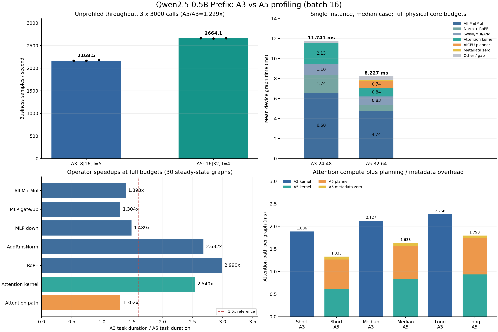

# Qwen2.5-0.5B Prefix：A3与A5 profiling对比

采集日期：2026-10-21（Asia/Shanghai）。实测设备：A3 `Ascend910_9382` 与A5 `Ascend950PR_958b`，均为逻辑卡1。

当前推荐配置下，A5/A3业务QPS比为 **1.229倍**。固定同一中位输入、单实例、使用各自物理全核预算时，无profiling的QPS比为 **1.482倍**。两种比较回答不同问题：部署吞吐同时受每实例核预算、并发和算子实现影响。

逐算子证据解释了低于1.6倍的主要来源：

- 全核、单实例下，全部169个MatMul累计耗时约 **6.601ms → 4.740ms**，加速 **1.393倍**；MLP gate/up与down占A5设备图时间约45.1%，其加速分别只有1.304与1.489倍。
- A5 Attention计算kernel本身快 **2.540倍**；加上每层AICPU planner和metadata清零后，Attention整条设备路径只有 **1.302倍**。planner与清零占该路径48.7%。
- A3推荐5实例、每实例8|16，A5推荐4实例、每实例16|32。增加实例会拉长单个图的设备任务时间；不能把单实例或某个kernel的加速比直接当作最终QPS比。

## 环境、输入与边界

| 项 | A3 | A5 |
| --- | --- | --- |
| 机器 / 容器 | 99 / hejun-cann9-qwen25 | 850-a5 / hejun-cann910-qwen25 |
| 项目根目录 | /export/home/ext.hejun23/workspace/ascend-ge-adapters | /home/h00909914/ascend-ge-adapters |
| 物理AIC/AIV | 24/48 | 32/64 |
| 推荐限核 / batch / 实例 | 8\|16 / 16 / 5 | 16\|32 / 16 / 4 |
| CANN | 9.0.0 / B250 | 9.1.0 / B243 |
| Python | 3.11.15 | 3.12.13 |
| Torch / TorchNPU | 2.9.0+cpu / 2.9.0.post2 | 2.10.0+cpu / 2.10.0.post2 |
| Transformers | 5.10.1 | 5.10.1 |
| 主仓HEAD | 4288aa6874842ec15e3f44bdc0b22b09a5753125 | 59050e390a8bcd4d01f7beac50b741c008285f2a |
| Attention源码子模块 | b4b30cd73862d19e16242f2d1e82075ace83d770 | 同左 |
| Attention实现 | prefix_910 / FIA-GQA / prefix-merged | prefix_a5 / cannbot DSL生成的AscendC macro |
| weight-NZ pass | 启用 | 未启用 |
| MatMul实际路径 | MatMulV3 ND×NZ，task_time可见 | MatMulV3 ND×ND，op_summary可见 |

两台机器是当前已有部署栈，CANN、Torch与图优化路径不同。本报告给出当前部署中的可观测耗时归因；没有把全部差值归因于芯片微架构，也没有验证“裸硬件理论性能应为1.6倍”的规格前提。设备为共享环境，保留每次运行前后npu-smi快照；A3有较多驻留HBM，计算利用率快照为空闲，无法排除所有瞬时外部干扰。

公共输入为100组batch16，摘要`21defc288cc9848d6f1f71f8a8c6d900327963431e57e77125274b5f5fc8c85b`。两边模型适配源码SHA256相同，同seed的全局请求序列摘要也逐一相同。三个代表case按packed T排序选择：

| 输入 | case_id | packed T | 共享prefix | batch | A5逻辑Q tile填充率 |
| --- | --- | --- | --- | --- | --- |
| short | case-0084 | 1839 | 24 | 16 | 75.6% |
| median | case-0020 | 2041 | 24 | 16 | 66.4% |
| long | case-0088 | 2330 | 23 | 16 | 62.8% |

填充率定义为有效Q行数 / (128 × 所有unit的Q tile数)，仅描述固定128行分块的逻辑尾块填充，不能当作PMU算力利用率。A5将prefix作为独立unit；A3将prefix与第一条请求合并，分块与GQA布局不同。

所有实验使用隔离的YAML副本和输入副本；没有修改两边默认YAML或默认输入池。A5没有拉取或重置分支。完整环境、AIR及依赖二进制摘要保留在两端`work/a3-a5-profiling-20261021/environment.json`。

## 测量口径与预热过滤

普通性能复测关闭profiling，推荐配置各跑seed42/43/44、每轮3000次调用。QPS为业务样本/秒，P99为整batch H2D、描述符、执行和同步耗时，不含服务排队、组batch等待、编译、加载和预热。

profiler采集PipeUtilization、设备task、runtime API与时间线；每个固定输入的单实例采集先预热10次，再测30次；16核补采为100次。推荐并发采集每实例预热10次、共测100次。分析按Model ID分组，用step_trace剔除各图实例最前面的预热步骤，不混入冷启动、编译、首次shape执行或AICPU首调初始化。

设备图时间取每步FP Start至Iteration End；逐算子表为保留测量步骤内各设备task的Task Duration均值。它与无profiling的整batch延迟口径不同。各流水线PMU比率可重叠，不相加；A3 MIX kernel的AIV列为0也不能推断没有向量计算。并发下多个图可重叠，跨图task耗时之和不能当作测量墙钟时间。

特别修正采集缺项：A3的op_summary每图缺少169个NZ MatMul，但task_time含`MatMulV3_ND_NZ_ND_ND_FP16_FP16_FP16_FP16_high_performance_65536`的完整时间。分析从task_time恢复，并通过时间线connection_id关联原MatMul节点；不能仅对op_summary求和。A5另有每图24条MEMCPY_ASYNC，结合源码和每层调用位置归为metadata清零，不能漏掉。

## 无profiling的性能对照

| 场景 | A3 | A5 | A5/A3 |
| --- | --- | --- | --- |
| 推荐配置业务QPS中位数（3×3000次） | 2168.494 | 2664.147 | 1.229× |
| 推荐配置QPS范围 | 2166.909–2180.259 | 2655.138–2664.462 | — |
| 推荐配置最差轮P99 ms | 41.177 | 26.994 | 均<60ms |
| 中位输入、单实例、全核业务QPS | 1362.996 | 2019.967 | 1.482× |
| 同为16核、中位输入、单实例P50 ms | 13.080 | 11.677 | 1.120×（延迟比） |

同16核时A3普通运行有一次269.557ms长尾，P99仍为13.175ms；其QPS为1190.707，A5为1357.694。表中同时展示P50以区分稳定延迟与少量异常，完整均值、最大值和逐调用记录保留，不删除该长尾。

## 逐算子耗时：中位输入、单实例、全核预算

A3使用24|48，A5使用32|64；A5自定义Attention仍固定16个AIC。以下为30次稳态图的逐task算术均值，累计值是每个图中该类别全部调用的平均总时间。K/V与gate/up分别合并同形投影，避免把不同调度顺序误当成同一个节点。

| 类别 | A3次/图 | A5次/图 | A3单次均值 us | A5单次均值 us | A3累计 ms/图 | A5累计 ms/图 | A3耗时/A5耗时 |
| --- | --- | --- | --- | --- | --- | --- | --- |
| Q投影 | 24 | 24 | 20.870 | 13.045 | 0.501 | 0.313 | 1.600× |
| K/V投影合计 | 48 | 48 | 9.994 | 8.006 | 0.480 | 0.384 | 1.248× |
| O投影 | 24 | 24 | 22.766 | 13.816 | 0.546 | 0.332 | 1.648× |
| MLP gate/up合计 | 48 | 48 | 66.434 | 50.965 | 3.189 | 2.446 | 1.304× |
| MLP down | 24 | 24 | 78.292 | 52.574 | 1.879 | 1.262 | 1.489× |
| 裁剪后的输出头 | 1 | 1 | 6.302 | 2.685 | 0.006 | 0.003 | 2.347× |
| Attention计算kernel | 24 | 24 | 88.640 | 34.893 | 2.127 | 0.837 | 2.540× |
| A5 Attention planner | 0 | 24 | — | 30.691 | 0.000 | 0.737 | — |
| A5 metadata清零 | 0 | 24 | — | 2.470 | 0.000 | 0.059 | — |
| AddRmsNorm | 47 | 47 | 23.394 | 8.724 | 1.100 | 0.410 | 2.682× |
| RmsNorm | 2 | 2 | 15.737 | 5.838 | 0.031 | 0.012 | 2.696× |
| RoPE | 24 | 24 | 25.516 | 8.534 | 0.612 | 0.205 | 2.990× |
| Swish | 24 | 24 | 28.705 | 19.431 | 0.689 | 0.466 | 1.477× |
| Mul | 24 | 24 | 16.809 | 15.063 | 0.403 | 0.362 | 1.116× |
| GatherV2 | 4 | 4 | 9.089 | 4.866 | 0.036 | 0.019 | 1.868× |
| Add | 1 | 1 | 9.771 | 7.132 | 0.010 | 0.007 | 1.370× |
| Sub | 1 | 1 | 2.815 | 2.552 | 0.003 | 0.003 | 1.103× |
| bounds int64→int32 | 0 | 1 | — | 2.174 | 0.000 | 0.002 | — |
| Slice | 1 | 1 | 11.413 | 3.469 | 0.011 | 0.003 | 3.291× |

| 汇总 | A3 ms | A5 ms | A3/A5 |
| --- | --- | --- | --- |
| 全部MatMul（169次） | 6.601 | 4.740 | 1.393× |
| Attention设备路径（kernel+planner+清零） | 2.127 | 1.633 | 1.302× |
| 全部已捕获设备task累计 | 11.625 | 7.862 | 1.479× |
| 设备图时间均值 | 11.741 | 8.227 | 1.427× |
| 设备图时间中位数 | 11.736 | 7.923 | 1.481× |
| 图内未被设备task覆盖的区间 | 0.117 | 0.365 | — |

A5图时间均值高于中位数，保留了采集中的长步骤；所有算子均值仍使用全部30个稳态步骤。图内未覆盖区间包含调度、提交间隔等未归属设备task的时间，不直接等同CPU计算，也不与Host API耗时重复相加。

## Prefix Attention实现差异及实测影响

| 方面 | A3 | A5 |
| --- | --- | --- |
| 计算实现 | AscendC FIA模板链，FiaBlockCubeNonQuantGqa；prefix与req0合并 | cannbot DSL生成AscendC，128×128 Q/KV macro流水线，2个AIV半块 |
| GQA / 输入 | 14 Q heads、2 KV heads、D64；TND；bounds int64 | 同一GQA数学问题；bounds转int32，多一条Cast/图 |
| prefix处理 | prefix-merged，第一请求与prefix合并 | prefix是独立unit，其他请求按prefix+private逻辑取K/V |
| 规划方式 | FIA tiling与分核；实际图内kernel有24个AIC block预算 | 每层metadata清零→AICPU planner→macro kernel |
| Attention核数 | 随GE预算；本次全核24 | GE交付件kAicCores=16，全核32的实验仍只launch16 |
| 中位输入每层计算kernel us | 88.640 | 34.893 |
| 每层planner us | 无对应设备task | 30.691 |
| 每层metadata清零 us | 无对应设备task | 2.470 |

A5 planner和metadata清零合计每图 **0.796ms**，约占A5设备图均值的9.7%。planner的aicpu明细另记录平均Task_time=15.525us、Dispatch_time=4.836us；这些是同一planner的另一统计视图，不再叠加到Task Duration。

输入长度变化下，Attention路径的影响如下：

| 输入 | A3 kernel ms | A5 kernel ms | A5 planner+清零 ms | kernel加速比 | 完整Attention路径加速比 |
| --- | --- | --- | --- | --- | --- |
| short | 1.886 | 0.605 | 0.728 | 3.118× | 1.414× |
| median | 2.127 | 0.837 | 0.796 | 2.540× | 1.302× |
| long | 2.266 | 0.934 | 0.864 | 2.427× | 1.260× |

源码定位：`third_party/ascend-ops/prefix-attention/cannbot-dsl/ge/src/kernel_launcher.h:23`固定kAicCores；`ge/src/prefix_attention_op.cc`在每次Execute中清零metadata并调用planner和kernel；`prefix_attn/metadata.py`描述分核盒；`prefix_attn/attention.py`描述q_head/q_tile循环、两遍softmax和流水线。A3入口为`ascendc/op_kernel/prefix_infer_attention_score.cpp`，语义与tiling改动详见`ascendc/docs/FIA_DELTA.md`。这些路径均位于相同的b4b30cd子模块版本中。

A3源码还包含`ascendc/op_host/op_api/prefix_infer_attention_score_custom_op.cpp`的同步D2H包装支路。但本次稳态轨迹中未观察到每层两次拷贝对应的48次/图开销；可见Memcpy约为输入H2D数量级，设备task覆盖图时间约99%。因此不把这段源码的D2H逻辑直接认定为本次瓶颈，也不把等待stream完成的Host API时长再次相加。具体运行分支或缓存机制若要优化，仍需单独确认。

A3的NZ MatMul与A5的ND MatMul也不是相同布局路径。未做关闭NZ pass的A/B，本报告不估算NZ pass的独立收益；仅确认它属于比较环境差异，169个MatMul均已计入耗时。

## 并发为何进一步压缩吞吐差距

同一中位输入、同样开启profiling，保持各自推荐限核，只改变实例数：

| 平台 | 限核 | 实例1图时间均值 ms | 推荐实例 | 并发图时间均值 ms | 单图时间膨胀 | 采集内业务QPS |
| --- | --- | --- | --- | --- | --- | --- |
| A3 | 8\|16 | 21.561 | 5 | 34.258 | 1.589× | 2320.485 |
| A5 | 16\|32 | 11.959 | 4 | 23.797 | 1.990× | 2630.320 |

A3从1到5实例时，图时间约膨胀1.59倍；A5从1到4实例时约膨胀1.99倍。并发让设备资源竞争变强，更多实例并不等于成比例增加可用算力。每实例核预算也不是独占绑核，不能把8×5或16×4解释成物理核心数。采集内QPS受profiling开销、固定输入和短测量段影响，不用于取代前面的三轮普通吞吐结果。

## 可以优先验证的优化方向

1. **A5将planner和metadata清零提到每个请求/图执行的一次公共准备阶段**：24层使用相同bounds、head配置和16核策略，当前重复24次规划。若只按已测串行task费用估计，省去23次planner约0.706ms/图，再省23次清零约0.057ms/图。该估计没有实施验证，并发、调度和缓存会影响真实收益；metadata必须按请求/图实例隔离，不能无条件跨请求缓存。
2. **A5让Attention核数成为显式可验证的参数**：当前GE预算32不会改变固定16核的Attention。应以不同核数变体做正确性和端到端A/B，不能直接假设32核更快；更宽kernel可能降低并发吞吐。
3. **继续优化占比最大的MatMul/MLP**：当前169个MatMul约快1.39倍，MLP约占A5设备图45%。可围绕ND/NZ、tiling、gate/up布局、Swish与Mul融合做独立A/B，并配合Memory/MemoryAccess组进一步验证带宽或计算限制；本轮PipeUtilization与时长证据不足以断言全部MLP都是带宽瓶颈。

以上为后续实验建议，本轮没有修改算子实现、默认限核、batch或实例数，也没有承诺优化后必达1.6倍。

## 图表



图中operator累计值均来自中位输入、单实例、全核采集；普通吞吐来自各自推荐配置的三轮复测。1.6虚线只表示本次问题中的参照值。

## 附录A：全部运行记录

状态均来自原始结果，prof=on的QPS与P99带采集开销。输入full为100组随机池，short/median/long为前述单case。

| 平台 | 实验 | AIC/AIV | 实例 | 输入 | 调用数 | seed | prof | 业务QPS | P50 ms | P99 ms | max ms | 状态 | run_id |
| --- | --- | --- | --- | --- | --- | --- | --- | --- | --- | --- | --- | --- | --- |
| A3 | plain-opt-s42 | 8/16 | 5 | full | 3000 | 42 | off | 2166.909 | 36.620 | 41.036 | 42.707 | success | 20261021T075753-4d7237f8 |
| A3 | profile-median-opt-i1 | 8/16 | 1 | median | 30 | 42 | on | 736.258 | 21.711 | 21.911 | 21.911 | success | 20261021T075943-78bb8710 |
| A3 | plain-opt-s43 | 8/16 | 5 | full | 3000 | 43 | off | 2168.494 | 36.557 | 41.177 | 42.495 | success | 20261021T080119-b4a785b8 |
| A3 | plain-opt-s44 | 8/16 | 5 | full | 3000 | 44 | off | 2180.259 | 36.404 | 40.797 | 41.763 | success | 20261021T080316-ecbe54b0 |
| A3 | plain-median-full-i1 | 24/48 | 1 | median | 1000 | 42 | off | 1362.996 | 11.733 | 11.836 | 13.142 | success | 20261021T080502-4977038c |
| A3 | profile-short-full-i1 | 24/48 | 1 | short | 30 | 42 | on | 1430.730 | 11.141 | 11.372 | 11.372 | success | 20261021T080558-47a23a44 |
| A3 | profile-median-full-i1 | 24/48 | 1 | median | 30 | 42 | on | 1345.540 | 11.875 | 11.933 | 11.933 | success | 20261021T080643-6ebba159 |
| A3 | profile-long-full-i1 | 24/48 | 1 | long | 30 | 42 | on | 1235.731 | 12.920 | 13.327 | 13.327 | success | 20261021T080727-129a2e46 |
| A3 | profile-median-opt-concurrent | 8/16 | 5 | median | 100 | 42 | on | 2320.485 | 34.401 | 35.538 | 35.538 | success | 20261021T080811-d0f8ffdf |
| A3 | plain-median-c16-i1 | 16/32 | 1 | median | 1000 | 42 | off | 1190.707 | 13.080 | 13.175 | 269.557 | success | 20261021T081151-85aab800 |
| A3 | profile-median-c16-i1 | 16/32 | 1 | median | 30 | 42 | on | 949.375 | 13.318 | 106.645 | 106.645 | success | 20261021T081248-0c3a7cd9 |
| A3 | profile-median-c16-i1-repeat | 16/32 | 1 | median | 100 | 43 | on | 1201.294 | 13.305 | 13.916 | 13.916 | success | 20261021T081848-0ab0df92 |
| A5 | plain-opt-s42 | 16/32 | 4 | full | 3000 | 42 | off | 2664.462 | 23.820 | 26.994 | 52.730 | success | 20261021T075804-769caead |
| A5 | profile-median-opt-i1 | 16/32 | 1 | median | 30 | 42 | on | 1314.104 | 11.795 | 22.445 | 22.445 | success | 20261021T075930-6adcbbf6 |
| A5 | plain-opt-s43 | 16/32 | 4 | full | 3000 | 43 | off | 2655.138 | 23.901 | 26.977 | 73.552 | success | 20261021T080052-99d8fc7e |
| A5 | plain-opt-s44 | 16/32 | 4 | full | 3000 | 44 | off | 2664.147 | 23.863 | 26.818 | 56.006 | success | 20261021T080225-a6db2f71 |
| A5 | plain-median-full-i1 | 32/64 | 1 | median | 1000 | 42 | off | 2019.967 | 7.897 | 8.015 | 19.266 | success | 20261021T080348-e851513e |
| A5 | profile-short-full-i1 | 32/64 | 1 | short | 30 | 42 | on | 2056.256 | 7.411 | 17.935 | 17.935 | success | 20261021T080438-4c7c5b4f |
| A5 | profile-median-full-i1 | 32/64 | 1 | median | 30 | 42 | on | 1893.028 | 8.147 | 17.287 | 17.287 | success | 20261021T080520-150f3348 |
| A5 | profile-long-full-i1 | 32/64 | 1 | long | 30 | 42 | on | 1650.046 | 9.386 | 17.936 | 17.936 | success | 20261021T080603-cab1485d |
| A5 | profile-median-opt-concurrent | 16/32 | 4 | median | 100 | 42 | on | 2630.320 | 23.463 | 53.273 | 53.273 | success | 20261021T080648-6703323f |
| A5 | plain-median-c16-i1 | 16/32 | 1 | median | 1000 | 42 | off | 1357.694 | 11.677 | 12.237 | 22.320 | success | 20261021T081147-795fe349 |

## 附录B：profiling窗口与异常说明

| 平台 | 实验 | 保留图数 | 剔除预热 | 图时间均值 ms | 中位数 ms | 最大值 ms | 设备task累计 ms/图 | 未覆盖区间 ms/图 |
| --- | --- | --- | --- | --- | --- | --- | --- | --- |
| A3 | profile-median-opt-i1 | 30 | 10 | 21.561 | 21.553 | 21.698 | 21.435 | 0.126 |
| A3 | profile-short-full-i1 | 30 | 10 | 11.022 | 11.010 | 11.157 | 10.894 | 0.128 |
| A3 | profile-median-full-i1 | 30 | 10 | 11.741 | 11.736 | 11.806 | 11.625 | 0.117 |
| A3 | profile-long-full-i1 | 30 | 10 | 12.786 | 12.774 | 12.934 | 12.666 | 0.120 |
| A3 | profile-median-opt-concurrent | 100 | 50 | 34.258 | 34.241 | 35.407 | 34.134 | 0.124 |
| A3 | profile-median-c16-i1 | 30 | 10 | 16.263 | 13.157 | 106.441 | 12.998 | 3.264 |
| A3 | profile-median-c16-i1-repeat | 100 | 10 | 13.148 | 13.135 | 13.308 | 12.988 | 0.160 |
| A5 | profile-median-opt-i1 | 30 | 10 | 11.959 | 11.597 | 22.223 | 11.553 | 0.405 |
| A5 | profile-short-full-i1 | 30 | 10 | 7.556 | 7.201 | 17.659 | 7.138 | 0.418 |
| A5 | profile-median-full-i1 | 30 | 10 | 8.227 | 7.923 | 17.062 | 7.862 | 0.365 |
| A5 | profile-long-full-i1 | 30 | 10 | 9.480 | 9.185 | 17.692 | 9.126 | 0.354 |
| A5 | profile-median-opt-concurrent | 100 | 40 | 23.797 | 23.216 | 52.785 | 22.888 | 0.909 |

A3首次16核profiling有一次约106ms的整batch长步骤，设备图未覆盖区间均值被拉高；原记录保留，补采100次用于核对稳定状态。补采设备图均值13.148ms、中位数13.135ms。A5全核采集中也保留长步骤，因而均值与中位数存在差别。没有把异常计为0，也没有从均值中删除测量段样本。

## 附录C：每层主要算子累计耗时

单位us，为30个稳态图的均值。K/V及gate/up为每层两次调用合计，其他列为单次；所有24层均展示。

### A3：中位输入、单实例、全核

| 层（从0开始） | Q | K/V | O | gate/up | down | Attention kernel | planner | metadata清零 |
| --- | --- | --- | --- | --- | --- | --- | --- | --- |
| 0 | 21.093 | 20.007 | 22.858 | 132.559 | 78.203 | 87.460 | 0.000 | 0.000 |
| 1 | 21.061 | 20.057 | 22.769 | 132.132 | 78.014 | 89.428 | 0.000 | 0.000 |
| 2 | 20.867 | 19.905 | 23.086 | 134.821 | 78.385 | 88.595 | 0.000 | 0.000 |
| 3 | 21.026 | 19.808 | 22.627 | 138.347 | 78.430 | 88.867 | 0.000 | 0.000 |
| 4 | 20.553 | 19.955 | 23.001 | 138.761 | 78.156 | 89.500 | 0.000 | 0.000 |
| 5 | 20.877 | 20.095 | 22.735 | 134.780 | 78.291 | 88.703 | 0.000 | 0.000 |
| 6 | 20.870 | 19.993 | 22.782 | 131.954 | 78.132 | 89.130 | 0.000 | 0.000 |
| 7 | 20.909 | 19.917 | 22.640 | 131.763 | 78.164 | 88.125 | 0.000 | 0.000 |
| 8 | 20.893 | 20.044 | 22.867 | 131.428 | 78.293 | 87.867 | 0.000 | 0.000 |
| 9 | 20.807 | 19.928 | 22.763 | 131.929 | 78.305 | 88.283 | 0.000 | 0.000 |
| 10 | 20.954 | 19.956 | 23.258 | 131.893 | 78.264 | 89.092 | 0.000 | 0.000 |
| 11 | 20.914 | 19.771 | 22.697 | 131.599 | 78.316 | 88.745 | 0.000 | 0.000 |
| 12 | 20.809 | 19.962 | 22.605 | 132.006 | 78.130 | 89.102 | 0.000 | 0.000 |
| 13 | 20.617 | 20.241 | 22.764 | 131.736 | 78.268 | 88.387 | 0.000 | 0.000 |
| 14 | 20.827 | 20.189 | 22.235 | 131.669 | 78.420 | 88.873 | 0.000 | 0.000 |
| 15 | 20.955 | 19.898 | 23.358 | 131.987 | 78.259 | 88.537 | 0.000 | 0.000 |
| 16 | 20.801 | 19.839 | 22.841 | 132.872 | 78.288 | 88.378 | 0.000 | 0.000 |
| 17 | 20.813 | 19.985 | 22.625 | 132.245 | 78.366 | 88.407 | 0.000 | 0.000 |
| 18 | 20.881 | 19.995 | 22.351 | 131.599 | 78.342 | 89.220 | 0.000 | 0.000 |
| 19 | 20.833 | 20.011 | 22.778 | 132.578 | 78.554 | 88.185 | 0.000 | 0.000 |
| 20 | 20.912 | 19.941 | 23.025 | 132.329 | 78.366 | 89.408 | 0.000 | 0.000 |
| 21 | 20.973 | 20.063 | 22.745 | 133.697 | 78.285 | 88.171 | 0.000 | 0.000 |
| 22 | 20.745 | 20.009 | 22.421 | 132.505 | 78.274 | 88.406 | 0.000 | 0.000 |
| 23 | 20.895 | 20.162 | 22.543 | 131.661 | 78.495 | 88.481 | 0.000 | 0.000 |

### A5：中位输入、单实例、全核

| 层（从0开始） | Q | K/V | O | gate/up | down | Attention kernel | planner | metadata清零 |
| --- | --- | --- | --- | --- | --- | --- | --- | --- |
| 0 | 13.027 | 15.986 | 13.765 | 101.892 | 52.602 | 35.064 | 35.299 | 2.518 |
| 1 | 12.997 | 15.823 | 13.878 | 102.199 | 52.536 | 34.681 | 31.073 | 2.595 |
| 2 | 12.985 | 16.106 | 13.795 | 101.550 | 52.567 | 34.931 | 30.527 | 2.511 |
| 3 | 12.971 | 15.929 | 13.802 | 101.618 | 52.557 | 35.179 | 30.598 | 2.468 |
| 4 | 13.031 | 15.824 | 13.785 | 101.982 | 52.580 | 34.621 | 30.508 | 2.500 |
| 5 | 13.091 | 16.074 | 13.818 | 102.050 | 52.672 | 35.131 | 30.800 | 2.482 |
| 6 | 13.033 | 15.997 | 13.816 | 102.291 | 52.555 | 34.252 | 30.281 | 2.508 |
| 7 | 13.065 | 16.014 | 13.814 | 101.720 | 52.617 | 35.595 | 30.498 | 2.470 |
| 8 | 13.099 | 16.029 | 13.828 | 101.897 | 52.543 | 34.576 | 30.687 | 2.462 |
| 9 | 13.050 | 15.959 | 13.769 | 101.740 | 52.544 | 34.805 | 30.536 | 2.621 |
| 10 | 13.071 | 15.977 | 13.849 | 102.159 | 52.605 | 34.987 | 30.526 | 2.495 |
| 11 | 13.055 | 16.106 | 13.854 | 102.068 | 52.574 | 34.683 | 30.536 | 2.498 |
| 12 | 13.080 | 16.017 | 13.828 | 101.744 | 52.537 | 35.124 | 30.291 | 2.468 |
| 13 | 13.067 | 16.089 | 13.805 | 102.020 | 52.574 | 34.752 | 30.370 | 2.504 |
| 14 | 13.067 | 16.038 | 13.963 | 101.920 | 52.618 | 34.927 | 30.428 | 2.458 |
| 15 | 13.025 | 16.040 | 13.777 | 102.246 | 52.548 | 34.699 | 30.506 | 2.433 |
| 16 | 13.015 | 15.902 | 13.784 | 101.797 | 52.566 | 35.146 | 30.478 | 2.409 |
| 17 | 13.090 | 16.181 | 13.797 | 102.001 | 52.514 | 35.215 | 30.572 | 2.419 |
| 18 | 13.014 | 15.926 | 13.801 | 101.709 | 52.558 | 34.589 | 30.267 | 2.401 |
| 19 | 13.042 | 16.078 | 13.783 | 101.927 | 52.570 | 35.172 | 30.310 | 2.391 |
| 20 | 13.066 | 16.007 | 13.786 | 102.203 | 52.530 | 34.410 | 30.414 | 2.389 |
| 21 | 13.059 | 16.102 | 13.832 | 101.700 | 52.692 | 35.329 | 30.295 | 2.411 |
| 22 | 13.039 | 16.040 | 13.849 | 102.050 | 52.570 | 34.459 | 30.229 | 2.404 |
| 23 | 13.050 | 16.032 | 13.805 | 101.854 | 52.546 | 35.115 | 30.566 | 2.473 |

## 附录D：完整逐节点时长

以下覆盖全部设备task：A3每图321条，A5每图370条（含24条metadata清零）。每行是在同一采集内按类别/顺序识别的节点，均有30次保留测量。两个平台分别列出，避免对同形K/V、gate/up或融合前后的节点强行逐一配对。跨平台比较采用主表和附录C的语义分组。

### A3逐节点

| 类别 | 组内序号 | 层 | 均值 us | 中位数 us | 次数 | 原始节点或kernel |
| --- | --- | --- | --- | --- | --- | --- |
| GatherV2 | 1 | — | 10.689 | 10.680 | 30 | GatherV2 |
| RmsNorm | 1 | — | 23.210 | 22.120 | 30 | RmsNorm |
| K/V投影合计 | 1 | 0 | 10.075 | 9.980 | 30 | MatMulV2_1_v3 |
| K/V投影合计 | 2 | 0 | 9.932 | 9.900 | 30 | MatMulV2_2_v3 |
| Q投影 | 1 | 0 | 21.093 | 21.020 | 30 | MatMulV2_v3 |
| GatherV2 | 2 | — | 14.293 | 14.300 | 30 | GatherV2_1 |
| GatherV2 | 3 | — | 6.443 | 6.400 | 30 | GatherV2_2 |
| RoPE | 1 | — | 24.858 | 24.840 | 30 | ApplyRotaryPosEmb |
| Attention计算kernel | 1 | 0 | 87.460 | 87.791 | 30 | PrefixInferAttentionScore |
| O投影 | 1 | 0 | 22.858 | 23.140 | 30 | MatMul/v2_v3 |
| AddRmsNorm | 1 | — | 25.858 | 25.820 | 30 | RmsNorm_1/AddRmsNorm |
| MLP gate/up合计 | 1 | 0 | 66.612 | 66.741 | 30 | MatMul_1/v2_v3 |
| MLP gate/up合计 | 2 | 0 | 65.947 | 65.981 | 30 | MatMul_2/v2_v3 |
| Swish | 1 | — | 28.819 | 28.750 | 30 | Swish |
| Mul | 1 | — | 16.728 | 16.730 | 30 | Mul |
| MLP down | 1 | 0 | 78.203 | 78.141 | 30 | MatMul_3/v2_v3 |
| AddRmsNorm | 2 | — | 20.487 | 20.340 | 30 | RmsNorm_2/AddRmsNorm |
| Q投影 | 2 | 1 | 21.061 | 21.020 | 30 | MatMulV2_3_v3 |
| K/V投影合计 | 3 | 1 | 10.056 | 10.040 | 30 | MatMulV2_4_v3 |
| K/V投影合计 | 4 | 1 | 10.001 | 9.960 | 30 | MatMulV2_5_v3 |
| RoPE | 2 | — | 26.175 | 25.730 | 30 | ApplyRotaryPosEmb_1 |
| Attention计算kernel | 2 | 1 | 89.428 | 88.781 | 30 | PrefixInferAttentionScore_1 |
| O投影 | 2 | 1 | 22.769 | 22.770 | 30 | MatMul_4/v2_v3 |
| AddRmsNorm | 3 | — | 26.951 | 26.860 | 30 | RmsNorm_3/AddRmsNorm |
| MLP gate/up合计 | 3 | 1 | 66.422 | 66.401 | 30 | MatMul_5/v2_v3 |
| MLP gate/up合计 | 4 | 1 | 65.710 | 65.801 | 30 | MatMul_6/v2_v3 |
| Swish | 2 | — | 28.688 | 28.630 | 30 | Swish_1 |
| Mul | 2 | — | 16.823 | 16.760 | 30 | Mul_1 |
| MLP down | 2 | 1 | 78.014 | 77.921 | 30 | MatMul_7/v2_v3 |
| AddRmsNorm | 4 | — | 20.593 | 20.050 | 30 | RmsNorm_4/AddRmsNorm |
| Q投影 | 3 | 2 | 20.867 | 20.920 | 30 | MatMulV2_6_v3 |
| K/V投影合计 | 5 | 2 | 9.939 | 9.880 | 30 | MatMulV2_7_v3 |
| K/V投影合计 | 6 | 2 | 9.966 | 9.920 | 30 | MatMulV2_8_v3 |
| RoPE | 3 | — | 25.909 | 25.790 | 30 | ApplyRotaryPosEmb_2 |
| Attention计算kernel | 3 | 2 | 88.595 | 87.651 | 30 | PrefixInferAttentionScore_2 |
| O投影 | 3 | 2 | 23.086 | 22.660 | 30 | MatMul_8/v2_v3 |
| AddRmsNorm | 5 | — | 26.226 | 26.220 | 30 | RmsNorm_5/AddRmsNorm |
| MLP gate/up合计 | 5 | 2 | 67.225 | 67.191 | 30 | MatMul_10/v2_v3 |
| MLP gate/up合计 | 6 | 2 | 67.596 | 67.521 | 30 | MatMul_9/v2_v3 |
| Swish | 3 | — | 28.771 | 28.710 | 30 | Swish_2 |
| Mul | 3 | — | 16.798 | 16.700 | 30 | Mul_2 |
| MLP down | 3 | 2 | 78.385 | 78.381 | 30 | MatMul_11/v2_v3 |
| AddRmsNorm | 6 | — | 20.255 | 19.910 | 30 | RmsNorm_6/AddRmsNorm |
| K/V投影合计 | 7 | 3 | 9.940 | 9.950 | 30 | MatMulV2_10_v3 |
| K/V投影合计 | 8 | 3 | 9.868 | 9.830 | 30 | MatMulV2_11_v3 |
| Q投影 | 4 | 3 | 21.026 | 21.100 | 30 | MatMulV2_9_v3 |
| RoPE | 4 | — | 24.034 | 23.800 | 30 | ApplyRotaryPosEmb_3 |
| Attention计算kernel | 4 | 3 | 88.867 | 89.022 | 30 | PrefixInferAttentionScore_3 |
| O投影 | 4 | 3 | 22.627 | 22.610 | 30 | MatMul_12/v2_v3 |
| AddRmsNorm | 7 | — | 26.088 | 25.940 | 30 | RmsNorm_7/AddRmsNorm |
| MLP gate/up合计 | 7 | 3 | 70.644 | 70.431 | 30 | MatMul_13/v2_v3 |
| MLP gate/up合计 | 8 | 3 | 67.703 | 67.691 | 30 | MatMul_14/v2_v3 |
| Swish | 4 | — | 28.657 | 28.630 | 30 | Swish_3 |
| Mul | 4 | — | 16.775 | 16.650 | 30 | Mul_3 |
| MLP down | 4 | 3 | 78.430 | 78.501 | 30 | MatMul_15/v2_v3 |
| AddRmsNorm | 8 | — | 20.590 | 20.080 | 30 | RmsNorm_8/AddRmsNorm |
| Q投影 | 5 | 4 | 20.553 | 20.520 | 30 | MatMulV2_12_v3 |
| K/V投影合计 | 9 | 4 | 10.000 | 9.960 | 30 | MatMulV2_13_v3 |
| K/V投影合计 | 10 | 4 | 9.955 | 9.830 | 30 | MatMulV2_14_v3 |
| RoPE | 5 | — | 25.781 | 25.750 | 30 | ApplyRotaryPosEmb_4 |
| Attention计算kernel | 5 | 4 | 89.500 | 89.351 | 30 | PrefixInferAttentionScore_4 |
| O投影 | 5 | 4 | 23.001 | 23.080 | 30 | MatMul_16/v2_v3 |
| AddRmsNorm | 9 | — | 26.215 | 26.170 | 30 | RmsNorm_9/AddRmsNorm |
| MLP gate/up合计 | 9 | 4 | 70.330 | 70.331 | 30 | MatMul_17/v2_v3 |
| MLP gate/up合计 | 10 | 4 | 68.432 | 68.441 | 30 | MatMul_18/v2_v3 |
| Swish | 5 | — | 28.751 | 28.710 | 30 | Swish_4 |
| Mul | 5 | — | 16.823 | 16.700 | 30 | Mul_4 |
| MLP down | 5 | 4 | 78.156 | 78.141 | 30 | MatMul_19/v2_v3 |
| AddRmsNorm | 10 | — | 20.225 | 19.680 | 30 | RmsNorm_10/AddRmsNorm |
| Q投影 | 6 | 5 | 20.877 | 20.950 | 30 | MatMulV2_15_v3 |
| K/V投影合计 | 11 | 5 | 10.060 | 10.080 | 30 | MatMulV2_16_v3 |
| K/V投影合计 | 12 | 5 | 10.035 | 10.030 | 30 | MatMulV2_17_v3 |
| RoPE | 6 | — | 25.983 | 25.860 | 30 | ApplyRotaryPosEmb_5 |
| Attention计算kernel | 6 | 5 | 88.703 | 89.091 | 30 | PrefixInferAttentionScore_5 |
| O投影 | 6 | 5 | 22.735 | 22.570 | 30 | MatMul_20/v2_v3 |
| AddRmsNorm | 11 | — | 26.291 | 26.260 | 30 | RmsNorm_11/AddRmsNorm |
| MLP gate/up合计 | 11 | 5 | 68.306 | 68.451 | 30 | MatMul_21/v2_v3 |
| MLP gate/up合计 | 12 | 5 | 66.474 | 66.421 | 30 | MatMul_22/v2_v3 |
| Swish | 6 | — | 28.627 | 28.610 | 30 | Swish_5 |
| Mul | 6 | — | 16.768 | 16.700 | 30 | Mul_5 |
| MLP down | 6 | 5 | 78.291 | 78.271 | 30 | MatMul_23/v2_v3 |
| AddRmsNorm | 12 | — | 20.178 | 20.060 | 30 | RmsNorm_12/AddRmsNorm |
| Q投影 | 7 | 6 | 20.870 | 20.910 | 30 | MatMulV2_18_v3 |
| K/V投影合计 | 13 | 6 | 9.973 | 9.920 | 30 | MatMulV2_19_v3 |
| K/V投影合计 | 14 | 6 | 10.021 | 9.880 | 30 | MatMulV2_20_v3 |
| RoPE | 7 | — | 25.879 | 25.750 | 30 | ApplyRotaryPosEmb_6 |
| Attention计算kernel | 7 | 6 | 89.130 | 89.121 | 30 | PrefixInferAttentionScore_6 |
| O投影 | 7 | 6 | 22.782 | 22.590 | 30 | MatMul_24/v2_v3 |
| AddRmsNorm | 13 | — | 26.701 | 26.690 | 30 | RmsNorm_13/AddRmsNorm |
| MLP gate/up合计 | 13 | 6 | 65.834 | 65.861 | 30 | MatMul_25/v2_v3 |
| MLP gate/up合计 | 14 | 6 | 66.120 | 66.301 | 30 | MatMul_26/v2_v3 |
| Swish | 7 | — | 28.794 | 28.710 | 30 | Swish_6 |
| Mul | 7 | — | 16.875 | 16.670 | 30 | Mul_6 |
| MLP down | 7 | 6 | 78.132 | 78.161 | 30 | MatMul_27/v2_v3 |
| AddRmsNorm | 14 | — | 20.003 | 19.870 | 30 | RmsNorm_14/AddRmsNorm |
| Q投影 | 8 | 7 | 20.909 | 20.940 | 30 | MatMulV2_21_v3 |
| K/V投影合计 | 15 | 7 | 9.980 | 9.950 | 30 | MatMulV2_22_v3 |
| K/V投影合计 | 16 | 7 | 9.937 | 9.930 | 30 | MatMulV2_23_v3 |
| RoPE | 8 | — | 25.772 | 25.790 | 30 | ApplyRotaryPosEmb_7 |
| Attention计算kernel | 8 | 7 | 88.125 | 87.421 | 30 | PrefixInferAttentionScore_7 |
| O投影 | 8 | 7 | 22.640 | 22.610 | 30 | MatMul_28/v2_v3 |
| AddRmsNorm | 15 | — | 26.403 | 26.380 | 30 | RmsNorm_15/AddRmsNorm |
| MLP gate/up合计 | 15 | 7 | 66.002 | 66.021 | 30 | MatMul_29/v2_v3 |
| MLP gate/up合计 | 16 | 7 | 65.762 | 65.771 | 30 | MatMul_30/v2_v3 |
| Swish | 8 | — | 28.654 | 28.630 | 30 | Swish_7 |
| Mul | 8 | — | 16.813 | 16.750 | 30 | Mul_7 |
| MLP down | 8 | 7 | 78.164 | 78.151 | 30 | MatMul_31/v2_v3 |
| AddRmsNorm | 16 | — | 20.099 | 19.860 | 30 | RmsNorm_16/AddRmsNorm |
| Q投影 | 9 | 8 | 20.893 | 20.940 | 30 | MatMulV2_24_v3 |
| K/V投影合计 | 17 | 8 | 10.085 | 10.040 | 30 | MatMulV2_25_v3 |
| K/V投影合计 | 18 | 8 | 9.959 | 10.020 | 30 | MatMulV2_26_v3 |
| RoPE | 9 | — | 25.961 | 25.870 | 30 | ApplyRotaryPosEmb_8 |
| Attention计算kernel | 9 | 8 | 87.867 | 87.551 | 30 | PrefixInferAttentionScore_8 |
| O投影 | 9 | 8 | 22.867 | 22.330 | 30 | MatMul_32/v2_v3 |
| AddRmsNorm | 17 | — | 26.307 | 26.280 | 30 | RmsNorm_17/AddRmsNorm |
| MLP gate/up合计 | 17 | 8 | 65.892 | 65.981 | 30 | MatMul_33/v2_v3 |
| MLP gate/up合计 | 18 | 8 | 65.536 | 65.471 | 30 | MatMul_34/v2_v3 |
| Swish | 9 | — | 28.659 | 28.630 | 30 | Swish_8 |
| Mul | 9 | — | 16.696 | 16.700 | 30 | Mul_8 |
| MLP down | 9 | 8 | 78.293 | 78.381 | 30 | MatMul_35/v2_v3 |
| AddRmsNorm | 18 | — | 19.964 | 20.040 | 30 | RmsNorm_18/AddRmsNorm |
| Q投影 | 10 | 9 | 20.807 | 20.910 | 30 | MatMulV2_27_v3 |
| K/V投影合计 | 19 | 9 | 9.923 | 9.870 | 30 | MatMulV2_28_v3 |
| K/V投影合计 | 20 | 9 | 10.005 | 9.920 | 30 | MatMulV2_29_v3 |
| RoPE | 10 | — | 24.334 | 24.090 | 30 | ApplyRotaryPosEmb_9 |
| Attention计算kernel | 10 | 9 | 88.283 | 87.921 | 30 | PrefixInferAttentionScore_9 |
| O投影 | 10 | 9 | 22.763 | 22.850 | 30 | MatMul_36/v2_v3 |
| AddRmsNorm | 19 | — | 26.007 | 25.890 | 30 | RmsNorm_19/AddRmsNorm |
| MLP gate/up合计 | 19 | 9 | 66.408 | 66.491 | 30 | MatMul_37/v2_v3 |
| MLP gate/up合计 | 20 | 9 | 65.522 | 65.681 | 30 | MatMul_38/v2_v3 |
| Swish | 10 | — | 28.658 | 28.640 | 30 | Swish_9 |
| Mul | 10 | — | 16.751 | 16.700 | 30 | Mul_9 |
| MLP down | 10 | 9 | 78.305 | 78.331 | 30 | MatMul_39/v2_v3 |
| AddRmsNorm | 20 | — | 20.449 | 20.100 | 30 | RmsNorm_20/AddRmsNorm |
| Q投影 | 11 | 10 | 20.954 | 20.930 | 30 | MatMulV2_30_v3 |
| K/V投影合计 | 21 | 10 | 10.041 | 10.040 | 30 | MatMulV2_31_v3 |
| K/V投影合计 | 22 | 10 | 9.915 | 9.960 | 30 | MatMulV2_32_v3 |
| RoPE | 11 | — | 26.175 | 25.930 | 30 | ApplyRotaryPosEmb_10 |
| Attention计算kernel | 11 | 10 | 89.092 | 88.892 | 30 | PrefixInferAttentionScore_10 |
| O投影 | 11 | 10 | 23.258 | 22.940 | 30 | MatMul_40/v2_v3 |
| AddRmsNorm | 21 | — | 26.325 | 26.260 | 30 | RmsNorm_21/AddRmsNorm |
| MLP gate/up合计 | 21 | 10 | 65.830 | 65.861 | 30 | MatMul_41/v2_v3 |
| MLP gate/up合计 | 22 | 10 | 66.062 | 66.021 | 30 | MatMul_42/v2_v3 |
| Swish | 11 | — | 28.745 | 28.730 | 30 | Swish_10 |
| Mul | 11 | — | 16.693 | 16.720 | 30 | Mul_10 |
| MLP down | 11 | 10 | 78.264 | 78.161 | 30 | MatMul_43/v2_v3 |
| AddRmsNorm | 22 | — | 20.305 | 19.960 | 30 | RmsNorm_22/AddRmsNorm |
| Q投影 | 12 | 11 | 20.914 | 20.970 | 30 | MatMulV2_33_v3 |
| K/V投影合计 | 23 | 11 | 9.925 | 9.800 | 30 | MatMulV2_34_v3 |
| K/V投影合计 | 24 | 11 | 9.846 | 9.800 | 30 | MatMulV2_35_v3 |
| RoPE | 12 | — | 25.928 | 25.740 | 30 | ApplyRotaryPosEmb_11 |
| Attention计算kernel | 12 | 11 | 88.745 | 88.671 | 30 | PrefixInferAttentionScore_11 |
| O投影 | 12 | 11 | 22.697 | 22.540 | 30 | MatMul_44/v2_v3 |
| AddRmsNorm | 23 | — | 26.275 | 26.240 | 30 | RmsNorm_23/AddRmsNorm |
| MLP gate/up合计 | 23 | 11 | 65.696 | 65.661 | 30 | MatMul_45/v2_v3 |
| MLP gate/up合计 | 24 | 11 | 65.904 | 65.891 | 30 | MatMul_46/v2_v3 |
| Swish | 12 | — | 28.737 | 28.660 | 30 | Swish_11 |
| Mul | 12 | — | 16.741 | 16.720 | 30 | Mul_11 |
| MLP down | 12 | 11 | 78.316 | 78.311 | 30 | MatMul_47/v2_v3 |
| AddRmsNorm | 24 | — | 20.552 | 20.150 | 30 | RmsNorm_24/AddRmsNorm |
| Q投影 | 13 | 12 | 20.809 | 20.840 | 30 | MatMulV2_36_v3 |
| K/V投影合计 | 25 | 12 | 10.041 | 10.080 | 30 | MatMulV2_37_v3 |
| K/V投影合计 | 26 | 12 | 9.921 | 9.910 | 30 | MatMulV2_38_v3 |
| RoPE | 13 | — | 25.913 | 25.900 | 30 | ApplyRotaryPosEmb_12 |
| Attention计算kernel | 13 | 12 | 89.102 | 88.891 | 30 | PrefixInferAttentionScore_12 |
| O投影 | 13 | 12 | 22.605 | 22.640 | 30 | MatMul_48/v2_v3 |
| AddRmsNorm | 25 | — | 26.823 | 26.770 | 30 | RmsNorm_25/AddRmsNorm |
| MLP gate/up合计 | 25 | 12 | 66.270 | 66.421 | 30 | MatMul_49/v2_v3 |
| MLP gate/up合计 | 26 | 12 | 65.736 | 65.791 | 30 | MatMul_50/v2_v3 |
| Swish | 13 | — | 28.737 | 28.660 | 30 | Swish_12 |
| Mul | 13 | — | 16.904 | 16.690 | 30 | Mul_12 |
| MLP down | 13 | 12 | 78.130 | 78.081 | 30 | MatMul_51/v2_v3 |
| AddRmsNorm | 26 | — | 20.511 | 19.900 | 30 | RmsNorm_26/AddRmsNorm |
| Q投影 | 14 | 13 | 20.617 | 20.600 | 30 | MatMulV2_39_v3 |
| K/V投影合计 | 27 | 13 | 10.133 | 10.200 | 30 | MatMulV2_40_v3 |
| K/V投影合计 | 28 | 13 | 10.109 | 10.160 | 30 | MatMulV2_41_v3 |
| RoPE | 14 | — | 25.721 | 25.700 | 30 | ApplyRotaryPosEmb_13 |
| Attention计算kernel | 14 | 13 | 88.387 | 88.931 | 30 | PrefixInferAttentionScore_13 |
| O投影 | 14 | 13 | 22.764 | 22.900 | 30 | MatMul_52/v2_v3 |
| AddRmsNorm | 27 | — | 26.211 | 26.190 | 30 | RmsNorm_27/AddRmsNorm |
| MLP gate/up合计 | 27 | 13 | 65.707 | 65.701 | 30 | MatMul_53/v2_v3 |
| MLP gate/up合计 | 28 | 13 | 66.029 | 66.031 | 30 | MatMul_54/v2_v3 |
| Swish | 14 | — | 28.635 | 28.600 | 30 | Swish_13 |
| Mul | 14 | — | 16.801 | 16.700 | 30 | Mul_13 |
| MLP down | 14 | 13 | 78.268 | 78.341 | 30 | MatMul_55/v2_v3 |
| AddRmsNorm | 28 | — | 19.828 | 19.820 | 30 | RmsNorm_28/AddRmsNorm |
| Q投影 | 15 | 14 | 20.827 | 20.910 | 30 | MatMulV2_42_v3 |
| K/V投影合计 | 29 | 14 | 10.027 | 10.160 | 30 | MatMulV2_43_v3 |
| K/V投影合计 | 30 | 14 | 10.163 | 10.190 | 30 | MatMulV2_44_v3 |
| RoPE | 15 | — | 23.983 | 24.080 | 30 | ApplyRotaryPosEmb_14 |
| Attention计算kernel | 15 | 14 | 88.873 | 89.301 | 30 | PrefixInferAttentionScore_14 |
| O投影 | 15 | 14 | 22.235 | 22.220 | 30 | MatMul_56/v2_v3 |
| AddRmsNorm | 29 | — | 26.354 | 26.200 | 30 | RmsNorm_29/AddRmsNorm |
| MLP gate/up合计 | 29 | 14 | 66.032 | 65.991 | 30 | MatMul_57/v2_v3 |
| MLP gate/up合计 | 30 | 14 | 65.637 | 65.621 | 30 | MatMul_58/v2_v3 |
| Swish | 15 | — | 28.715 | 28.650 | 30 | Swish_14 |
| Mul | 15 | — | 16.818 | 16.730 | 30 | Mul_14 |
| MLP down | 15 | 14 | 78.420 | 78.381 | 30 | MatMul_59/v2_v3 |
| AddRmsNorm | 30 | — | 20.349 | 20.070 | 30 | RmsNorm_30/AddRmsNorm |
| Q投影 | 16 | 15 | 20.955 | 20.970 | 30 | MatMulV2_45_v3 |
| K/V投影合计 | 31 | 15 | 9.959 | 9.960 | 30 | MatMulV2_46_v3 |
| K/V投影合计 | 32 | 15 | 9.939 | 9.980 | 30 | MatMulV2_47_v3 |
| RoPE | 16 | — | 25.971 | 25.770 | 30 | ApplyRotaryPosEmb_15 |
| Attention计算kernel | 16 | 15 | 88.537 | 88.001 | 30 | PrefixInferAttentionScore_15 |
| O投影 | 16 | 15 | 23.358 | 22.890 | 30 | MatMul_60/v2_v3 |
| AddRmsNorm | 31 | — | 26.239 | 26.180 | 30 | RmsNorm_31/AddRmsNorm |
| MLP gate/up合计 | 31 | 15 | 65.800 | 65.861 | 30 | MatMul_61/v2_v3 |
| MLP gate/up合计 | 32 | 15 | 66.187 | 66.251 | 30 | MatMul_62/v2_v3 |
| Swish | 16 | — | 28.792 | 28.720 | 30 | Swish_15 |
| Mul | 16 | — | 16.775 | 16.710 | 30 | Mul_15 |
| MLP down | 16 | 15 | 78.259 | 78.291 | 30 | MatMul_63/v2_v3 |
| AddRmsNorm | 32 | — | 19.853 | 19.800 | 30 | RmsNorm_32/AddRmsNorm |
| Q投影 | 17 | 16 | 20.801 | 20.830 | 30 | MatMulV2_48_v3 |
| K/V投影合计 | 33 | 16 | 9.907 | 9.870 | 30 | MatMulV2_49_v3 |
| K/V投影合计 | 34 | 16 | 9.932 | 9.890 | 30 | MatMulV2_50_v3 |
| RoPE | 17 | — | 25.967 | 25.920 | 30 | ApplyRotaryPosEmb_16 |
| Attention计算kernel | 17 | 16 | 88.378 | 87.882 | 30 | PrefixInferAttentionScore_16 |
| O投影 | 17 | 16 | 22.841 | 22.800 | 30 | MatMul_64/v2_v3 |
| AddRmsNorm | 33 | — | 26.221 | 26.240 | 30 | RmsNorm_33/AddRmsNorm |
| MLP gate/up合计 | 33 | 16 | 66.212 | 66.181 | 30 | MatMul_65/v2_v3 |
| MLP gate/up合计 | 34 | 16 | 66.660 | 66.691 | 30 | MatMul_66/v2_v3 |
| Swish | 17 | — | 28.642 | 28.630 | 30 | Swish_16 |
| Mul | 17 | — | 16.822 | 16.750 | 30 | Mul_16 |
| MLP down | 17 | 16 | 78.288 | 78.321 | 30 | MatMul_67/v2_v3 |
| AddRmsNorm | 34 | — | 20.505 | 20.300 | 30 | RmsNorm_34/AddRmsNorm |
| Q投影 | 18 | 17 | 20.813 | 20.770 | 30 | MatMulV2_51_v3 |
| K/V投影合计 | 35 | 17 | 10.053 | 10.160 | 30 | MatMulV2_52_v3 |
| K/V投影合计 | 36 | 17 | 9.931 | 9.940 | 30 | MatMulV2_53_v3 |
| RoPE | 18 | — | 26.068 | 25.830 | 30 | ApplyRotaryPosEmb_17 |
| Attention计算kernel | 18 | 17 | 88.407 | 88.041 | 30 | PrefixInferAttentionScore_17 |
| O投影 | 18 | 17 | 22.625 | 22.500 | 30 | MatMul_68/v2_v3 |
| AddRmsNorm | 35 | — | 26.251 | 26.190 | 30 | RmsNorm_35/AddRmsNorm |
| MLP gate/up合计 | 35 | 17 | 66.027 | 66.051 | 30 | MatMul_69/v2_v3 |
| MLP gate/up合计 | 36 | 17 | 66.218 | 66.111 | 30 | MatMul_70/v2_v3 |
| Swish | 18 | — | 28.744 | 28.660 | 30 | Swish_17 |
| Mul | 18 | — | 16.714 | 16.700 | 30 | Mul_17 |
| MLP down | 18 | 17 | 78.366 | 78.461 | 30 | MatMul_71/v2_v3 |
| AddRmsNorm | 36 | — | 20.377 | 19.950 | 30 | RmsNorm_36/AddRmsNorm |
| Q投影 | 19 | 18 | 20.881 | 20.940 | 30 | MatMulV2_54_v3 |
| K/V投影合计 | 37 | 18 | 9.931 | 9.900 | 30 | MatMulV2_55_v3 |
| K/V投影合计 | 38 | 18 | 10.064 | 10.010 | 30 | MatMulV2_56_v3 |
| RoPE | 19 | — | 24.226 | 24.070 | 30 | ApplyRotaryPosEmb_18 |
| Attention计算kernel | 19 | 18 | 89.220 | 89.551 | 30 | PrefixInferAttentionScore_18 |
| O投影 | 19 | 18 | 22.351 | 22.260 | 30 | MatMul_72/v2_v3 |
| AddRmsNorm | 37 | — | 26.491 | 26.520 | 30 | RmsNorm_37/AddRmsNorm |
| MLP gate/up合计 | 37 | 18 | 65.877 | 65.961 | 30 | MatMul_73/v2_v3 |
| MLP gate/up合计 | 38 | 18 | 65.722 | 65.801 | 30 | MatMul_74/v2_v3 |
| Swish | 19 | — | 28.656 | 28.630 | 30 | Swish_18 |
| Mul | 19 | — | 16.964 | 16.710 | 30 | Mul_18 |
| MLP down | 19 | 18 | 78.342 | 78.401 | 30 | MatMul_75/v2_v3 |
| AddRmsNorm | 38 | — | 20.255 | 20.000 | 30 | RmsNorm_38/AddRmsNorm |
| Q投影 | 20 | 19 | 20.833 | 20.880 | 30 | MatMulV2_57_v3 |
| K/V投影合计 | 39 | 19 | 10.002 | 10.020 | 30 | MatMulV2_58_v3 |
| K/V投影合计 | 40 | 19 | 10.009 | 9.940 | 30 | MatMulV2_59_v3 |
| RoPE | 20 | — | 25.975 | 25.880 | 30 | ApplyRotaryPosEmb_19 |
| Attention计算kernel | 20 | 19 | 88.185 | 88.382 | 30 | PrefixInferAttentionScore_19 |
| O投影 | 20 | 19 | 22.778 | 22.700 | 30 | MatMul_76/v2_v3 |
| AddRmsNorm | 39 | — | 26.274 | 26.250 | 30 | RmsNorm_39/AddRmsNorm |
| MLP gate/up合计 | 39 | 19 | 66.289 | 66.421 | 30 | MatMul_77/v2_v3 |
| MLP gate/up合计 | 40 | 19 | 66.289 | 66.351 | 30 | MatMul_78/v2_v3 |
| Swish | 20 | — | 28.630 | 28.620 | 30 | Swish_19 |
| Mul | 20 | — | 16.909 | 16.690 | 30 | Mul_19 |
| MLP down | 20 | 19 | 78.554 | 78.641 | 30 | MatMul_79/v2_v3 |
| AddRmsNorm | 40 | — | 20.398 | 19.850 | 30 | RmsNorm_40/AddRmsNorm |
| Q投影 | 21 | 20 | 20.912 | 20.950 | 30 | MatMulV2_60_v3 |
| K/V投影合计 | 41 | 20 | 9.915 | 9.770 | 30 | MatMulV2_61_v3 |
| K/V投影合计 | 42 | 20 | 10.026 | 9.990 | 30 | MatMulV2_62_v3 |
| RoPE | 21 | — | 25.766 | 25.750 | 30 | ApplyRotaryPosEmb_20 |
| Attention计算kernel | 21 | 20 | 89.408 | 89.142 | 30 | PrefixInferAttentionScore_20 |
| O投影 | 21 | 20 | 23.025 | 23.220 | 30 | MatMul_80/v2_v3 |
| AddRmsNorm | 41 | — | 26.339 | 26.270 | 30 | RmsNorm_41/AddRmsNorm |
| MLP gate/up合计 | 41 | 20 | 66.125 | 66.131 | 30 | MatMul_81/v2_v3 |
| MLP gate/up合计 | 42 | 20 | 66.204 | 66.391 | 30 | MatMul_82/v2_v3 |
| Swish | 21 | — | 28.639 | 28.620 | 30 | Swish_20 |
| Mul | 21 | — | 16.757 | 16.750 | 30 | Mul_20 |
| MLP down | 21 | 20 | 78.366 | 78.391 | 30 | MatMul_83/v2_v3 |
| AddRmsNorm | 42 | — | 20.310 | 19.960 | 30 | RmsNorm_42/AddRmsNorm |
| Q投影 | 22 | 21 | 20.973 | 20.930 | 30 | MatMulV2_63_v3 |
| K/V投影合计 | 43 | 21 | 10.102 | 10.170 | 30 | MatMulV2_64_v3 |
| K/V投影合计 | 44 | 21 | 9.961 | 9.860 | 30 | MatMulV2_65_v3 |
| RoPE | 22 | — | 26.062 | 25.890 | 30 | ApplyRotaryPosEmb_21 |
| Attention计算kernel | 22 | 21 | 88.171 | 87.681 | 30 | PrefixInferAttentionScore_21 |
| O投影 | 22 | 21 | 22.745 | 22.880 | 30 | MatMul_84/v2_v3 |
| AddRmsNorm | 43 | — | 26.449 | 26.350 | 30 | RmsNorm_43/AddRmsNorm |
| MLP gate/up合计 | 43 | 21 | 67.108 | 67.141 | 30 | MatMul_85/v2_v3 |
| MLP gate/up合计 | 44 | 21 | 66.589 | 66.481 | 30 | MatMul_86/v2_v3 |
| Swish | 22 | — | 28.738 | 28.730 | 30 | Swish_21 |
| Mul | 22 | — | 16.832 | 16.660 | 30 | Mul_21 |
| MLP down | 22 | 21 | 78.285 | 78.311 | 30 | MatMul_87/v2_v3 |
| AddRmsNorm | 44 | — | 20.481 | 20.130 | 30 | RmsNorm_44/AddRmsNorm |
| Q投影 | 23 | 22 | 20.745 | 20.760 | 30 | MatMulV2_66_v3 |
| K/V投影合计 | 45 | 22 | 9.973 | 9.940 | 30 | MatMulV2_67_v3 |
| K/V投影合计 | 46 | 22 | 10.036 | 10.040 | 30 | MatMulV2_68_v3 |
| RoPE | 23 | — | 25.921 | 25.850 | 30 | ApplyRotaryPosEmb_22 |
| Attention计算kernel | 23 | 22 | 88.406 | 88.501 | 30 | PrefixInferAttentionScore_22 |
| O投影 | 23 | 22 | 22.421 | 22.240 | 30 | MatMul_88/v2_v3 |
| AddRmsNorm | 45 | — | 26.315 | 26.260 | 30 | RmsNorm_45/AddRmsNorm |
| MLP gate/up合计 | 45 | 22 | 66.383 | 66.361 | 30 | MatMul_89/v2_v3 |
| MLP gate/up合计 | 46 | 22 | 66.122 | 66.151 | 30 | MatMul_90/v2_v3 |
| Swish | 23 | — | 28.669 | 28.630 | 30 | Swish_22 |
| Mul | 23 | — | 16.935 | 16.740 | 30 | Mul_22 |
| MLP down | 23 | 22 | 78.274 | 78.191 | 30 | MatMul_91/v2_v3 |
| AddRmsNorm | 46 | — | 20.548 | 20.080 | 30 | RmsNorm_46/AddRmsNorm |
| Q投影 | 24 | 23 | 20.895 | 20.910 | 30 | MatMulV2_69_v3 |
| K/V投影合计 | 47 | 23 | 10.016 | 10.030 | 30 | MatMulV2_70_v3 |
| K/V投影合计 | 48 | 23 | 10.146 | 10.240 | 30 | MatMulV2_71_v3 |
| RoPE | 24 | — | 24.014 | 23.900 | 30 | ApplyRotaryPosEmb_23 |
| Attention计算kernel | 24 | 23 | 88.481 | 88.562 | 30 | PrefixInferAttentionScore_23 |
| O投影 | 24 | 23 | 22.543 | 22.610 | 30 | MatMul_92/v2_v3 |
| AddRmsNorm | 47 | — | 26.797 | 26.760 | 30 | RmsNorm_47/AddRmsNorm |
| MLP gate/up合计 | 47 | 23 | 65.905 | 65.901 | 30 | MatMul_93/v2_v3 |
| MLP gate/up合计 | 48 | 23 | 65.756 | 65.801 | 30 | MatMul_94/v2_v3 |
| Swish | 24 | — | 28.771 | 28.690 | 30 | Swish_23 |
| Mul | 24 | — | 16.910 | 16.720 | 30 | Mul_23 |
| MLP down | 24 | 23 | 78.495 | 78.401 | 30 | MatMul_95/v2_v3 |
| Add | 1 | — | 9.771 | 9.600 | 30 | Add_47 |
| StridedSliceV3 | 1 | — | 11.413 | 11.060 | 30 | StridedSliceV2 |
| Sub | 1 | — | 2.815 | 2.800 | 30 | Sub |
| GatherV2 | 4 | — | 4.929 | 4.920 | 30 | GatherV2_3 |
| RmsNorm | 2 | — | 8.265 | 8.250 | 30 | RmsNorm_48 |
| 裁剪后的输出头 | 1 | 24 | 6.302 | 6.340 | 30 | MatMul_96/v2_v3 |

### A5逐节点

| 类别 | 组内序号 | 层 | 均值 us | 中位数 us | 次数 | 原始节点或kernel |
| --- | --- | --- | --- | --- | --- | --- |
| GatherV2 | 1 | — | 8.698 | 8.713 | 30 | GatherV2 |
| RmsNorm | 1 | — | 6.615 | 6.620 | 30 | RmsNorm |
| K/V投影合计 | 1 | 0 | 7.976 | 7.978 | 30 | aclnnAddmm_MatMulV3Common_MatMulV3 |
| K/V投影合计 | 2 | 0 | 8.010 | 8.047 | 30 | aclnnAddmm_MatMulV3Common_MatMulV3 |
| Q投影 | 1 | 0 | 13.027 | 12.995 | 30 | aclnnAddmm_MatMulV3Common_MatMulV3 |
| GatherV2 | 2 | — | 3.671 | 3.746 | 30 | GatherV2_1 |
| GatherV2 | 3 | — | 3.580 | 3.637 | 30 | GatherV2_2 |
| RoPE | 1 | — | 8.455 | 8.415 | 30 | ApplyRotaryPosEmb |
| bounds int64→int32 | 1 | — | 2.174 | 2.170 | 30 | Cast |
| A5 metadata清零 | 1 | 0 | 2.518 | 2.510 | 30 | N/A |
| A5 Attention planner | 1 | 0 | 35.299 | 30.447 | 30 | _Z28_prefix_attn_metadata_kernel23_PrefixAttnMetadataArgs_interface |
| Attention计算kernel | 1 | 0 | 35.064 | 35.032 | 30 | _Z36kernel__PrefixMacroKernel___call___023KernelArgTensor_half_3dS_S_S_f26KernelArgTensor_int32_t_1dS0_ |
| O投影 | 1 | 0 | 13.765 | 13.777 | 30 | aclnnMm_MatMulV3Common_MatMulV3 |
| AddRmsNorm | 1 | — | 8.224 | 8.308 | 30 | RmsNorm_1/AddRmsNorm |
| MLP gate/up合计 | 1 | 0 | 51.333 | 51.326 | 30 | aclnnMm_MatMulV3Common_MatMulV3 |
| MLP gate/up合计 | 2 | 0 | 50.559 | 50.506 | 30 | aclnnMm_MatMulV3Common_MatMulV3 |
| Swish | 1 | — | 18.625 | 18.569 | 30 | Swish |
| Mul | 1 | — | 14.693 | 14.680 | 30 | Mul |
| MLP down | 1 | 0 | 52.602 | 52.609 | 30 | aclnnMm_MatMulV3Common_MatMulV3 |
| AddRmsNorm | 2 | — | 9.268 | 9.238 | 30 | RmsNorm_2/AddRmsNorm |
| Q投影 | 2 | 1 | 12.997 | 12.963 | 30 | aclnnAddmm_MatMulV3Common_MatMulV3 |
| K/V投影合计 | 3 | 1 | 7.937 | 7.917 | 30 | aclnnAddmm_MatMulV3Common_MatMulV3 |
| K/V投影合计 | 4 | 1 | 7.886 | 7.965 | 30 | aclnnAddmm_MatMulV3Common_MatMulV3 |
| RoPE | 2 | — | 8.515 | 8.502 | 30 | ApplyRotaryPosEmb_1 |
| A5 metadata清零 | 2 | 1 | 2.595 | 2.514 | 30 | N/A |
| A5 Attention planner | 2 | 1 | 31.073 | 30.517 | 30 | _Z28_prefix_attn_metadata_kernel23_PrefixAttnMetadataArgs_interface |
| Attention计算kernel | 2 | 1 | 34.681 | 34.579 | 30 | _Z36kernel__PrefixMacroKernel___call___023KernelArgTensor_half_3dS_S_S_f26KernelArgTensor_int32_t_1dS0_ |
| O投影 | 2 | 1 | 13.878 | 13.909 | 30 | aclnnMm_MatMulV3Common_MatMulV3 |
| AddRmsNorm | 3 | — | 8.134 | 8.186 | 30 | RmsNorm_3/AddRmsNorm |
| MLP gate/up合计 | 3 | 1 | 51.563 | 51.525 | 30 | aclnnMm_MatMulV3Common_MatMulV3 |
| MLP gate/up合计 | 4 | 1 | 50.637 | 50.630 | 30 | aclnnMm_MatMulV3Common_MatMulV3 |
| Swish | 2 | — | 19.180 | 19.157 | 30 | Swish_1 |
| Mul | 2 | — | 15.014 | 14.891 | 30 | Mul_1 |
| MLP down | 2 | 1 | 52.536 | 52.520 | 30 | aclnnMm_MatMulV3Common_MatMulV3 |
| AddRmsNorm | 4 | — | 8.758 | 8.828 | 30 | RmsNorm_4/AddRmsNorm |
| Q投影 | 3 | 2 | 12.985 | 12.969 | 30 | aclnnAddmm_MatMulV3Common_MatMulV3 |
| K/V投影合计 | 5 | 2 | 8.069 | 8.099 | 30 | aclnnAddmm_MatMulV3Common_MatMulV3 |
| K/V投影合计 | 6 | 2 | 8.036 | 8.059 | 30 | aclnnAddmm_MatMulV3Common_MatMulV3 |
| RoPE | 3 | — | 8.649 | 8.633 | 30 | ApplyRotaryPosEmb_2 |
| A5 metadata清零 | 3 | 2 | 2.511 | 2.483 | 30 | N/A |
| A5 Attention planner | 3 | 2 | 30.527 | 30.221 | 30 | _Z28_prefix_attn_metadata_kernel23_PrefixAttnMetadataArgs_interface |
| Attention计算kernel | 3 | 2 | 34.931 | 35.102 | 30 | _Z36kernel__PrefixMacroKernel___call___023KernelArgTensor_half_3dS_S_S_f26KernelArgTensor_int32_t_1dS0_ |
| O投影 | 3 | 2 | 13.795 | 13.801 | 30 | aclnnMm_MatMulV3Common_MatMulV3 |
| AddRmsNorm | 5 | — | 8.250 | 8.314 | 30 | RmsNorm_5/AddRmsNorm |
| MLP gate/up合计 | 5 | 2 | 51.210 | 51.200 | 30 | aclnnMm_MatMulV3Common_MatMulV3 |
| MLP gate/up合计 | 6 | 2 | 50.340 | 50.354 | 30 | aclnnMm_MatMulV3Common_MatMulV3 |
| Swish | 3 | — | 16.132 | 16.113 | 30 | Swish_2 |
| Mul | 3 | — | 16.668 | 16.587 | 30 | Mul_2 |
| MLP down | 3 | 2 | 52.567 | 52.570 | 30 | aclnnMm_MatMulV3Common_MatMulV3 |
| AddRmsNorm | 6 | — | 8.872 | 8.904 | 30 | RmsNorm_6/AddRmsNorm |
| K/V投影合计 | 7 | 3 | 8.002 | 7.956 | 30 | aclnnAddmm_MatMulV3Common_MatMulV3 |
| K/V投影合计 | 8 | 3 | 7.927 | 7.918 | 30 | aclnnAddmm_MatMulV3Common_MatMulV3 |
| Q投影 | 4 | 3 | 12.971 | 12.938 | 30 | aclnnAddmm_MatMulV3Common_MatMulV3 |
| RoPE | 4 | — | 8.513 | 8.535 | 30 | ApplyRotaryPosEmb_3 |
| A5 metadata清零 | 4 | 3 | 2.468 | 2.459 | 30 | N/A |
| A5 Attention planner | 4 | 3 | 30.598 | 30.306 | 30 | _Z28_prefix_attn_metadata_kernel23_PrefixAttnMetadataArgs_interface |
| Attention计算kernel | 4 | 3 | 35.179 | 35.215 | 30 | _Z36kernel__PrefixMacroKernel___call___023KernelArgTensor_half_3dS_S_S_f26KernelArgTensor_int32_t_1dS0_ |
| O投影 | 4 | 3 | 13.802 | 13.811 | 30 | aclnnMm_MatMulV3Common_MatMulV3 |
| AddRmsNorm | 7 | — | 8.386 | 8.462 | 30 | RmsNorm_7/AddRmsNorm |
| MLP gate/up合计 | 7 | 3 | 51.081 | 50.989 | 30 | aclnnMm_MatMulV3Common_MatMulV3 |
| MLP gate/up合计 | 8 | 3 | 50.537 | 50.543 | 30 | aclnnMm_MatMulV3Common_MatMulV3 |
| Swish | 4 | — | 18.430 | 18.318 | 30 | Swish_3 |
| Mul | 4 | — | 14.811 | 14.691 | 30 | Mul_3 |
| MLP down | 4 | 3 | 52.557 | 52.522 | 30 | aclnnMm_MatMulV3Common_MatMulV3 |
| AddRmsNorm | 8 | — | 9.365 | 9.360 | 30 | RmsNorm_8/AddRmsNorm |
| Q投影 | 5 | 4 | 13.031 | 13.046 | 30 | aclnnAddmm_MatMulV3Common_MatMulV3 |
| K/V投影合计 | 9 | 4 | 7.885 | 7.952 | 30 | aclnnAddmm_MatMulV3Common_MatMulV3 |
| K/V投影合计 | 10 | 4 | 7.940 | 7.958 | 30 | aclnnAddmm_MatMulV3Common_MatMulV3 |
| RoPE | 5 | — | 8.565 | 8.505 | 30 | ApplyRotaryPosEmb_4 |
| A5 metadata清零 | 5 | 4 | 2.500 | 2.467 | 30 | N/A |
| A5 Attention planner | 5 | 4 | 30.508 | 30.004 | 30 | _Z28_prefix_attn_metadata_kernel23_PrefixAttnMetadataArgs_interface |
| Attention计算kernel | 5 | 4 | 34.621 | 34.486 | 30 | _Z36kernel__PrefixMacroKernel___call___023KernelArgTensor_half_3dS_S_S_f26KernelArgTensor_int32_t_1dS0_ |
| O投影 | 5 | 4 | 13.785 | 13.765 | 30 | aclnnMm_MatMulV3Common_MatMulV3 |
| AddRmsNorm | 9 | — | 8.262 | 8.285 | 30 | RmsNorm_9/AddRmsNorm |
| MLP gate/up合计 | 9 | 4 | 51.501 | 51.447 | 30 | aclnnMm_MatMulV3Common_MatMulV3 |
| MLP gate/up合计 | 10 | 4 | 50.482 | 50.491 | 30 | aclnnMm_MatMulV3Common_MatMulV3 |
| Swish | 5 | — | 19.559 | 19.557 | 30 | Swish_4 |
| Mul | 5 | — | 15.247 | 15.166 | 30 | Mul_4 |
| MLP down | 5 | 4 | 52.580 | 52.580 | 30 | aclnnMm_MatMulV3Common_MatMulV3 |
| AddRmsNorm | 10 | — | 9.022 | 9.010 | 30 | RmsNorm_10/AddRmsNorm |
| Q投影 | 6 | 5 | 13.091 | 13.079 | 30 | aclnnAddmm_MatMulV3Common_MatMulV3 |
| K/V投影合计 | 11 | 5 | 8.041 | 8.017 | 30 | aclnnAddmm_MatMulV3Common_MatMulV3 |
| K/V投影合计 | 12 | 5 | 8.033 | 8.028 | 30 | aclnnAddmm_MatMulV3Common_MatMulV3 |
| RoPE | 6 | — | 8.479 | 8.481 | 30 | ApplyRotaryPosEmb_5 |
| A5 metadata清零 | 6 | 5 | 2.482 | 2.438 | 30 | N/A |
| A5 Attention planner | 6 | 5 | 30.800 | 30.453 | 30 | _Z28_prefix_attn_metadata_kernel23_PrefixAttnMetadataArgs_interface |
| Attention计算kernel | 6 | 5 | 35.131 | 34.983 | 30 | _Z36kernel__PrefixMacroKernel___call___023KernelArgTensor_half_3dS_S_S_f26KernelArgTensor_int32_t_1dS0_ |
| O投影 | 6 | 5 | 13.818 | 13.809 | 30 | aclnnMm_MatMulV3Common_MatMulV3 |
| AddRmsNorm | 11 | — | 8.325 | 8.346 | 30 | RmsNorm_11/AddRmsNorm |
| MLP gate/up合计 | 11 | 5 | 51.588 | 51.520 | 30 | aclnnMm_MatMulV3Common_MatMulV3 |
| MLP gate/up合计 | 12 | 5 | 50.462 | 50.451 | 30 | aclnnMm_MatMulV3Common_MatMulV3 |
| Swish | 6 | — | 19.939 | 19.742 | 30 | Swish_5 |
| Mul | 6 | — | 14.941 | 14.914 | 30 | Mul_5 |
| MLP down | 6 | 5 | 52.672 | 52.651 | 30 | aclnnMm_MatMulV3Common_MatMulV3 |
| AddRmsNorm | 12 | — | 9.419 | 9.415 | 30 | RmsNorm_12/AddRmsNorm |
| Q投影 | 7 | 6 | 13.033 | 13.053 | 30 | aclnnAddmm_MatMulV3Common_MatMulV3 |
| K/V投影合计 | 13 | 6 | 7.984 | 7.982 | 30 | aclnnAddmm_MatMulV3Common_MatMulV3 |
| K/V投影合计 | 14 | 6 | 8.012 | 8.023 | 30 | aclnnAddmm_MatMulV3Common_MatMulV3 |
| RoPE | 7 | — | 8.454 | 8.441 | 30 | ApplyRotaryPosEmb_6 |
| A5 metadata清零 | 7 | 6 | 2.508 | 2.507 | 30 | N/A |
| A5 Attention planner | 7 | 6 | 30.281 | 30.261 | 30 | _Z28_prefix_attn_metadata_kernel23_PrefixAttnMetadataArgs_interface |
| Attention计算kernel | 7 | 6 | 34.252 | 34.294 | 30 | _Z36kernel__PrefixMacroKernel___call___023KernelArgTensor_half_3dS_S_S_f26KernelArgTensor_int32_t_1dS0_ |
| O投影 | 7 | 6 | 13.816 | 13.791 | 30 | aclnnMm_MatMulV3Common_MatMulV3 |
| AddRmsNorm | 13 | — | 8.275 | 8.307 | 30 | RmsNorm_13/AddRmsNorm |
| MLP gate/up合计 | 13 | 6 | 51.660 | 51.582 | 30 | aclnnMm_MatMulV3Common_MatMulV3 |
| MLP gate/up合计 | 14 | 6 | 50.631 | 50.647 | 30 | aclnnMm_MatMulV3Common_MatMulV3 |
| Swish | 7 | — | 19.720 | 19.703 | 30 | Swish_6 |
| Mul | 7 | — | 15.146 | 15.076 | 30 | Mul_6 |
| MLP down | 7 | 6 | 52.555 | 52.563 | 30 | aclnnMm_MatMulV3Common_MatMulV3 |
| AddRmsNorm | 14 | — | 9.200 | 9.122 | 30 | RmsNorm_14/AddRmsNorm |
| Q投影 | 8 | 7 | 13.065 | 13.079 | 30 | aclnnAddmm_MatMulV3Common_MatMulV3 |
| K/V投影合计 | 15 | 7 | 8.020 | 8.062 | 30 | aclnnAddmm_MatMulV3Common_MatMulV3 |
| K/V投影合计 | 16 | 7 | 7.994 | 7.986 | 30 | aclnnAddmm_MatMulV3Common_MatMulV3 |
| RoPE | 8 | — | 8.603 | 8.553 | 30 | ApplyRotaryPosEmb_7 |
| A5 metadata清零 | 8 | 7 | 2.470 | 2.458 | 30 | N/A |
| A5 Attention planner | 8 | 7 | 30.498 | 30.289 | 30 | _Z28_prefix_attn_metadata_kernel23_PrefixAttnMetadataArgs_interface |
| Attention计算kernel | 8 | 7 | 35.595 | 35.620 | 30 | _Z36kernel__PrefixMacroKernel___call___023KernelArgTensor_half_3dS_S_S_f26KernelArgTensor_int32_t_1dS0_ |
| O投影 | 8 | 7 | 13.814 | 13.813 | 30 | aclnnMm_MatMulV3Common_MatMulV3 |
| AddRmsNorm | 15 | — | 8.329 | 8.323 | 30 | RmsNorm_15/AddRmsNorm |
| MLP gate/up合计 | 15 | 7 | 51.314 | 51.248 | 30 | aclnnMm_MatMulV3Common_MatMulV3 |
| MLP gate/up合计 | 16 | 7 | 50.406 | 50.422 | 30 | aclnnMm_MatMulV3Common_MatMulV3 |
| Swish | 8 | — | 20.049 | 20.005 | 30 | Swish_7 |
| Mul | 8 | — | 14.761 | 14.627 | 30 | Mul_7 |
| MLP down | 8 | 7 | 52.617 | 52.556 | 30 | aclnnMm_MatMulV3Common_MatMulV3 |
| AddRmsNorm | 16 | — | 9.372 | 9.276 | 30 | RmsNorm_16/AddRmsNorm |
| Q投影 | 9 | 8 | 13.099 | 13.108 | 30 | aclnnAddmm_MatMulV3Common_MatMulV3 |
| K/V投影合计 | 17 | 8 | 8.053 | 8.057 | 30 | aclnnAddmm_MatMulV3Common_MatMulV3 |
| K/V投影合计 | 18 | 8 | 7.976 | 7.994 | 30 | aclnnAddmm_MatMulV3Common_MatMulV3 |
| RoPE | 9 | — | 8.493 | 8.492 | 30 | ApplyRotaryPosEmb_8 |
| A5 metadata清零 | 9 | 8 | 2.462 | 2.442 | 30 | N/A |
| A5 Attention planner | 9 | 8 | 30.687 | 30.258 | 30 | _Z28_prefix_attn_metadata_kernel23_PrefixAttnMetadataArgs_interface |
| Attention计算kernel | 9 | 8 | 34.576 | 34.472 | 30 | _Z36kernel__PrefixMacroKernel___call___023KernelArgTensor_half_3dS_S_S_f26KernelArgTensor_int32_t_1dS0_ |
| O投影 | 9 | 8 | 13.828 | 13.825 | 30 | aclnnMm_MatMulV3Common_MatMulV3 |
| AddRmsNorm | 17 | — | 8.419 | 8.389 | 30 | RmsNorm_17/AddRmsNorm |
| MLP gate/up合计 | 17 | 8 | 51.313 | 51.307 | 30 | aclnnMm_MatMulV3Common_MatMulV3 |
| MLP gate/up合计 | 18 | 8 | 50.584 | 50.603 | 30 | aclnnMm_MatMulV3Common_MatMulV3 |
| Swish | 9 | — | 19.435 | 19.453 | 30 | Swish_8 |
| Mul | 9 | — | 15.024 | 15.055 | 30 | Mul_8 |
| MLP down | 9 | 8 | 52.543 | 52.531 | 30 | aclnnMm_MatMulV3Common_MatMulV3 |
| AddRmsNorm | 18 | — | 9.300 | 9.315 | 30 | RmsNorm_18/AddRmsNorm |
| Q投影 | 10 | 9 | 13.050 | 13.079 | 30 | aclnnAddmm_MatMulV3Common_MatMulV3 |
| K/V投影合计 | 19 | 9 | 7.991 | 8.002 | 30 | aclnnAddmm_MatMulV3Common_MatMulV3 |
| K/V投影合计 | 20 | 9 | 7.968 | 7.944 | 30 | aclnnAddmm_MatMulV3Common_MatMulV3 |
| RoPE | 10 | — | 8.571 | 8.575 | 30 | ApplyRotaryPosEmb_9 |
| A5 metadata清零 | 10 | 9 | 2.621 | 2.453 | 30 | N/A |
| A5 Attention planner | 10 | 9 | 30.536 | 30.040 | 30 | _Z28_prefix_attn_metadata_kernel23_PrefixAttnMetadataArgs_interface |
| Attention计算kernel | 10 | 9 | 34.805 | 34.709 | 30 | _Z36kernel__PrefixMacroKernel___call___023KernelArgTensor_half_3dS_S_S_f26KernelArgTensor_int32_t_1dS0_ |
| O投影 | 10 | 9 | 13.769 | 13.777 | 30 | aclnnMm_MatMulV3Common_MatMulV3 |
| AddRmsNorm | 19 | — | 8.334 | 8.358 | 30 | RmsNorm_19/AddRmsNorm |
| MLP gate/up合计 | 19 | 9 | 51.428 | 51.329 | 30 | aclnnMm_MatMulV3Common_MatMulV3 |
| MLP gate/up合计 | 20 | 9 | 50.312 | 50.319 | 30 | aclnnMm_MatMulV3Common_MatMulV3 |
| Swish | 10 | — | 19.829 | 19.855 | 30 | Swish_9 |
| Mul | 10 | — | 14.877 | 14.848 | 30 | Mul_9 |
| MLP down | 10 | 9 | 52.544 | 52.547 | 30 | aclnnMm_MatMulV3Common_MatMulV3 |
| AddRmsNorm | 20 | — | 9.210 | 9.157 | 30 | RmsNorm_20/AddRmsNorm |
| Q投影 | 11 | 10 | 13.071 | 13.073 | 30 | aclnnAddmm_MatMulV3Common_MatMulV3 |
| K/V投影合计 | 21 | 10 | 8.047 | 8.014 | 30 | aclnnAddmm_MatMulV3Common_MatMulV3 |
| K/V投影合计 | 22 | 10 | 7.930 | 7.963 | 30 | aclnnAddmm_MatMulV3Common_MatMulV3 |
| RoPE | 11 | — | 8.593 | 8.575 | 30 | ApplyRotaryPosEmb_10 |
| A5 metadata清零 | 11 | 10 | 2.495 | 2.482 | 30 | N/A |
| A5 Attention planner | 11 | 10 | 30.526 | 30.213 | 30 | _Z28_prefix_attn_metadata_kernel23_PrefixAttnMetadataArgs_interface |
| Attention计算kernel | 11 | 10 | 34.987 | 34.868 | 30 | _Z36kernel__PrefixMacroKernel___call___023KernelArgTensor_half_3dS_S_S_f26KernelArgTensor_int32_t_1dS0_ |
| O投影 | 11 | 10 | 13.849 | 13.823 | 30 | aclnnMm_MatMulV3Common_MatMulV3 |
| AddRmsNorm | 21 | — | 8.317 | 8.352 | 30 | RmsNorm_21/AddRmsNorm |
| MLP gate/up合计 | 21 | 10 | 51.656 | 51.599 | 30 | aclnnMm_MatMulV3Common_MatMulV3 |
| MLP gate/up合计 | 22 | 10 | 50.503 | 50.503 | 30 | aclnnMm_MatMulV3Common_MatMulV3 |
| Swish | 11 | — | 19.739 | 19.687 | 30 | Swish_10 |
| Mul | 11 | — | 15.080 | 14.963 | 30 | Mul_10 |
| MLP down | 11 | 10 | 52.605 | 52.559 | 30 | aclnnMm_MatMulV3Common_MatMulV3 |
| AddRmsNorm | 22 | — | 9.265 | 9.302 | 30 | RmsNorm_22/AddRmsNorm |
| Q投影 | 12 | 11 | 13.055 | 13.051 | 30 | aclnnAddmm_MatMulV3Common_MatMulV3 |
| K/V投影合计 | 23 | 11 | 8.109 | 8.084 | 30 | aclnnAddmm_MatMulV3Common_MatMulV3 |
| K/V投影合计 | 24 | 11 | 7.998 | 7.990 | 30 | aclnnAddmm_MatMulV3Common_MatMulV3 |
| RoPE | 12 | — | 8.649 | 8.630 | 30 | ApplyRotaryPosEmb_11 |
| A5 metadata清零 | 12 | 11 | 2.498 | 2.465 | 30 | N/A |
| A5 Attention planner | 12 | 11 | 30.536 | 30.134 | 30 | _Z28_prefix_attn_metadata_kernel23_PrefixAttnMetadataArgs_interface |
| Attention计算kernel | 12 | 11 | 34.683 | 34.661 | 30 | _Z36kernel__PrefixMacroKernel___call___023KernelArgTensor_half_3dS_S_S_f26KernelArgTensor_int32_t_1dS0_ |
| O投影 | 12 | 11 | 13.854 | 13.869 | 30 | aclnnMm_MatMulV3Common_MatMulV3 |
| AddRmsNorm | 23 | — | 8.035 | 8.055 | 30 | RmsNorm_23/AddRmsNorm |
| MLP gate/up合计 | 23 | 11 | 51.480 | 51.449 | 30 | aclnnMm_MatMulV3Common_MatMulV3 |
| MLP gate/up合计 | 24 | 11 | 50.588 | 50.585 | 30 | aclnnMm_MatMulV3Common_MatMulV3 |
| Swish | 12 | — | 19.121 | 19.051 | 30 | Swish_11 |
| Mul | 12 | — | 14.965 | 15.003 | 30 | Mul_11 |
| MLP down | 12 | 11 | 52.574 | 52.551 | 30 | aclnnMm_MatMulV3Common_MatMulV3 |
| AddRmsNorm | 24 | — | 8.820 | 8.717 | 30 | RmsNorm_24/AddRmsNorm |
| Q投影 | 13 | 12 | 13.080 | 13.055 | 30 | aclnnAddmm_MatMulV3Common_MatMulV3 |
| K/V投影合计 | 25 | 12 | 8.020 | 8.022 | 30 | aclnnAddmm_MatMulV3Common_MatMulV3 |
| K/V投影合计 | 26 | 12 | 7.997 | 7.986 | 30 | aclnnAddmm_MatMulV3Common_MatMulV3 |
| RoPE | 13 | — | 8.508 | 8.412 | 30 | ApplyRotaryPosEmb_12 |
| A5 metadata清零 | 13 | 12 | 2.468 | 2.448 | 30 | N/A |
| A5 Attention planner | 13 | 12 | 30.291 | 30.104 | 30 | _Z28_prefix_attn_metadata_kernel23_PrefixAttnMetadataArgs_interface |
| Attention计算kernel | 13 | 12 | 35.124 | 35.182 | 30 | _Z36kernel__PrefixMacroKernel___call___023KernelArgTensor_half_3dS_S_S_f26KernelArgTensor_int32_t_1dS0_ |
| O投影 | 13 | 12 | 13.828 | 13.790 | 30 | aclnnMm_MatMulV3Common_MatMulV3 |
| AddRmsNorm | 25 | — | 8.358 | 8.428 | 30 | RmsNorm_25/AddRmsNorm |
| MLP gate/up合计 | 25 | 12 | 51.334 | 51.372 | 30 | aclnnMm_MatMulV3Common_MatMulV3 |
| MLP gate/up合计 | 26 | 12 | 50.409 | 50.368 | 30 | aclnnMm_MatMulV3Common_MatMulV3 |
| Swish | 13 | — | 19.217 | 19.166 | 30 | Swish_12 |
| Mul | 13 | — | 14.876 | 14.886 | 30 | Mul_12 |
| MLP down | 13 | 12 | 52.537 | 52.533 | 30 | aclnnMm_MatMulV3Common_MatMulV3 |
| AddRmsNorm | 26 | — | 9.351 | 9.314 | 30 | RmsNorm_26/AddRmsNorm |
| Q投影 | 14 | 13 | 13.067 | 13.073 | 30 | aclnnAddmm_MatMulV3Common_MatMulV3 |
| K/V投影合计 | 27 | 13 | 8.058 | 8.092 | 30 | aclnnAddmm_MatMulV3Common_MatMulV3 |
| K/V投影合计 | 28 | 13 | 8.031 | 8.029 | 30 | aclnnAddmm_MatMulV3Common_MatMulV3 |
| RoPE | 14 | — | 8.440 | 8.417 | 30 | ApplyRotaryPosEmb_13 |
| A5 metadata清零 | 14 | 13 | 2.504 | 2.481 | 30 | N/A |
| A5 Attention planner | 14 | 13 | 30.370 | 30.246 | 30 | _Z28_prefix_attn_metadata_kernel23_PrefixAttnMetadataArgs_interface |
| Attention计算kernel | 14 | 13 | 34.752 | 34.677 | 30 | _Z36kernel__PrefixMacroKernel___call___023KernelArgTensor_half_3dS_S_S_f26KernelArgTensor_int32_t_1dS0_ |
| O投影 | 14 | 13 | 13.805 | 13.808 | 30 | aclnnMm_MatMulV3Common_MatMulV3 |
| AddRmsNorm | 27 | — | 8.031 | 8.043 | 30 | RmsNorm_27/AddRmsNorm |
| MLP gate/up合计 | 27 | 13 | 51.468 | 51.443 | 30 | aclnnMm_MatMulV3Common_MatMulV3 |
| MLP gate/up合计 | 28 | 13 | 50.552 | 50.555 | 30 | aclnnMm_MatMulV3Common_MatMulV3 |
| Swish | 14 | — | 19.825 | 19.851 | 30 | Swish_13 |
| Mul | 14 | — | 15.155 | 15.194 | 30 | Mul_13 |
| MLP down | 14 | 13 | 52.574 | 52.518 | 30 | aclnnMm_MatMulV3Common_MatMulV3 |
| AddRmsNorm | 28 | — | 9.171 | 9.075 | 30 | RmsNorm_28/AddRmsNorm |
| Q投影 | 15 | 14 | 13.067 | 13.064 | 30 | aclnnAddmm_MatMulV3Common_MatMulV3 |
| K/V投影合计 | 29 | 14 | 8.036 | 8.017 | 30 | aclnnAddmm_MatMulV3Common_MatMulV3 |
| K/V投影合计 | 30 | 14 | 8.001 | 7.978 | 30 | aclnnAddmm_MatMulV3Common_MatMulV3 |
| RoPE | 15 | — | 8.608 | 8.622 | 30 | ApplyRotaryPosEmb_14 |
| A5 metadata清零 | 15 | 14 | 2.458 | 2.449 | 30 | N/A |
| A5 Attention planner | 15 | 14 | 30.428 | 30.158 | 30 | _Z28_prefix_attn_metadata_kernel23_PrefixAttnMetadataArgs_interface |
| Attention计算kernel | 15 | 14 | 34.927 | 34.913 | 30 | _Z36kernel__PrefixMacroKernel___call___023KernelArgTensor_half_3dS_S_S_f26KernelArgTensor_int32_t_1dS0_ |
| O投影 | 15 | 14 | 13.963 | 13.934 | 30 | aclnnMm_MatMulV3Common_MatMulV3 |
| AddRmsNorm | 29 | — | 8.339 | 8.331 | 30 | RmsNorm_29/AddRmsNorm |
| MLP gate/up合计 | 29 | 14 | 51.470 | 51.422 | 30 | aclnnMm_MatMulV3Common_MatMulV3 |
| MLP gate/up合计 | 30 | 14 | 50.451 | 50.363 | 30 | aclnnMm_MatMulV3Common_MatMulV3 |
| Swish | 15 | — | 19.495 | 19.400 | 30 | Swish_14 |
| Mul | 15 | — | 14.963 | 14.912 | 30 | Mul_14 |
| MLP down | 15 | 14 | 52.618 | 52.555 | 30 | aclnnMm_MatMulV3Common_MatMulV3 |
| AddRmsNorm | 30 | — | 9.283 | 9.293 | 30 | RmsNorm_30/AddRmsNorm |
| Q投影 | 16 | 15 | 13.025 | 13.007 | 30 | aclnnAddmm_MatMulV3Common_MatMulV3 |
| K/V投影合计 | 31 | 15 | 8.014 | 8.035 | 30 | aclnnAddmm_MatMulV3Common_MatMulV3 |
| K/V投影合计 | 32 | 15 | 8.026 | 8.040 | 30 | aclnnAddmm_MatMulV3Common_MatMulV3 |
| RoPE | 16 | — | 8.532 | 8.494 | 30 | ApplyRotaryPosEmb_15 |
| A5 metadata清零 | 16 | 15 | 2.433 | 2.442 | 30 | N/A |
| A5 Attention planner | 16 | 15 | 30.506 | 30.419 | 30 | _Z28_prefix_attn_metadata_kernel23_PrefixAttnMetadataArgs_interface |
| Attention计算kernel | 16 | 15 | 34.699 | 34.632 | 30 | _Z36kernel__PrefixMacroKernel___call___023KernelArgTensor_half_3dS_S_S_f26KernelArgTensor_int32_t_1dS0_ |
| O投影 | 16 | 15 | 13.777 | 13.771 | 30 | aclnnMm_MatMulV3Common_MatMulV3 |
| AddRmsNorm | 31 | — | 8.070 | 8.081 | 30 | RmsNorm_31/AddRmsNorm |
| MLP gate/up合计 | 31 | 15 | 51.676 | 51.675 | 30 | aclnnMm_MatMulV3Common_MatMulV3 |
| MLP gate/up合计 | 32 | 15 | 50.569 | 50.576 | 30 | aclnnMm_MatMulV3Common_MatMulV3 |
| Swish | 16 | — | 19.826 | 19.691 | 30 | Swish_15 |
| Mul | 16 | — | 15.233 | 15.207 | 30 | Mul_15 |
| MLP down | 16 | 15 | 52.548 | 52.580 | 30 | aclnnMm_MatMulV3Common_MatMulV3 |
| AddRmsNorm | 32 | — | 9.214 | 9.171 | 30 | RmsNorm_32/AddRmsNorm |
| Q投影 | 17 | 16 | 13.015 | 13.020 | 30 | aclnnAddmm_MatMulV3Common_MatMulV3 |
| K/V投影合计 | 33 | 16 | 7.938 | 7.899 | 30 | aclnnAddmm_MatMulV3Common_MatMulV3 |
| K/V投影合计 | 34 | 16 | 7.964 | 7.986 | 30 | aclnnAddmm_MatMulV3Common_MatMulV3 |
| RoPE | 17 | — | 8.565 | 8.519 | 30 | ApplyRotaryPosEmb_16 |
| A5 metadata清零 | 17 | 16 | 2.409 | 2.407 | 30 | N/A |
| A5 Attention planner | 17 | 16 | 30.478 | 30.273 | 30 | _Z28_prefix_attn_metadata_kernel23_PrefixAttnMetadataArgs_interface |
| Attention计算kernel | 17 | 16 | 35.146 | 35.142 | 30 | _Z36kernel__PrefixMacroKernel___call___023KernelArgTensor_half_3dS_S_S_f26KernelArgTensor_int32_t_1dS0_ |
| O投影 | 17 | 16 | 13.784 | 13.794 | 30 | aclnnMm_MatMulV3Common_MatMulV3 |
| AddRmsNorm | 33 | — | 8.411 | 8.454 | 30 | RmsNorm_33/AddRmsNorm |
| MLP gate/up合计 | 33 | 16 | 51.453 | 51.447 | 30 | aclnnMm_MatMulV3Common_MatMulV3 |
| MLP gate/up合计 | 34 | 16 | 50.344 | 50.313 | 30 | aclnnMm_MatMulV3Common_MatMulV3 |
| Swish | 17 | — | 19.844 | 19.733 | 30 | Swish_16 |
| Mul | 17 | — | 14.872 | 14.808 | 30 | Mul_16 |
| MLP down | 17 | 16 | 52.566 | 52.564 | 30 | aclnnMm_MatMulV3Common_MatMulV3 |
| AddRmsNorm | 34 | — | 9.277 | 9.216 | 30 | RmsNorm_34/AddRmsNorm |
| Q投影 | 18 | 17 | 13.090 | 13.076 | 30 | aclnnAddmm_MatMulV3Common_MatMulV3 |
| K/V投影合计 | 35 | 17 | 8.102 | 8.120 | 30 | aclnnAddmm_MatMulV3Common_MatMulV3 |
| K/V投影合计 | 36 | 17 | 8.079 | 8.090 | 30 | aclnnAddmm_MatMulV3Common_MatMulV3 |
| RoPE | 18 | — | 8.620 | 8.608 | 30 | ApplyRotaryPosEmb_17 |
| A5 metadata清零 | 18 | 17 | 2.419 | 2.399 | 30 | N/A |
| A5 Attention planner | 18 | 17 | 30.572 | 30.263 | 30 | _Z28_prefix_attn_metadata_kernel23_PrefixAttnMetadataArgs_interface |
| Attention计算kernel | 18 | 17 | 35.215 | 35.078 | 30 | _Z36kernel__PrefixMacroKernel___call___023KernelArgTensor_half_3dS_S_S_f26KernelArgTensor_int32_t_1dS0_ |
| O投影 | 18 | 17 | 13.797 | 13.781 | 30 | aclnnMm_MatMulV3Common_MatMulV3 |
| AddRmsNorm | 35 | — | 8.370 | 8.343 | 30 | RmsNorm_35/AddRmsNorm |
| MLP gate/up合计 | 35 | 17 | 51.399 | 51.401 | 30 | aclnnMm_MatMulV3Common_MatMulV3 |
| MLP gate/up合计 | 36 | 17 | 50.601 | 50.574 | 30 | aclnnMm_MatMulV3Common_MatMulV3 |
| Swish | 18 | — | 19.995 | 19.934 | 30 | Swish_17 |
| Mul | 18 | — | 14.935 | 14.942 | 30 | Mul_17 |
| MLP down | 18 | 17 | 52.514 | 52.490 | 30 | aclnnMm_MatMulV3Common_MatMulV3 |
| AddRmsNorm | 36 | — | 9.402 | 9.412 | 30 | RmsNorm_36/AddRmsNorm |
| Q投影 | 19 | 18 | 13.014 | 12.981 | 30 | aclnnAddmm_MatMulV3Common_MatMulV3 |
| K/V投影合计 | 37 | 18 | 7.888 | 7.886 | 30 | aclnnAddmm_MatMulV3Common_MatMulV3 |
| K/V投影合计 | 38 | 18 | 8.037 | 8.089 | 30 | aclnnAddmm_MatMulV3Common_MatMulV3 |
| RoPE | 19 | — | 8.504 | 8.505 | 30 | ApplyRotaryPosEmb_18 |
| A5 metadata清零 | 19 | 18 | 2.401 | 2.380 | 30 | N/A |
| A5 Attention planner | 19 | 18 | 30.267 | 30.144 | 30 | _Z28_prefix_attn_metadata_kernel23_PrefixAttnMetadataArgs_interface |
| Attention计算kernel | 19 | 18 | 34.589 | 34.462 | 30 | _Z36kernel__PrefixMacroKernel___call___023KernelArgTensor_half_3dS_S_S_f26KernelArgTensor_int32_t_1dS0_ |
| O投影 | 19 | 18 | 13.801 | 13.780 | 30 | aclnnMm_MatMulV3Common_MatMulV3 |
| AddRmsNorm | 37 | — | 8.033 | 8.049 | 30 | RmsNorm_37/AddRmsNorm |
| MLP gate/up合计 | 37 | 18 | 51.399 | 51.384 | 30 | aclnnMm_MatMulV3Common_MatMulV3 |
| MLP gate/up合计 | 38 | 18 | 50.310 | 50.277 | 30 | aclnnMm_MatMulV3Common_MatMulV3 |
| Swish | 19 | — | 19.804 | 19.634 | 30 | Swish_18 |
| Mul | 19 | — | 14.775 | 14.704 | 30 | Mul_18 |
| MLP down | 19 | 18 | 52.558 | 52.559 | 30 | aclnnMm_MatMulV3Common_MatMulV3 |
| AddRmsNorm | 38 | — | 9.215 | 9.168 | 30 | RmsNorm_38/AddRmsNorm |
| Q投影 | 20 | 19 | 13.042 | 13.071 | 30 | aclnnAddmm_MatMulV3Common_MatMulV3 |
| K/V投影合计 | 39 | 19 | 8.062 | 8.024 | 30 | aclnnAddmm_MatMulV3Common_MatMulV3 |
| K/V投影合计 | 40 | 19 | 8.017 | 8.048 | 30 | aclnnAddmm_MatMulV3Common_MatMulV3 |
| RoPE | 20 | — | 8.503 | 8.381 | 30 | ApplyRotaryPosEmb_19 |
| A5 metadata清零 | 20 | 19 | 2.391 | 2.380 | 30 | N/A |
| A5 Attention planner | 20 | 19 | 30.310 | 30.159 | 30 | _Z28_prefix_attn_metadata_kernel23_PrefixAttnMetadataArgs_interface |
| Attention计算kernel | 20 | 19 | 35.172 | 35.094 | 30 | _Z36kernel__PrefixMacroKernel___call___023KernelArgTensor_half_3dS_S_S_f26KernelArgTensor_int32_t_1dS0_ |
| O投影 | 20 | 19 | 13.783 | 13.754 | 30 | aclnnMm_MatMulV3Common_MatMulV3 |
| AddRmsNorm | 39 | — | 8.300 | 8.270 | 30 | RmsNorm_39/AddRmsNorm |
| MLP gate/up合计 | 39 | 19 | 51.524 | 51.511 | 30 | aclnnMm_MatMulV3Common_MatMulV3 |
| MLP gate/up合计 | 40 | 19 | 50.403 | 50.410 | 30 | aclnnMm_MatMulV3Common_MatMulV3 |
| Swish | 20 | — | 19.846 | 19.556 | 30 | Swish_19 |
| Mul | 20 | — | 15.195 | 15.116 | 30 | Mul_19 |
| MLP down | 20 | 19 | 52.570 | 52.580 | 30 | aclnnMm_MatMulV3Common_MatMulV3 |
| AddRmsNorm | 40 | — | 9.355 | 9.395 | 30 | RmsNorm_40/AddRmsNorm |
| Q投影 | 21 | 20 | 13.066 | 13.062 | 30 | aclnnAddmm_MatMulV3Common_MatMulV3 |
| K/V投影合计 | 41 | 20 | 7.995 | 8.003 | 30 | aclnnAddmm_MatMulV3Common_MatMulV3 |
| K/V投影合计 | 42 | 20 | 8.012 | 7.973 | 30 | aclnnAddmm_MatMulV3Common_MatMulV3 |
| RoPE | 21 | — | 8.530 | 8.506 | 30 | ApplyRotaryPosEmb_20 |
| A5 metadata清零 | 21 | 20 | 2.389 | 2.363 | 30 | N/A |
| A5 Attention planner | 21 | 20 | 30.414 | 30.086 | 30 | _Z28_prefix_attn_metadata_kernel23_PrefixAttnMetadataArgs_interface |
| Attention计算kernel | 21 | 20 | 34.410 | 34.361 | 30 | _Z36kernel__PrefixMacroKernel___call___023KernelArgTensor_half_3dS_S_S_f26KernelArgTensor_int32_t_1dS0_ |
| O投影 | 21 | 20 | 13.786 | 13.784 | 30 | aclnnMm_MatMulV3Common_MatMulV3 |
| AddRmsNorm | 41 | — | 8.047 | 8.024 | 30 | RmsNorm_41/AddRmsNorm |
| MLP gate/up合计 | 41 | 20 | 51.619 | 51.627 | 30 | aclnnMm_MatMulV3Common_MatMulV3 |
| MLP gate/up合计 | 42 | 20 | 50.584 | 50.534 | 30 | aclnnMm_MatMulV3Common_MatMulV3 |
| Swish | 21 | — | 19.623 | 19.564 | 30 | Swish_20 |
| Mul | 21 | — | 15.049 | 15.007 | 30 | Mul_20 |
| MLP down | 21 | 20 | 52.530 | 52.541 | 30 | aclnnMm_MatMulV3Common_MatMulV3 |
| AddRmsNorm | 42 | — | 8.949 | 8.981 | 30 | RmsNorm_42/AddRmsNorm |
| Q投影 | 22 | 21 | 13.059 | 13.046 | 30 | aclnnAddmm_MatMulV3Common_MatMulV3 |
| K/V投影合计 | 43 | 21 | 8.155 | 8.143 | 30 | aclnnAddmm_MatMulV3Common_MatMulV3 |
| K/V投影合计 | 44 | 21 | 7.946 | 7.959 | 30 | aclnnAddmm_MatMulV3Common_MatMulV3 |
| RoPE | 22 | — | 8.414 | 8.416 | 30 | ApplyRotaryPosEmb_21 |
| A5 metadata清零 | 22 | 21 | 2.411 | 2.388 | 30 | N/A |
| A5 Attention planner | 22 | 21 | 30.295 | 30.058 | 30 | _Z28_prefix_attn_metadata_kernel23_PrefixAttnMetadataArgs_interface |
| Attention计算kernel | 22 | 21 | 35.329 | 35.338 | 30 | _Z36kernel__PrefixMacroKernel___call___023KernelArgTensor_half_3dS_S_S_f26KernelArgTensor_int32_t_1dS0_ |
| O投影 | 22 | 21 | 13.832 | 13.840 | 30 | aclnnMm_MatMulV3Common_MatMulV3 |
| AddRmsNorm | 43 | — | 8.321 | 8.395 | 30 | RmsNorm_43/AddRmsNorm |
| MLP gate/up合计 | 43 | 21 | 51.334 | 51.303 | 30 | aclnnMm_MatMulV3Common_MatMulV3 |
| MLP gate/up合计 | 44 | 21 | 50.365 | 50.285 | 30 | aclnnMm_MatMulV3Common_MatMulV3 |
| Swish | 22 | — | 19.712 | 19.634 | 30 | Swish_21 |
| Mul | 22 | — | 15.029 | 15.087 | 30 | Mul_21 |
| MLP down | 22 | 21 | 52.692 | 52.552 | 30 | aclnnMm_MatMulV3Common_MatMulV3 |
| AddRmsNorm | 44 | — | 9.457 | 9.395 | 30 | RmsNorm_44/AddRmsNorm |
| Q投影 | 23 | 22 | 13.039 | 13.067 | 30 | aclnnAddmm_MatMulV3Common_MatMulV3 |
| K/V投影合计 | 45 | 22 | 7.978 | 7.954 | 30 | aclnnAddmm_MatMulV3Common_MatMulV3 |
| K/V投影合计 | 46 | 22 | 8.062 | 8.064 | 30 | aclnnAddmm_MatMulV3Common_MatMulV3 |
| RoPE | 23 | — | 8.520 | 8.479 | 30 | ApplyRotaryPosEmb_22 |
| A5 metadata清零 | 23 | 22 | 2.404 | 2.380 | 30 | N/A |
| A5 Attention planner | 23 | 22 | 30.229 | 30.052 | 30 | _Z28_prefix_attn_metadata_kernel23_PrefixAttnMetadataArgs_interface |
| Attention计算kernel | 23 | 22 | 34.459 | 34.362 | 30 | _Z36kernel__PrefixMacroKernel___call___023KernelArgTensor_half_3dS_S_S_f26KernelArgTensor_int32_t_1dS0_ |
| O投影 | 23 | 22 | 13.849 | 13.798 | 30 | aclnnMm_MatMulV3Common_MatMulV3 |
| AddRmsNorm | 45 | — | 8.150 | 8.088 | 30 | RmsNorm_45/AddRmsNorm |
| MLP gate/up合计 | 45 | 22 | 51.578 | 51.599 | 30 | aclnnMm_MatMulV3Common_MatMulV3 |
| MLP gate/up合计 | 46 | 22 | 50.472 | 50.479 | 30 | aclnnMm_MatMulV3Common_MatMulV3 |
| Swish | 23 | — | 19.451 | 19.568 | 30 | Swish_22 |
| Mul | 23 | — | 15.249 | 15.191 | 30 | Mul_22 |
| MLP down | 23 | 22 | 52.570 | 52.587 | 30 | aclnnMm_MatMulV3Common_MatMulV3 |
| AddRmsNorm | 46 | — | 9.266 | 9.233 | 30 | RmsNorm_46/AddRmsNorm |
| Q投影 | 24 | 23 | 13.050 | 13.040 | 30 | aclnnAddmm_MatMulV3Common_MatMulV3 |
| K/V投影合计 | 47 | 23 | 8.004 | 7.985 | 30 | aclnnAddmm_MatMulV3Common_MatMulV3 |
| K/V投影合计 | 48 | 23 | 8.029 | 8.035 | 30 | aclnnAddmm_MatMulV3Common_MatMulV3 |
| RoPE | 24 | — | 8.543 | 8.486 | 30 | ApplyRotaryPosEmb_23 |
| A5 metadata清零 | 24 | 23 | 2.473 | 2.449 | 30 | N/A |
| A5 Attention planner | 24 | 23 | 30.566 | 30.104 | 30 | _Z28_prefix_attn_metadata_kernel23_PrefixAttnMetadataArgs_interface |
| Attention计算kernel | 24 | 23 | 35.115 | 35.075 | 30 | _Z36kernel__PrefixMacroKernel___call___023KernelArgTensor_half_3dS_S_S_f26KernelArgTensor_int32_t_1dS0_ |
| O投影 | 24 | 23 | 13.805 | 13.784 | 30 | aclnnMm_MatMulV3Common_MatMulV3 |
| AddRmsNorm | 47 | — | 8.487 | 8.516 | 30 | RmsNorm_47/AddRmsNorm |
| MLP gate/up合计 | 47 | 23 | 51.428 | 51.431 | 30 | aclnnMm_MatMulV3Common_MatMulV3 |
| MLP gate/up合计 | 48 | 23 | 50.426 | 50.389 | 30 | aclnnMm_MatMulV3Common_MatMulV3 |
| Swish | 24 | — | 19.939 | 19.947 | 30 | Swish_23 |
| Mul | 24 | — | 14.959 | 14.953 | 30 | Mul_23 |
| MLP down | 24 | 23 | 52.546 | 52.554 | 30 | aclnnMm_MatMulV3Common_MatMulV3 |
| Add | 1 | — | 7.132 | 7.149 | 30 | Add_47 |
| StridedSliceV2 | 1 | — | 3.469 | 3.365 | 30 | StridedSliceV2 |
| Sub | 1 | — | 2.552 | 2.528 | 30 | Sub |
| GatherV2 | 4 | — | 3.516 | 3.545 | 30 | GatherV2_3 |
| RmsNorm | 2 | — | 5.061 | 5.058 | 30 | RmsNorm_48 |
| 裁剪后的输出头 | 1 | 24 | 2.685 | 2.705 | 30 | aclnnMm_MatMulV3Common_MatMulV3 |

## 附录E：复现与原始证据

两端实验目录均为各自项目根下的`work/a3-a5-profiling-20261021`。其中保留隔离configs、输入池、attempts.jsonl、environment.json、原始PROF会话、msprof导出日志、profile-analysis.json及audit.json。所有run_id均可在各自`work/qwen2.5-0.5b/results/<run_id>`找到完整配置和日志。

```bash
# 在对应机器、容器和项目根目录中；A3还需source env_a3.sh
source /usr/local/Ascend/ascend-toolkit/latest/set_env.sh
python3 -m core.pipeline bench --config work/a3-a5-profiling-20261021/configs/profile-median-full-i1.yaml --device 1 --profiling
msprof --export=on --output=<本次结果目录>/bench-profiling/PROF_<会话>
python3 work/a3-a5-profiling-20261021/analyze_profile.py
python3 work/a3-a5-profiling-20261021/audit_profile.py
```

本次22次运行共22570次模型调用；12组profiling保留570个测量图。逐调用QPS/P99复算、零错误、输入摘要、相同seed序列、预热剔除、每图169 MatMul/24 Attention以及A5每图24 planner/24清零检查均通过。各自默认配置与默认输入池前后摘要相同。

交付分析记录包使用JSON/JSONL保存原始表字段，不包含CSV文件。大体积原始PROF二进制与时间线继续保存在两台服务器上述目录。文档文件名为`qwen2.5-0.5b-a3-a5-profiling.md`，记录包为`qwen-a3-a5-profiling-20261021.zip`。
