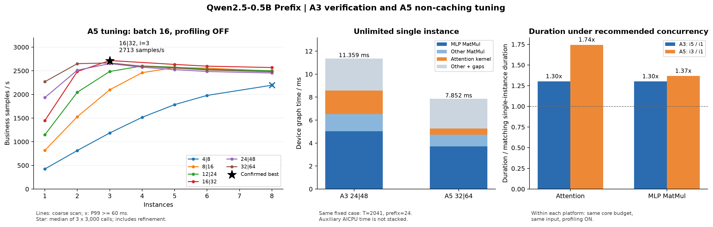

# Qwen2.5-0.5B Prefix：A3复测与A5无缓存调优

采集日期：2026-10-22。batch固定16；普通性能全部关闭profiling。原始版本的历史对比和缓存试验见
[qwen2.5-0.5b-a3-a5-profiling.md](qwen2.5-0.5b-a3-a5-profiling.md)。

## 实测结论

A3 推荐 `8|16、5实例` 的三轮 QPS 中位数为 **2126.997**，与文档 **2168.494**
相差 **-1.914%**；三轮 P99 为 42.101/41.440/40.913 ms，以下以这组三轮空闲卡结果作为当前吞吐依据，原文档数值作为历史参照。

A5 本次已测范围内推荐 **`16|32、batch16、3实例`**，
三轮长窗口 QPS 中位数 **2712.967**，最差轮 P99 **20.021 ms**，全部低于60ms。
对应A3复测中位数为 **1.275倍**。这里的最优是本次扫描与确认范围内的最高中位数，不是所有可能配置的数学证明。

| 关闭profiling的比较 | A3 QPS | A5 QPS | A5/A3 |
|---|---:|---:|---:|
| 不限核、单实例、1000调用、seed42 | 1359.868 | 2278.568 | 1.676 |
| 各自推荐配置、三轮3000调用中位数 | 2126.997 | 2712.967 | 1.275 |

A3 从不限核单实例到推荐并发的吞吐提升为 **1.564倍**，A5为 **1.191倍**。
峰值吞吐比与不限核单实例比不同，需同时看两端的并发收益与各算子的并发放大，而不能直接由单个kernel或硬件比值推导。
推荐配置下平均延迟的三轮中位数分别为A3 37.585ms、A5 17.682ms；
闭环模型中业务QPS近似为“实例数×batch/平均延迟”，实例数为5与3，
所以单请求延迟加速也不能直接当作峰值QPS加速。

## 环境与测量方法

| 项目 | A3 | A5 |
|---|---|---|
| 机器/容器 | 99 / hejun-cann9-qwen25 | 850-a5 / hejun-cann910-stream |
| 项目 | /export/home/ext.hejun23/workspace/ascend-ge-adapters | /home/h00909914/ascend-ge-adapters |
| 逻辑测试卡 | profiling为8（NPU4/Chip0）；空闲卡性能复验逐run记录，见附录A | 3（1号卡Critical，不使用） |
| 物理AIC/AIV | 24/48 | 32/64 |
| CANN | 9.0.0 | 9.3.0 weekly.20261014.01 |
| 算子 | prefix_910 / FIA-GQA | prefix_a5 / cannbot DSL macro，无缓存、提前planner辅流 |
| 算子基线 | b4b30cd | fbf0400 |
| 主仓检查点 | fe1b576f2eb8dbd14b223f5b9ebe7c8b0366956a | ccb8283deb6b8b4d80e7241c390512b34df70838 |
| MatMul权重路径 | WeightNZ pass，ND×NZ | ND×ND |

两端沿用已有部署栈，未隔离CANN升级的影响；本节比较实测算子耗时与当前配置。
使用同一100组batch16池，摘要
`21defc288cc9848d6f1f71f8a8c6d900327963431e57e77125274b5f5fc8c85b`。
正式普通性能按仓库原生bench统计业务样本/秒，延迟含H2D、描述符处理、执行与同步，排除服务排队和组batch等待。
输入编码复用仓库的encode方法，执行入口仍是未修改的runtime/build/ge_runtime。
A3最终空闲卡复测3×3000调用（seed42/43/44），另保留初测记录；A5扫描1000调用，前三候选各3×3000调用确认。
本次测试核数为 [4, 8, 12, 14, 16, 18, 20, 24, 28, 32]，初始实例数为1/2/3/4/5/6/8，并按结果补邻点；实际范围逐行见附录A。
每实例完整覆盖89种shape，warmup=10是下限；普通性能的实际预热数为89×实例数。profiling使用固定case-0020，预热10次/实例。

A5先恢复无缓存源码和已验证交付件，缓存实现保存在 `work/a3-a5-retuning-20261022/cache-recovery.patch`。
原算子的attention启动核数固定16，直接改GE限核无法覆盖本次完整核数搜索。
本次在隔离源码副本中为各候选重编Host launcher常量，使GE预算、planner owner预算、attention grid一致；
宏kernel与AICPU planner二进制保持不变，逐核数交付件摘要见variant-manifest.json。
历史A5“全核”profiling中GE为32|64，但attention实际只有16个block（34.893µs/层），本次分别核对真实grid。
现有macro planner为尾部流水保护保留一个空block，16/32核启动分别只有15/31个有效owner；block数不能直接等同于所有核持续满载。
不限核profiling与对照均真正移除GE的aicore_num选项，同时attention启动32核；A3对应24核。
需加载对应核数的算子交付件复现，不能只改GE配置仍使用固定16核算子。

所有候选先验证3个代表case；最终配置另检查全部100case，与基线 12800 个评分比较：
min cosine=1.000000000000，max relative L2=0，
max abs=0，逐位一致=True。
最终验证还通过/proc映射确认实际加载对应私有OPP中的交付件。

## Profiling对比与优化方向

固定case-0020：T=2041、prefix=24、batch16、N1/N2=14/2、D=64。
下表为去除各实例10次预热后的**设备task累计毫秒/图**；辅流可与主流重叠，不能把所有行简单相加当作端到端延迟。
每图核对169个MatMul、24个attention，A5另核对24个planner和24次metadata清零。

| 算子/角色 | A3 8核i1 | A5最优核数i1 | A3不限核i1 | A5不限核i1 | A3推荐i5 | A5推荐并发 | 不限核A3/A5 |
|---|---:|---:|---:|---:|---:|---:|---:|
| Q projection | 0.898 | 0.517 | 0.488 | 0.313 | 1.946 | 1.050 | 1.557 |
| KV projections | 0.496 | 0.325 | 0.451 | 0.384 | 2.157 | 0.920 | 1.175 |
| Attention kernel | 3.037 | 0.839 | 2.052 | 0.531 | 3.952 | 1.463 | 3.862 |
| Attention planner (AICPU) | 0.000 | 0.740 | 0.000 | 0.763 | 0.000 | 0.808 | — |
| Attention metadata memset | 0.000 | 0.013 | 0.000 | 0.013 | 0.000 | 0.015 | — |
| O projection | 0.880 | 0.540 | 0.541 | 0.331 | 1.783 | 1.236 | 1.633 |
| MLP gate/up | 8.223 | 4.279 | 3.170 | 2.443 | 10.673 | 5.777 | 1.298 |
| MLP down | 4.192 | 2.384 | 1.867 | 1.261 | 5.476 | 3.331 | 1.481 |
| Add | 0.008 | 0.009 | 0.009 | 0.007 | 0.021 | 0.013 | 1.208 |
| AddRmsNorm | 1.000 | 0.468 | 0.996 | 0.390 | 1.735 | 0.699 | 2.556 |
| ApplyRotaryPosEmb | 0.401 | 0.291 | 0.546 | 0.200 | 0.628 | 0.377 | 2.730 |
| GatherV2 | 0.028 | 0.020 | 0.034 | 0.020 | 0.039 | 0.029 | 1.744 |
| Mul | 0.644 | 0.516 | 0.378 | 0.391 | 1.677 | 1.056 | 0.967 |
| Output head | 0.004 | 0.003 | 0.006 | 0.003 | 0.041 | 0.013 | 2.148 |
| RmsNorm | 0.032 | 0.012 | 0.030 | 0.012 | 0.037 | 0.017 | 2.574 |
| StridedSliceV2 | 0.000 | 0.003 | 0.000 | 0.003 | 0.000 | 0.004 | — |
| StridedSliceV3 | 0.005 | 0.000 | 0.010 | 0.000 | 0.005 | 0.000 | — |
| Sub | 0.003 | 0.003 | 0.003 | 0.003 | 0.003 | 0.004 | 0.998 |
| Swish | 1.552 | 0.489 | 0.664 | 0.462 | 2.056 | 0.919 | 1.438 |

不限核单实例：设备图 11.359→7.852ms（1.447倍）；
MatMul累计 6.523→4.734ms（1.378倍），
MLP累计 5.038→3.704ms（1.360倍）；
attention平均每层 85.485→22.136µs（3.862倍）。

| 同核预算下，并发相对单实例的耗时放大 | A3 i5/i1 | A5推荐并发/i1 |
|---|---:|---:|
| Attention kernel | 1.301 | 1.744 |
| MatMul total | 1.503 | 1.532 |
| MLP total | 1.301 | 1.367 |
| Device graph | 1.611 | 1.568 |

A5不限核单实例profile的非任务空档为 0.893ms/图，
高于16核单实例的 0.167ms；推荐并发下为 0.155ms。
因此profile总span和普通性能QPS的比值不能直接互换。较短的满核kernel路径更容易暴露采集与Host投递开销，
需要关闭profiling的对照验证，不能把这部分空档直接归因于硬件计算性能。

A5不限核profile的Host API窗口内计数：

| API | 约调用数/图 | 平均µs | 累计ms/图 |
|---|---:|---:|---:|
| AscendCL@aclnnMm | 96.900 | 10.796 | 1.046 |
| AscendCL@aclnnAddmm | 72.000 | 10.250 | 0.738 |
| AscendCL@aclrtMallocHost | 72.000 | 3.536 | 0.255 |
| AscendCL@aclrtFreeHost | 72.000 | 3.201 | 0.230 |

A5 MatMul走aclnnMm/Addmm包装，A3主要为KernelLaunchWithHandle；A5还有逐图Host分配/释放。
父子API有嵌套，表中累计时间不能相加到设备图时间或当作全部独占CPU开销。
可进一步关联trace定位分配归属，测试QKV/gate-up融合、固定参数和workspace复用是否减少调用；
推荐并发的设备空档已较低，这些是待验证方向，不作为当前峰值差距的确定主因。

A5推荐并发的planner累计 0.808ms/图，
与同一模型主流任务重叠 96.54%，
未重叠部分 27.997µs/图。
未重叠时间也不自动等于关键路径等待；还需结合主流wait位置判断。
历史完整bounds缓存试验已证明本配置下收益很小，优先级应放在主计算和并发利用率。

1. **优先检查MLP/MatMul路径。** A5不限核单实例MLP占设备图时间 47.2%，
   其加速比与attention不同。当前A3有WeightNZ而A5为ND×ND，可测试A5兼容的常量权重预排布、
   MatMul tiling和gate/up投影组织；需独立验证新路径，不把格式差异直接等同于已证明的性能原因。
2. **检查激活读写融合。** A5 不限核单实例中，Swish+Mul 共 0.853 ms/图，占设备图时间 10.9%。可优先测试两输入 SiLU(gate)×up 融合，避免中间张量的写回与再次读取；不要为融合额外插入会抵消收益的 Concat/Transpose。
3. **Attention优先评估GQA的S1×G分块。** 当前A5源码按 `q_head=m//bl`、`q_tile=m%bl` 切块，
   每个Q head独立使用128行；A3的split_core.cpp已有按S1×G划分的代码路径。
   对本例，当前query块数336，行填充率66.44%；若按 `token=m//7`、`q_head=kv_head*7+m%7` 合并，
   在相同128行块下几何估计为240块、填充率93.01%。结合当前causal KV截断公式，
   KV tile访问次数的静态估计可由602降至310/层。该估计未计入G=7的不规则装载/重排、mask和流水成本，
   不等于实测FLOPs减半或速度翻倍。源码参照A5 `prefix_attn/attention.py` 的q_head-major循环和A3 `op_host/common_impl/split_core.cpp` 的 `s1Size*gSize` 分块。实现需要一起修改planner、逐行causal索引、Q装载及输出散写，并验证完整bounds变化。
4. **较小改动的attention候选。** 合并prefix与首个private的query区段，query块可由336降至322；
   或测试M=64（填充率79.73%），但块数升至560且增加调度/装载次数。应分别测量，不能只凭填充率决定。
5. **核预算与并发保持联合评估。** 本次优化点已通过长窗口确认。后续可再评估attention与MatMul分别使用不同核预算，
   结合并发profiling判断资源争用；这是额外实验维度，本次没有把未经测试的组合列为更优配置。
6. **修复尾部流水后评估收回保留owner。** 当前macro_cost路径固定少用一个owner，低核数时影响比例较大。
   需先定位并修复原先1/2项尾部owner的流水问题，再做固定/动态bounds、多实例完整验证；不能直接删除保护。

A5不限核单实例attention占设备图时间约 6.8%。在固定其他任务和调度不变的理想化模型下，
即使完全消除该部分，图时间改善上限约 1.073倍；这不是并发吞吐预测。
因此attention仍有明确的分块优化空间，但整体QPS还需要看MLP与并发放大。

PipeUtilization在两端CANN/混合核路径上的字段覆盖不同，A3部分MatMul无对应指标，0/缺失也不能解释为无计算。
跨平台逐算子比较以设备持续时间为主。A3短并发profiling窗口出现P99=167.728ms，A3仍沿用主线程预热的既有运行器；
该值不用于普通性能排名，首调用初始化等Host因素需另行分析。
空闲卡普通性能复验的最大延迟为358.069ms，虽然全局P99仍低于60ms，尾部仍有少量长延迟；
因此不能把“P99满足约束”表述为“完全没有尖峰”。可后续单独验证A3同工作线程预热与Host初始化，不能据此排除其他Host因素。关闭profiling的最终空闲卡三轮P99均为42.101/41.440/40.913ms。

## 附录A：全部关闭profiling的性能记录

| 平台 | run | 限核AIC/AIV | 实例 | 调用数 | seed | 状态 | 业务QPS | P99 ms | 最大ms |
|---|---|---|---:|---:|---:|---|---:|---:|---:|
| A3 | `a3-default-c8-i5-s42` | 8\|16 | 5 | 3000 | 42 | success / 占用风险 | 2161.644 | 41.683 | 45.757 |
| A3 | `a3-default-c8-i5-s43` | 8\|16 | 5 | 3000 | 43 | success / 占用风险 | 2167.871 | 41.103 | 42.219 |
| A3 | `a3-default-c8-i5-s44` | 8\|16 | 5 | 3000 | 44 | success | 2175.812 | 40.859 | 42.603 |
| A3 | `a3-idle-default-c8-i5-s42` | 8\|16 | 5 | 3000 | 42 | contaminated | 2122.354 | 64.106 | 282.802 |
| A3 | `a3-clean-default-c8-i5-s42` | 8\|16 | 5 | 3000 | 42 | success | 2094.122 | 42.101 | 287.101 |
| A3 | `a3-clean-default-c8-i5-s43` | 8\|16 | 5 | 3000 | 43 | success | 2126.997 | 41.440 | 358.069 |
| A3 | `a3-clean-default-c8-i5-s44` | 8\|16 | 5 | 3000 | 44 | success | 2170.244 | 40.913 | 42.374 |
| A3 | `a3-clean-control-unlimited-i1` | unlimited | 1 | 1000 | 42 | success | 1359.868 | 13.040 | 13.116 |
| A3 | `a3-control-unlimited-i1` | unlimited | 1 | 1000 | 42 | success / 占用风险 | 1382.242 | 12.892 | 12.997 |
| A5 | `a5-grid-c16-i1-s42` | 16\|32 | 1 | 1000 | 42 | success | 1448.120 | 12.527 | 12.906 |
| A5 | `a5-grid-c16-i2-s42` | 16\|32 | 2 | 1000 | 42 | success | 2485.012 | 14.853 | 15.205 |
| A5 | `a5-grid-c16-i3-s42` | 16\|32 | 3 | 1000 | 42 | success | 2717.169 | 19.963 | 20.554 |
| A5 | `a5-grid-c16-i4-s42` | 16\|32 | 4 | 1000 | 42 | failed | — | — | — |
| A5 | `a5-grid-c16-i5-s42` | 16\|32 | 5 | 1000 | 42 | success | 2634.928 | 33.448 | 34.056 |
| A5 | `a5-grid-c16-i6-s42` | 16\|32 | 6 | 1000 | 42 | success | 2598.338 | 40.168 | 40.915 |
| A5 | `a5-grid-c16-i8-s42` | 16\|32 | 8 | 1000 | 42 | success | 2569.262 | 53.439 | 54.744 |
| A5 | `a5-grid-c32-i1-s42` | 32\|64 | 1 | 1000 | 42 | success | 2268.829 | 8.006 | 9.592 |
| A5 | `a5-grid-c32-i2-s42` | 32\|64 | 2 | 1000 | 42 | success | 2651.151 | 13.487 | 13.778 |
| A5 | `a5-grid-c32-i3-s42` | 32\|64 | 3 | 1000 | 42 | success | 2666.368 | 20.165 | 20.783 |
| A5 | `a5-grid-c32-i4-s42` | 32\|64 | 4 | 1000 | 42 | success | 2596.398 | 27.036 | 27.637 |
| A5 | `a5-grid-c32-i5-s42` | 32\|64 | 5 | 1000 | 42 | success | 2558.517 | 34.526 | 34.865 |
| A5 | `a5-grid-c32-i6-s42` | 32\|64 | 6 | 1000 | 42 | success | 2518.428 | 41.586 | 42.067 |
| A5 | `a5-grid-c32-i8-s42` | 32\|64 | 8 | 1000 | 42 | success | 2479.163 | 54.974 | 55.804 |
| A5 | `a5-grid-c8-i1-s42` | 8\|16 | 1 | 1000 | 42 | success | 817.800 | 22.554 | 23.199 |
| A5 | `a5-grid-c8-i2-s42` | 8\|16 | 2 | 1000 | 42 | success | 1528.966 | 24.085 | 24.724 |
| A5 | `a5-grid-c8-i3-s42` | 8\|16 | 3 | 1000 | 42 | success | 2098.776 | 26.411 | 27.066 |
| A5 | `a5-grid-c8-i4-s42` | 8\|16 | 4 | 1000 | 42 | success | 2460.449 | 30.197 | 31.584 |
| A5 | `a5-grid-c8-i5-s42` | 8\|16 | 5 | 1000 | 42 | success | 2568.441 | 36.825 | 37.938 |
| A5 | `a5-grid-c8-i6-s42` | 8\|16 | 6 | 1000 | 42 | success | 2556.372 | 44.086 | 49.619 |
| A5 | `a5-grid-c8-i8-s42` | 8\|16 | 8 | 1000 | 42 | success | 2492.350 | 57.677 | 60.383 |
| A5 | `a5-grid-c24-i1-s42` | 24\|48 | 1 | 1000 | 42 | success | 1933.477 | 9.227 | 9.510 |
| A5 | `a5-grid-c24-i2-s42` | 24\|48 | 2 | 1000 | 42 | success | 2512.486 | 14.044 | 15.389 |
| A5 | `a5-grid-c24-i3-s42` | 24\|48 | 3 | 1000 | 42 | success | 2651.559 | 19.564 | 19.914 |
| A5 | `a5-grid-c24-i4-s42` | 24\|48 | 4 | 1000 | 42 | success | 2575.709 | 26.718 | 27.189 |
| A5 | `a5-grid-c24-i5-s42` | 24\|48 | 5 | 1000 | 42 | success | 2525.566 | 33.740 | 34.012 |
| A5 | `a5-grid-c24-i6-s42` | 24\|48 | 6 | 1000 | 42 | success | 2485.370 | 40.809 | 41.429 |
| A5 | `a5-grid-c24-i8-s42` | 24\|48 | 8 | 1000 | 42 | success | 2453.679 | 54.182 | 54.976 |
| A5 | `a5-grid-c12-i1-s42` | 12\|24 | 1 | 1000 | 42 | success | 1147.327 | 15.829 | 16.267 |
| A5 | `a5-grid-c12-i2-s42` | 12\|24 | 2 | 1000 | 42 | success | 2046.670 | 17.731 | 24.206 |
| A5 | `a5-grid-c12-i3-s42` | 12\|24 | 3 | 1000 | 42 | success | 2485.621 | 21.471 | 22.303 |
| A5 | `a5-grid-c12-i4-s42` | 12\|24 | 4 | 1000 | 42 | success | 2602.347 | 26.839 | 27.679 |
| A5 | `a5-grid-c12-i5-s42` | 12\|24 | 5 | 1000 | 42 | success | 2577.178 | 33.461 | 34.285 |
| A5 | `a5-grid-c12-i6-s42` | 12\|24 | 6 | 1000 | 42 | success | 2532.735 | 40.424 | 41.574 |
| A5 | `a5-grid-c12-i8-s42` | 12\|24 | 8 | 1000 | 42 | success | 2502.056 | 53.930 | 55.124 |
| A5 | `a5-grid-c4-i1-s42` | 4\|8 | 1 | 1000 | 42 | success | 424.628 | 44.226 | 44.350 |
| A5 | `a5-grid-c4-i2-s42` | 4\|8 | 2 | 1000 | 42 | success | 814.240 | 46.263 | 46.575 |
| A5 | `a5-grid-c4-i3-s42` | 4\|8 | 3 | 1000 | 42 | success | 1186.138 | 47.380 | 47.796 |
| A5 | `a5-grid-c4-i4-s42` | 4\|8 | 4 | 1000 | 42 | success | 1516.726 | 49.133 | 49.788 |
| A5 | `a5-grid-c4-i5-s42` | 4\|8 | 5 | 1000 | 42 | success | 1785.069 | 51.984 | 52.763 |
| A5 | `a5-grid-c4-i6-s42` | 4\|8 | 6 | 1000 | 42 | success | 1979.356 | 55.723 | 56.705 |
| A5 | `a5-grid-c4-i8-s42` | 4\|8 | 8 | 1000 | 42 | success | 2195.310 | 67.151 | 68.798 |
| A5 | `a5-concurrency-refine-c4-i7-s42` | 4\|8 | 7 | 1000 | 42 | success | 2108.663 | 60.982 | 62.135 |
| A5 | `a5-core-refine-c14-i2-s42` | 14\|28 | 2 | 1000 | 42 | success | 2271.966 | 15.692 | 15.900 |
| A5 | `a5-core-refine-c14-i3-s42` | 14\|28 | 3 | 1000 | 42 | success | 2604.271 | 20.254 | 21.015 |
| A5 | `a5-core-refine-c14-i4-s42` | 14\|28 | 4 | 1000 | 42 | success | 2613.735 | 26.803 | 27.620 |
| A5 | `a5-core-refine-c18-i2-s42` | 18\|36 | 2 | 1000 | 42 | success | 2305.923 | 15.365 | 16.353 |
| A5 | `a5-core-refine-c18-i3-s42` | 18\|36 | 3 | 1000 | 42 | success | 2589.490 | 20.156 | 20.577 |
| A5 | `a5-core-refine-c18-i4-s42` | 18\|36 | 4 | 1000 | 42 | success | 2623.655 | 26.360 | 26.621 |
| A5 | `a5-core-refine-c20-i2-s42` | 20\|40 | 2 | 1000 | 42 | success | 2441.442 | 14.430 | 26.724 |
| A5 | `a5-core-refine-c20-i3-s42` | 20\|40 | 3 | 1000 | 42 | success | 2638.902 | 19.387 | 19.653 |
| A5 | `a5-core-refine-c20-i4-s42` | 20\|40 | 4 | 1000 | 42 | success | 2599.780 | 26.011 | 26.650 |
| A5 | `a5-core-refine-c28-i2-s42` | 28\|56 | 2 | 1000 | 42 | success | 2594.846 | 13.566 | 15.905 |
| A5 | `a5-core-refine-c28-i3-s42` | 28\|56 | 3 | 1000 | 42 | success | 2645.272 | 19.910 | 22.184 |
| A5 | `a5-core-refine-c28-i4-s42` | 28\|56 | 4 | 1000 | 42 | success | 2557.458 | 27.064 | 31.247 |
| A5 | `a5-confirm-c16-i3-s42` | 16\|32 | 3 | 3000 | 42 | success | 2712.967 | 20.021 | 20.820 |
| A5 | `a5-confirm-c16-i3-s43` | 16\|32 | 3 | 3000 | 43 | success | 2706.757 | 20.012 | 21.156 |
| A5 | `a5-confirm-c16-i3-s44` | 16\|32 | 3 | 3000 | 44 | success | 2715.152 | 19.994 | 26.849 |
| A5 | `a5-confirm-c32-i3-s42` | 32\|64 | 3 | 3000 | 42 | success | 2663.300 | 20.304 | 20.812 |
| A5 | `a5-confirm-c32-i3-s43` | 32\|64 | 3 | 3000 | 43 | success | 2669.300 | 20.271 | 20.930 |
| A5 | `a5-confirm-c32-i3-s44` | 32\|64 | 3 | 3000 | 44 | success | 2660.645 | 20.082 | 26.726 |
| A5 | `a5-confirm-c24-i3-s42` | 24\|48 | 3 | 3000 | 42 | success | 2640.833 | 19.771 | 20.339 |
| A5 | `a5-confirm-c24-i3-s43` | 24\|48 | 3 | 3000 | 43 | success | 2643.158 | 19.683 | 20.092 |
| A5 | `a5-confirm-c24-i3-s44` | 24\|48 | 3 | 3000 | 44 | success | 2645.343 | 19.612 | 21.761 |
| A5 | `a5-control-unlimited-i1` | unlimited | 1 | 1000 | 42 | success | 2278.568 | 7.851 | 8.354 |
| A5 | `a5-default-validated` | 16\|32 | 3 | 1000 | 42 | success | 2714.666 | 19.880 | 21.158 |
| A5 | `a5-retry-c16-i4-s42` | 16\|32 | 4 | 1000 | 42 | success | 2685.941 | 26.481 | 27.087 |

A3初始seed42结束、seed43开始以及旧不限核对照前后，NPU4/Chip0出现其他进程；
这三条记录标注占用风险，不参与当前中位数或平台比值。后续重新选择空闲逻辑卡，
补跑三轮默认性能及不限核对照，逐run的device_idle_before/device_idle_after均为True。
其中一次0号卡重测结束时发现额外进程，已标注contaminated并保留，不参与中位数和比值。
A3各组profiling的目标卡前后快照没有其他进程；不能把后续对照的占用追溯为profiling期间也占用。

首次16核4实例的建流失败（507899）没有虚构QPS，后续单独补测并保留两次记录。
驱动日志确认失败发生在URMA远端SQ/CQ分配阶段、算子执行之前，详细证据见stream-create-failure-audit.json。
所有失败与完整native日志均保留在对应run目录。各次before/after记录设备状态。

## 附录B：候选的三轮长窗口确认

| 限核AIC/AIV | 实例 | 三轮QPS中位数 | 最差轮P99 ms | 三轮全部满足P99<60 |
|---|---:|---:|---:|---|
| 16\|32 | 3 | 2712.967 | 20.021 | True |
| 32\|64 | 3 | 2663.300 | 20.304 | True |
| 24\|48 | 3 | 2643.158 | 19.771 | True |

选择准则为三轮全部P99<60ms时，业务QPS中位数最高。扫描及相邻补点范围以optimum.json和上表全部记录为准。

## 附录C：Profiling运行记录

以下QPS/P99带采集开销，只作为完整过程记录，不参与配置排名。

| 平台 | run | 限核AIC/AIV | 实例 | 调用数 | seed | 状态 | 业务QPS | P99 ms | 最大ms |
|---|---|---|---:|---:|---:|---|---:|---:|---:|
| A3 | `a3-profile-limited-i1` | 8\|16 | 1 | 30 | 42 | success | 739.103 | 21.694 | 21.694 |
| A3 | `a3-profile-unlimited-i1` | unlimited | 1 | 30 | 42 | success | 1391.837 | 11.569 | 11.569 |
| A3 | `a3-profile-optimal-i5` | 8\|16 | 5 | 100 | 42 | success | 1996.768 | 167.728 | 167.728 |
| A5 | `a5-profile-optimal-limit-i1` | 16\|32 | 1 | 30 | 42 | success | 1438.896 | 11.836 | 11.836 |
| A5 | `a5-profile-unlimited-i1` | unlimited | 1 | 30 | 42 | success | 1989.728 | 8.736 | 8.736 |
| A5 | `a5-profile-optimal-concurrent` | 16\|32 | 3 | 100 | 42 | success | 2750.507 | 18.223 | 18.223 |

原始目录：

- `a3-profile-optimal-i5`：`/export/home/ext.hejun23/workspace/ascend-ge-adapters/work/a3-a5-retuning-20261022/runs/a3-profile-optimal-i5/bench-profiling/PROF_000001_20261022212139333_00129702ECGPFHRP`
- `a3-profile-limited-i1`：`/export/home/ext.hejun23/workspace/ascend-ge-adapters/work/a3-a5-retuning-20261022/runs/a3-profile-limited-i1/bench-profiling/PROF_000001_20261022212046686_00128470QLBDRADC`
- `a3-profile-unlimited-i1`：`/export/home/ext.hejun23/workspace/ascend-ge-adapters/work/a3-a5-retuning-20261022/runs/a3-profile-unlimited-i1/bench-profiling/PROF_000001_20261022212112219_00129082DQLNMHQG`
- `a5-profile-unlimited-i1`：`/home/h00909914/ascend-ge-adapters/work/a3-a5-retuning-20261022/runs/a5-profile-unlimited-i1/bench-profiling/PROF_000001_20261022144310074_00221829OPEDFBPQ`
- `a5-profile-optimal-limit-i1`：`/home/h00909914/ascend-ge-adapters/work/a3-a5-retuning-20261022/runs/a5-profile-optimal-limit-i1/bench-profiling/PROF_000001_20261022144234341_00212004EDGFIFJL`
- `a5-profile-optimal-concurrent`：`/home/h00909914/ascend-ge-adapters/work/a3-a5-retuning-20261022/runs/a5-profile-optimal-concurrent/bench-profiling/PROF_000001_20261022144345445_00231342OHAKEJHB`

原始PROF目录位于对应run的bench-profiling下。导出表转为JSONL后删除CSV；保留原始采集文件、时间线、
profile-analysis.json、stream-analysis.json与export-tables-index.json。

## 附录D：24层attention逐算子平均耗时（µs）

| 层 | A3 8核i1 | A5最优核i1 | A3不限核i1 | A5不限核i1 | A3推荐i5 | A5推荐并发 | 不限核A3/A5 |
|---|---:|---:|---:|---:|---:|---:|---:|
| 0 | 126.729 | 34.986 | 85.042 | 22.558 | 163.951 | 69.264 | 3.770 |
| 1 | 128.189 | 35.035 | 86.782 | 22.104 | 166.403 | 58.997 | 3.926 |
| 2 | 127.033 | 34.931 | 85.563 | 22.044 | 165.267 | 53.796 | 3.882 |
| 3 | 125.447 | 34.808 | 85.322 | 22.200 | 163.948 | 58.432 | 3.843 |
| 4 | 127.449 | 35.034 | 84.848 | 21.999 | 162.962 | 62.445 | 3.857 |
| 5 | 126.806 | 35.106 | 85.138 | 22.369 | 170.428 | 60.520 | 3.806 |
| 6 | 125.098 | 35.159 | 85.078 | 21.908 | 168.052 | 58.910 | 3.883 |
| 7 | 127.844 | 35.019 | 85.420 | 22.289 | 163.522 | 61.796 | 3.832 |
| 8 | 126.492 | 34.862 | 85.400 | 21.932 | 166.056 | 65.532 | 3.894 |
| 9 | 124.769 | 35.137 | 85.785 | 22.046 | 169.740 | 61.334 | 3.891 |
| 10 | 127.495 | 34.915 | 86.906 | 22.199 | 157.574 | 58.500 | 3.915 |
| 11 | 126.764 | 34.847 | 85.846 | 22.005 | 161.311 | 61.913 | 3.901 |
| 12 | 124.989 | 34.890 | 84.710 | 22.219 | 160.573 | 60.241 | 3.813 |
| 13 | 127.573 | 34.877 | 85.581 | 21.952 | 163.901 | 60.002 | 3.899 |
| 14 | 126.605 | 34.909 | 85.303 | 22.246 | 162.403 | 61.174 | 3.835 |
| 15 | 125.151 | 35.073 | 85.138 | 22.063 | 167.763 | 62.839 | 3.859 |
| 16 | 127.556 | 34.957 | 85.684 | 22.239 | 165.548 | 63.807 | 3.853 |
| 17 | 127.036 | 34.881 | 85.886 | 22.031 | 164.796 | 62.375 | 3.898 |
| 18 | 124.825 | 34.876 | 85.548 | 22.060 | 168.176 | 61.056 | 3.878 |
| 19 | 127.102 | 34.993 | 84.259 | 22.255 | 170.171 | 61.760 | 3.786 |
| 20 | 126.657 | 35.094 | 85.244 | 22.217 | 161.877 | 59.849 | 3.837 |
| 21 | 124.905 | 34.900 | 85.445 | 22.143 | 160.985 | 58.679 | 3.859 |
| 22 | 127.762 | 34.938 | 85.846 | 22.059 | 163.834 | 59.729 | 3.892 |
| 23 | 126.943 | 34.958 | 85.862 | 22.127 | 163.010 | 60.453 | 3.880 |

## 附录E：169个MatMul逐算子平均耗时（µs）

KV两次投影与gate/up按图中执行顺序编号；各平台同一角色、层与序号对齐。

| 算子 | 层 | A3 8核i1 | A5最优核i1 | A3不限核i1 | A5不限核i1 | A3推荐i5 | A5推荐并发 | 不限核A3/A5 |
|---|---:|---:|---:|---:|---:|---:|---:|---:|
| Q projection #1 | 0 | 37.387 | 21.460 | 20.479 | 12.955 | 71.280 | 39.715 | 1.581 |
| Q projection #2 | 1 | 37.424 | 21.492 | 20.605 | 12.974 | 80.253 | 40.213 | 1.588 |
| Q projection #3 | 2 | 37.405 | 21.488 | 20.267 | 13.244 | 85.595 | 41.558 | 1.530 |
| Q projection #4 | 3 | 37.401 | 21.522 | 20.287 | 13.098 | 74.815 | 37.987 | 1.549 |
| Q projection #5 | 4 | 37.555 | 21.548 | 20.331 | 13.051 | 78.338 | 46.346 | 1.558 |
| Q projection #6 | 5 | 37.378 | 21.573 | 20.293 | 13.056 | 77.769 | 45.878 | 1.554 |
| Q projection #7 | 6 | 37.445 | 21.505 | 20.230 | 13.040 | 79.093 | 47.901 | 1.551 |
| Q projection #8 | 7 | 37.463 | 21.683 | 20.269 | 13.070 | 83.838 | 45.576 | 1.551 |
| Q projection #9 | 8 | 37.409 | 21.594 | 20.265 | 13.052 | 84.711 | 44.907 | 1.553 |
| Q projection #10 | 9 | 37.389 | 21.544 | 20.533 | 13.029 | 81.330 | 45.520 | 1.576 |
| Q projection #11 | 10 | 37.419 | 21.551 | 20.331 | 13.052 | 80.649 | 46.663 | 1.558 |
| Q projection #12 | 11 | 37.430 | 21.536 | 20.315 | 13.059 | 79.362 | 44.223 | 1.556 |
| Q projection #13 | 12 | 37.383 | 21.622 | 20.225 | 13.070 | 79.697 | 43.928 | 1.547 |
| Q projection #14 | 13 | 37.365 | 21.606 | 20.385 | 13.045 | 82.161 | 44.384 | 1.563 |
| Q projection #15 | 14 | 37.397 | 21.510 | 20.305 | 13.070 | 78.782 | 41.292 | 1.554 |
| Q projection #16 | 15 | 37.376 | 21.544 | 20.357 | 13.134 | 77.703 | 45.040 | 1.550 |
| Q projection #17 | 16 | 37.441 | 21.551 | 20.262 | 13.093 | 85.753 | 42.995 | 1.548 |
| Q projection #18 | 17 | 37.367 | 21.603 | 20.245 | 13.064 | 86.441 | 46.883 | 1.550 |
| Q projection #19 | 18 | 37.454 | 21.570 | 20.361 | 13.048 | 81.314 | 44.457 | 1.560 |
| Q projection #20 | 19 | 37.420 | 21.562 | 20.532 | 13.065 | 86.628 | 47.888 | 1.572 |
| Q projection #21 | 20 | 37.520 | 21.541 | 20.370 | 13.084 | 93.042 | 42.898 | 1.557 |
| Q projection #22 | 21 | 37.535 | 21.573 | 20.391 | 13.065 | 87.080 | 38.617 | 1.561 |
| Q projection #23 | 22 | 37.463 | 21.575 | 20.220 | 13.054 | 76.358 | 42.471 | 1.549 |
| Q projection #24 | 23 | 37.491 | 21.567 | 20.415 | 13.029 | 74.106 | 42.838 | 1.567 |
| KV projections #1 | 0 | 10.339 | 6.736 | 9.433 | 8.042 | 40.980 | 20.666 | 1.173 |
| KV projections #2 | 0 | 10.346 | 6.768 | 9.445 | 8.066 | 36.453 | 19.413 | 1.171 |
| KV projections #3 | 1 | 10.331 | 6.809 | 9.371 | 7.965 | 52.128 | 24.533 | 1.177 |
| KV projections #4 | 1 | 10.279 | 6.785 | 9.267 | 7.978 | 31.719 | 13.024 | 1.162 |
| KV projections #5 | 2 | 10.339 | 6.740 | 9.434 | 7.911 | 49.787 | 22.991 | 1.193 |
| KV projections #6 | 2 | 10.309 | 6.764 | 9.522 | 7.967 | 35.021 | 11.656 | 1.195 |
| KV projections #7 | 3 | 10.314 | 6.805 | 9.389 | 8.050 | 56.933 | 23.524 | 1.166 |
| KV projections #8 | 3 | 10.325 | 6.744 | 9.334 | 8.028 | 40.042 | 15.770 | 1.163 |
| KV projections #9 | 4 | 10.301 | 6.763 | 9.511 | 7.992 | 41.857 | 23.742 | 1.190 |
| KV projections #10 | 4 | 10.307 | 6.725 | 9.410 | 7.930 | 36.500 | 13.582 | 1.187 |
| KV projections #11 | 5 | 10.366 | 6.747 | 9.421 | 7.987 | 54.701 | 27.376 | 1.180 |
| KV projections #12 | 5 | 10.333 | 6.776 | 9.461 | 7.989 | 37.318 | 13.406 | 1.184 |
| KV projections #13 | 6 | 10.349 | 6.755 | 9.438 | 7.956 | 54.766 | 22.073 | 1.186 |
| KV projections #14 | 6 | 10.349 | 6.743 | 9.493 | 7.923 | 41.591 | 13.145 | 1.198 |
| KV projections #15 | 7 | 10.381 | 6.731 | 9.349 | 8.029 | 49.628 | 24.505 | 1.164 |
| KV projections #16 | 7 | 10.322 | 6.741 | 9.206 | 7.879 | 38.385 | 11.841 | 1.168 |
| KV projections #17 | 8 | 10.350 | 6.767 | 9.394 | 8.021 | 51.157 | 26.309 | 1.171 |
| KV projections #18 | 8 | 10.352 | 6.780 | 9.354 | 7.982 | 38.228 | 13.844 | 1.172 |
| KV projections #19 | 9 | 10.325 | 6.751 | 9.447 | 8.006 | 52.229 | 26.015 | 1.180 |
| KV projections #20 | 9 | 10.331 | 6.821 | 9.365 | 8.008 | 39.296 | 14.235 | 1.169 |
| KV projections #21 | 10 | 10.319 | 6.735 | 9.327 | 7.957 | 58.761 | 25.307 | 1.172 |
| KV projections #22 | 10 | 10.313 | 6.759 | 9.418 | 7.920 | 36.920 | 14.719 | 1.189 |
| KV projections #23 | 11 | 10.331 | 6.718 | 9.322 | 7.966 | 59.748 | 22.929 | 1.170 |
| KV projections #24 | 11 | 10.334 | 6.866 | 9.335 | 8.025 | 42.307 | 13.978 | 1.163 |
| KV projections #25 | 12 | 10.335 | 6.797 | 9.301 | 8.039 | 49.130 | 26.464 | 1.157 |
| KV projections #26 | 12 | 10.317 | 6.787 | 9.221 | 8.007 | 40.863 | 12.640 | 1.152 |
| KV projections #27 | 13 | 10.324 | 6.786 | 9.478 | 7.999 | 50.337 | 24.559 | 1.185 |
| KV projections #28 | 13 | 10.326 | 6.763 | 9.408 | 8.034 | 33.191 | 12.838 | 1.171 |
| KV projections #29 | 14 | 10.325 | 6.784 | 9.572 | 7.971 | 56.104 | 25.345 | 1.201 |
| KV projections #30 | 14 | 10.325 | 6.758 | 9.441 | 7.898 | 33.435 | 13.535 | 1.195 |
| KV projections #31 | 15 | 10.323 | 6.748 | 9.357 | 7.982 | 57.404 | 24.155 | 1.172 |
| KV projections #32 | 15 | 10.315 | 6.771 | 9.425 | 7.998 | 34.895 | 14.535 | 1.178 |
| KV projections #33 | 16 | 10.289 | 6.768 | 9.357 | 8.048 | 56.306 | 23.841 | 1.163 |
| KV projections #34 | 16 | 10.354 | 6.791 | 9.390 | 8.005 | 30.982 | 15.934 | 1.173 |
| KV projections #35 | 17 | 10.361 | 6.759 | 9.345 | 8.040 | 58.592 | 22.415 | 1.162 |
| KV projections #36 | 17 | 10.289 | 6.818 | 9.323 | 7.941 | 34.275 | 13.492 | 1.174 |
| KV projections #37 | 18 | 10.339 | 6.763 | 9.360 | 7.939 | 52.245 | 29.224 | 1.179 |
| KV projections #38 | 18 | 10.370 | 6.756 | 9.339 | 8.005 | 35.650 | 14.402 | 1.167 |
| KV projections #39 | 19 | 10.383 | 6.749 | 9.521 | 8.006 | 59.787 | 22.820 | 1.189 |
| KV projections #40 | 19 | 10.335 | 6.789 | 9.296 | 7.987 | 36.933 | 13.162 | 1.164 |
| KV projections #41 | 20 | 10.368 | 6.779 | 9.429 | 7.997 | 62.080 | 27.566 | 1.179 |
| KV projections #42 | 20 | 10.387 | 6.792 | 9.425 | 8.014 | 35.687 | 13.140 | 1.176 |
| KV projections #43 | 21 | 10.380 | 6.791 | 9.417 | 8.017 | 48.178 | 24.292 | 1.175 |
| KV projections #44 | 21 | 10.354 | 6.764 | 9.421 | 8.009 | 36.348 | 12.370 | 1.176 |
| KV projections #45 | 22 | 10.331 | 6.754 | 9.397 | 8.021 | 58.018 | 21.966 | 1.171 |
| KV projections #46 | 22 | 10.369 | 6.722 | 9.331 | 7.995 | 28.213 | 11.827 | 1.167 |
| KV projections #47 | 23 | 10.426 | 6.793 | 9.359 | 7.994 | 55.257 | 27.559 | 1.171 |
| KV projections #48 | 23 | 10.400 | 6.781 | 9.413 | 7.979 | 36.573 | 13.191 | 1.180 |
| O projection #1 | 0 | 36.662 | 22.657 | 22.114 | 13.769 | 65.521 | 48.117 | 1.606 |
| O projection #2 | 1 | 36.604 | 22.467 | 22.762 | 13.822 | 65.124 | 60.160 | 1.647 |
| O projection #3 | 2 | 36.715 | 22.522 | 22.738 | 13.794 | 77.578 | 48.460 | 1.648 |
| O projection #4 | 3 | 36.720 | 22.580 | 22.416 | 13.783 | 76.445 | 52.475 | 1.626 |
| O projection #5 | 4 | 36.629 | 22.545 | 22.044 | 13.819 | 70.537 | 49.140 | 1.595 |
| O projection #6 | 5 | 36.571 | 22.530 | 22.814 | 13.842 | 71.590 | 51.867 | 1.648 |
| O projection #7 | 6 | 36.569 | 22.479 | 22.749 | 13.762 | 72.144 | 48.847 | 1.653 |
| O projection #8 | 7 | 36.643 | 22.535 | 22.894 | 13.787 | 69.338 | 50.801 | 1.661 |
| O projection #9 | 8 | 36.621 | 22.566 | 22.224 | 13.776 | 69.226 | 55.458 | 1.613 |
| O projection #10 | 9 | 36.608 | 22.529 | 22.399 | 13.826 | 81.726 | 53.465 | 1.620 |
| O projection #11 | 10 | 36.677 | 22.477 | 22.645 | 13.823 | 77.841 | 52.548 | 1.638 |
| O projection #12 | 11 | 36.692 | 22.498 | 22.621 | 13.781 | 74.480 | 50.512 | 1.641 |
| O projection #13 | 12 | 36.643 | 22.572 | 21.961 | 13.794 | 76.308 | 54.164 | 1.592 |
| O projection #14 | 13 | 36.608 | 22.577 | 22.557 | 13.794 | 81.902 | 52.036 | 1.635 |
| O projection #15 | 14 | 36.540 | 22.435 | 22.592 | 13.824 | 80.479 | 52.983 | 1.634 |
| O projection #16 | 15 | 36.663 | 22.434 | 22.485 | 13.791 | 74.296 | 53.124 | 1.630 |
| O projection #17 | 16 | 36.698 | 22.492 | 22.739 | 13.806 | 70.248 | 50.786 | 1.647 |
| O projection #18 | 17 | 36.603 | 22.532 | 22.181 | 13.792 | 75.620 | 51.717 | 1.608 |
| O projection #19 | 18 | 36.675 | 22.490 | 22.805 | 13.773 | 76.670 | 50.115 | 1.656 |
| O projection #20 | 19 | 36.725 | 22.533 | 22.303 | 13.810 | 82.039 | 52.831 | 1.615 |
| O projection #21 | 20 | 36.661 | 22.589 | 22.857 | 13.777 | 73.157 | 50.045 | 1.659 |
| O projection #22 | 21 | 36.693 | 22.489 | 22.559 | 13.811 | 75.002 | 48.308 | 1.633 |
| O projection #23 | 22 | 36.697 | 22.486 | 22.138 | 13.827 | 74.919 | 45.221 | 1.601 |
| O projection #24 | 23 | 36.828 | 22.451 | 23.249 | 13.768 | 71.074 | 53.113 | 1.689 |
| MLP gate/up #1 | 0 | 170.673 | 89.428 | 65.159 | 51.376 | 223.303 | 120.657 | 1.268 |
| MLP gate/up #2 | 0 | 171.627 | 89.037 | 66.910 | 50.654 | 230.460 | 121.983 | 1.321 |
| MLP gate/up #3 | 1 | 170.597 | 89.553 | 65.842 | 51.680 | 223.245 | 116.397 | 1.274 |
| MLP gate/up #4 | 1 | 170.806 | 88.714 | 70.326 | 50.410 | 228.772 | 122.654 | 1.395 |
| MLP gate/up #5 | 2 | 171.342 | 89.368 | 71.662 | 51.257 | 224.382 | 114.714 | 1.398 |
| MLP gate/up #6 | 2 | 171.941 | 88.706 | 70.600 | 50.192 | 239.621 | 122.655 | 1.407 |
| MLP gate/up #7 | 3 | 172.372 | 89.509 | 69.996 | 51.243 | 216.313 | 114.220 | 1.366 |
| MLP gate/up #8 | 3 | 173.663 | 88.817 | 68.378 | 50.474 | 225.225 | 123.556 | 1.355 |
| MLP gate/up #9 | 4 | 170.832 | 89.511 | 66.603 | 51.314 | 220.205 | 118.775 | 1.298 |
| MLP gate/up #10 | 4 | 172.645 | 88.809 | 67.004 | 50.397 | 235.586 | 126.182 | 1.330 |
| MLP gate/up #11 | 5 | 172.039 | 89.509 | 65.718 | 51.563 | 212.680 | 119.347 | 1.275 |
| MLP gate/up #12 | 5 | 172.576 | 88.981 | 64.965 | 50.620 | 231.017 | 122.619 | 1.283 |
| MLP gate/up #13 | 6 | 170.754 | 89.425 | 65.555 | 51.444 | 213.535 | 118.440 | 1.274 |
| MLP gate/up #14 | 6 | 172.048 | 88.728 | 64.971 | 50.151 | 217.757 | 122.998 | 1.295 |
| MLP gate/up #15 | 7 | 170.748 | 89.508 | 65.849 | 51.266 | 209.903 | 117.724 | 1.284 |
| MLP gate/up #16 | 7 | 171.701 | 88.735 | 65.134 | 50.334 | 224.488 | 118.349 | 1.294 |
| MLP gate/up #17 | 8 | 170.747 | 89.450 | 65.279 | 51.316 | 222.811 | 119.103 | 1.272 |
| MLP gate/up #18 | 8 | 171.378 | 88.780 | 65.078 | 50.380 | 228.224 | 121.177 | 1.292 |
| MLP gate/up #19 | 9 | 170.531 | 89.431 | 65.356 | 51.272 | 211.432 | 116.935 | 1.275 |
| MLP gate/up #20 | 9 | 171.630 | 88.784 | 65.792 | 50.321 | 231.086 | 122.262 | 1.307 |
| MLP gate/up #21 | 10 | 170.498 | 89.623 | 65.343 | 51.407 | 214.238 | 115.890 | 1.271 |
| MLP gate/up #22 | 10 | 171.470 | 88.751 | 66.132 | 50.335 | 220.640 | 118.599 | 1.314 |
| MLP gate/up #23 | 11 | 170.906 | 89.595 | 65.462 | 51.380 | 212.737 | 114.552 | 1.274 |
| MLP gate/up #24 | 11 | 171.593 | 88.764 | 65.190 | 50.345 | 229.760 | 123.107 | 1.295 |
| MLP gate/up #25 | 12 | 170.546 | 89.516 | 66.042 | 51.447 | 214.379 | 117.236 | 1.284 |
| MLP gate/up #26 | 12 | 171.478 | 88.787 | 65.917 | 50.388 | 237.849 | 123.002 | 1.308 |
| MLP gate/up #27 | 13 | 170.913 | 89.457 | 65.110 | 51.409 | 219.444 | 120.692 | 1.267 |
| MLP gate/up #28 | 13 | 171.758 | 88.742 | 65.077 | 50.415 | 226.348 | 119.047 | 1.291 |
| MLP gate/up #29 | 14 | 170.580 | 89.490 | 64.867 | 51.538 | 217.876 | 118.053 | 1.259 |
| MLP gate/up #30 | 14 | 171.670 | 88.790 | 64.888 | 50.476 | 228.914 | 119.537 | 1.286 |
| MLP gate/up #31 | 15 | 170.914 | 89.513 | 65.322 | 51.441 | 217.639 | 122.987 | 1.270 |
| MLP gate/up #32 | 15 | 171.188 | 88.671 | 65.534 | 50.309 | 228.792 | 122.743 | 1.303 |
| MLP gate/up #33 | 16 | 170.596 | 89.549 | 65.910 | 51.318 | 212.853 | 119.458 | 1.284 |
| MLP gate/up #34 | 16 | 171.698 | 88.751 | 65.457 | 50.310 | 229.833 | 125.590 | 1.301 |
| MLP gate/up #35 | 17 | 170.500 | 89.477 | 66.213 | 51.262 | 209.459 | 120.180 | 1.292 |
| MLP gate/up #36 | 17 | 171.514 | 88.761 | 65.318 | 50.385 | 227.085 | 119.501 | 1.296 |
| MLP gate/up #37 | 18 | 170.668 | 89.449 | 65.470 | 51.383 | 215.894 | 119.717 | 1.274 |
| MLP gate/up #38 | 18 | 171.525 | 88.790 | 65.214 | 50.405 | 235.815 | 125.657 | 1.294 |
| MLP gate/up #39 | 19 | 170.628 | 89.540 | 65.890 | 51.375 | 212.167 | 117.370 | 1.283 |
| MLP gate/up #40 | 19 | 171.613 | 88.745 | 65.876 | 50.496 | 231.735 | 122.476 | 1.305 |
| MLP gate/up #41 | 20 | 170.742 | 89.465 | 65.442 | 51.443 | 213.711 | 119.533 | 1.272 |
| MLP gate/up #42 | 20 | 171.612 | 88.772 | 65.331 | 50.357 | 222.701 | 125.048 | 1.297 |
| MLP gate/up #43 | 21 | 171.167 | 89.464 | 65.490 | 51.331 | 215.573 | 118.488 | 1.276 |
| MLP gate/up #44 | 21 | 171.596 | 88.763 | 65.735 | 50.374 | 222.163 | 126.281 | 1.305 |
| MLP gate/up #45 | 22 | 170.526 | 89.470 | 65.874 | 51.410 | 215.372 | 115.245 | 1.281 |
| MLP gate/up #46 | 22 | 171.910 | 88.747 | 65.221 | 50.406 | 222.956 | 123.195 | 1.294 |
| MLP gate/up #47 | 23 | 170.790 | 89.532 | 65.652 | 51.448 | 216.060 | 118.344 | 1.276 |
| MLP gate/up #48 | 23 | 171.482 | 88.753 | 64.881 | 50.342 | 230.483 | 124.548 | 1.289 |
| MLP down #1 | 0 | 174.473 | 99.491 | 77.737 | 52.542 | 235.231 | 143.360 | 1.480 |
| MLP down #2 | 1 | 174.627 | 99.367 | 77.678 | 52.477 | 227.321 | 135.509 | 1.480 |
| MLP down #3 | 2 | 174.592 | 99.484 | 77.859 | 52.647 | 234.481 | 138.811 | 1.479 |
| MLP down #4 | 3 | 174.697 | 99.362 | 77.743 | 52.522 | 229.500 | 141.044 | 1.480 |
| MLP down #5 | 4 | 174.536 | 99.309 | 77.707 | 52.482 | 227.540 | 143.818 | 1.481 |
| MLP down #6 | 5 | 174.750 | 99.408 | 77.744 | 52.565 | 229.968 | 139.263 | 1.479 |
| MLP down #7 | 6 | 174.672 | 99.327 | 77.779 | 52.506 | 234.646 | 136.554 | 1.481 |
| MLP down #8 | 7 | 174.682 | 99.357 | 77.840 | 52.488 | 228.310 | 133.780 | 1.483 |
| MLP down #9 | 8 | 174.516 | 99.326 | 77.790 | 52.598 | 224.836 | 144.195 | 1.479 |
| MLP down #10 | 9 | 174.746 | 99.314 | 77.682 | 52.631 | 227.517 | 137.987 | 1.476 |
| MLP down #11 | 10 | 174.525 | 99.299 | 77.714 | 52.568 | 231.160 | 141.565 | 1.478 |
| MLP down #12 | 11 | 174.612 | 99.346 | 77.690 | 52.548 | 230.080 | 138.729 | 1.478 |
| MLP down #13 | 12 | 174.554 | 99.356 | 77.710 | 52.551 | 219.979 | 138.986 | 1.479 |
| MLP down #14 | 13 | 174.588 | 99.311 | 77.784 | 52.567 | 231.833 | 135.673 | 1.480 |
| MLP down #15 | 14 | 174.483 | 99.341 | 77.782 | 52.476 | 221.833 | 136.465 | 1.482 |
| MLP down #16 | 15 | 174.704 | 99.323 | 77.808 | 52.571 | 224.738 | 138.503 | 1.480 |
| MLP down #17 | 16 | 174.591 | 99.353 | 77.878 | 52.543 | 229.659 | 138.863 | 1.482 |
| MLP down #18 | 17 | 174.616 | 99.341 | 77.818 | 52.525 | 227.658 | 141.004 | 1.482 |
| MLP down #19 | 18 | 174.673 | 99.402 | 77.918 | 52.586 | 222.706 | 141.681 | 1.482 |
| MLP down #20 | 19 | 174.843 | 99.372 | 78.024 | 52.539 | 227.825 | 136.981 | 1.485 |
| MLP down #21 | 20 | 174.587 | 99.340 | 77.819 | 52.561 | 225.131 | 139.254 | 1.481 |
| MLP down #22 | 21 | 174.856 | 99.354 | 77.909 | 52.620 | 231.015 | 133.751 | 1.481 |
| MLP down #23 | 22 | 174.779 | 99.303 | 77.894 | 52.485 | 230.382 | 137.364 | 1.484 |
| MLP down #24 | 23 | 174.816 | 99.293 | 78.172 | 52.491 | 222.565 | 137.671 | 1.489 |
| Output head #1 | 24 | 3.753 | 2.581 | 5.507 | 2.563 | 40.539 | 12.733 | 2.148 |

## 附录F：交付件与复现

两端过程目录均为项目根下 `work/a3-a5-retuning-20261022/`。保存canonical-model.yaml、base-plan.json、
逐run的plan/result、native日志、requests.jsonl、全部profiling、算子正确性结果和源文件/交付件摘要。
A5额外保存variants/cN私有OPP、variant-manifest.json、optimum.json、attention-geometry.json、
optimum-plan.json和optimum-environment.json；私有OPP用于复现特定核数，不与默认安装混用。
扫描期间使用隔离计划，完成后已把 `Ascend950PR_958b` 默认配置更新为
`16|32、batch16、3实例`，依赖版本记录同步到当前算子检查点fbf0400。
默认算子保持无缓存，启动核数与GE默认预算一致。通过标准pipeline默认入口再次验证：
100case/12800评分，逐位一致=True，
FP32参考通过；关闭profiling的1000调用复验QPS **2714.666**、
P99 **19.880ms**。该轮是默认入口复验，不替代三轮候选中位数。
输入池、AIR、runtime及前端适配源码摘要未变；原默认配置与算子交付件备份在default-backup中。

本次未提交或推送代码。已有README及其他过程文件修改保留；缓存恢复补丁单独保存。

## 附录G：MatMul硬件流水效率与瓶颈复析（2026-10-23）

本节复析2026-10-22已采集的A5 op_summary，不重新运行模型。固定case-0020、T=2041、prefix=24、batch16。
分别使用16|32单实例、真正不限核32|64单实例、推荐16|32三实例。
按Model ID分别剔除10次预热，保留30/30/100个正式图，逐图校验169个MatMul；共27040次正式MatMul调用。
各角色/层按执行顺序、输入shape与已有逐算子映射交叉核对。表中耗时直接取op_summary的Task Duration，
与前文task_time存在小于0.02µs的导出粒度差异，角色平均值已交叉检查。
比例按aic_total_cycles加权：sum(ratio_i*cycles_i)/sum(cycles_i)，不是调用次数的简单平均。
各流水会重叠，不能将比例相加，也不能把ratio直接当作HBM带宽百分比。

结论是：**单实例的MLP主要偏Cube；推荐3实例下，down明显转为MTE2路径受限，gate/up为MTE2与Cube混合。**
因此“MatMul是主要耗时”不等于“当前主要受纯Cube峰值算力限制”。

### G.1 16|32，单实例

| 角色 | M,N,K | 平均Task µs | MAC % | MTE1 % | MTE2 % | MTE3 % | Fixpipe % | Scalar % |
|---|---|---:|---:|---:|---:|---:|---:|---:|
| Q projection | 2041,896,896 | 21.556 | 82.51 | 24.21 | 74.98 | 0.00 | 63.05 | 17.43 |
| KV projections | 2041,128,896 | 6.769 | 39.36 | 19.74 | 64.05 | 0.00 | 73.74 | 26.33 |
| O projection | 2041,896,896 | 22.520 | 78.09 | 22.85 | 65.96 | 0.00 | 59.08 | 15.09 |
| MLP gate/up | 2041,4864,896 | 89.137 | 95.05 | 26.54 | 73.13 | 0.00 | 72.64 | 12.83 |
| MLP down | 2041,896,4864 | 99.354 | 94.86 | 28.07 | 82.45 | 0.00 | 13.45 | 11.84 |
| Output head | 16,8,896 | 2.581 | 7.42 | 7.25 | 36.19 | 0.10 | 49.60 | 50.66 |

MLP gate/up与down的MAC均约95%，高于MTE2的73.13%/82.45%，支持单实例更偏Cube的判断。
Q/O投影也是MAC高于MTE2。KV窄N=128，MAC仅39.36%、Fixpipe73.74%、MTE2 64.05%，更偏搬运/输出路径与短算子开销。

### G.2 不限核32|64，单实例

| 角色 | M,N,K | 平均Task µs | MAC % | MTE1 % | MTE2 % | MTE3 % | Fixpipe % | Scalar % |
|---|---|---:|---:|---:|---:|---:|---:|---:|
| Q projection | 2041,896,896 | 13.063 | 69.79 | 20.50 | 62.73 | 0.00 | 53.16 | 21.75 |
| KV projections | 2041,128,896 | 7.991 | 19.88 | 13.66 | 65.99 | 0.00 | 71.24 | 28.82 |
| O projection | 2041,896,896 | 13.799 | 65.50 | 19.22 | 56.35 | 0.00 | 48.92 | 19.27 |
| MLP gate/up | 2041,4864,896 | 50.888 | 88.52 | 23.96 | 72.96 | 0.00 | 69.74 | 12.97 |
| MLP down | 2041,896,4864 | 52.546 | 90.21 | 26.61 | 79.95 | 0.00 | 12.89 | 12.90 |
| Output head | 16,8,896 | 2.564 | 7.46 | 7.30 | 37.07 | 0.10 | 50.81 | 49.45 |

MLP的MAC仍为88.52%/90.21%，高于MTE2 72.96%/79.95%，没有显示MTE2是最长流水。
KV反而由16核6.769µs增至32核7.991µs，MAC降至19.88%、Fixpipe71.24%；
这是增加核数对窄矩阵不利的直接证据，不能把所有投影都按同一大MatMul策略调度。

### G.3 16|32，三实例（当前推荐点）

| 角色 | M,N,K | 平均Task µs | MAC % | MTE1 % | MTE2 % | MTE3 % | Fixpipe % | Scalar % |
|---|---|---:|---:|---:|---:|---:|---:|---:|
| Q projection | 2041,896,896 | 43.758 | 61.59 | 17.71 | 82.31 | 0.00 | 62.56 | 12.74 |
| KV projections | 2041,128,896 | 19.165 | 29.69 | 14.82 | 69.11 | 0.00 | 76.17 | 20.85 |
| O projection | 2041,896,896 | 51.513 | 54.17 | 15.70 | 79.92 | 0.00 | 53.31 | 10.25 |
| MLP gate/up | 2041,4864,896 | 120.351 | 80.62 | 22.46 | 84.66 | 0.00 | 67.00 | 10.87 |
| MLP down | 2041,896,4864 | 138.785 | 72.61 | 21.14 | 92.75 | 0.00 | 12.40 | 8.97 |
| Output head | 16,8,896 | 12.733 | 5.41 | 5.30 | 34.67 | 0.02 | 41.78 | 46.06 |

- down：MTE2=92.75%，MAC=72.61%；24层逐层加权MTE2均在92.14%～93.18%，MAC在69.95%～75.21%，全部MTE2高于MAC。
- gate/up：MTE2=84.66%，MAC=80.62%；48个投影逐层MTE2均高于MAC，但差距较小，属于混合瓶颈。
- Q/O：MTE2约82.31%/79.92%，MAC仅61.59%/54.17%，也支持并发下搬运路径或共享资源压力增加。
- KV：Fixpipe76.17%高于MTE2 69.11%，MAC仅29.69%；更偏结果输出与搬运，非Cube计算受限。
- MTE1约15%～22%，MLP Scalar约9%～11%，当前没有显示其为最长流水。
- MTE3约0不等于没有写回：该MatMul输出可由Fixpipe执行L0C到GM/L1的搬运，需同时看Fixpipe。
- AIV的vec/mte2/mte3均为0；本批MatMul为AI_CORE且Mix Block Num=0，不能将该0解读为Vector性能差。

### G.4 绝对流水时间交叉验证

下表是每次调用的平均µs；流水时间是跨block汇总归一后的PMU统计，不是整个芯片所有核时间之和，且相互重叠。

| 角色 | 指标 | 16核i1 µs | 16核i3 µs | 变化 |
|---|---|---:|---:|---:|
| MLP gate/up | Task Duration | 89.137 | 120.351 | +35.02% |
| MLP gate/up | MAC time | 84.454 | 90.604 | +7.28% |
| MLP gate/up | MTE2 time | 64.979 | 95.241 | +46.57% |
| MLP down | Task Duration | 99.354 | 138.785 | +39.69% |
| MLP down | MAC time | 93.985 | 94.602 | +0.66% |
| MLP down | MTE2 time | 81.686 | 120.084 | +47.01% |

特别是down，MAC时间仅+0.66%，而MTE2时间+47.01%，Task Duration+39.69%。
这比单独看MTE2/MAC比例，更支持“并发时搬运/共享存储路径限制增加”的推断。
但MTE2时间可能包含流水阻塞/等待，尚不能据此区分HBM带宽、L2竞争、GM→L1通路或调度背压。
当前PipeUtilization采集没有HBM/L2带宽或命中率字段，不能宣称HBM带宽已打满。
后续应补采该CANN/A5支持的带宽、缓存与stall/指令时间线，再决定L2复用、预取/双缓冲、分块与布局策略。

### G.5 不应混淆的两个Cube指标

判断流水是否被矩阵计算占满，主要看aic_mac_ratio；cube_utilization(%)采用
`total_cycles/(freq*core_num*Task Duration)`，其分母包含核数与Task总跨度，不能直接当作MAC流水效率或实测FLOPs/峰值FLOPs。
本批数据用物理32核、1650MHz代入公式可逐行复算：16核i1的gate/up约49.51%，32核i1约93.20%。
16核时约一半的数值与物理核数归一化有关，不能据此认为被分配的16个核内部只有约50%的MAC效率；其MAC实际约95.05%。
三实例下调度与共享资源争用又会拉低该指标，不能把各实例的百分比简单相加成全芯片利用率。

### G.6 优化优先级与证据范围

1. 对实际三实例场景，优先定位down的MTE2路径：检查L2/GM读取、L1复用、预取与分块。应先补带宽与缓存证据，不直接假设换NZ必然有效。
2. 对gate/up，维持Cube效率并减少重复输入访问，评估gate/up投影组织及激活融合；MTE2与MAC接近，需要同时衡量搬运、计算和Fixpipe。
3. KV可评估合并K/V投影、窄N专用tiling或较小核数；其主要问题不是提升大矩阵MAC峰值。
4. 单实例与三实例的最优实现可能不同；任何候选最后都需回到16|32、batch16、3实例关闭profiling验证QPS/P99。

指标定义参照官方[op_summary字段说明](https://www.hiascend.com/doc_center/source/zh/CANNCommunityEdition/910beta2/devaids/Profiling/atlasprofiling_16_0067.html)、
[PipeUtilization字段说明](https://www.hiascend.com/document/detail/zh/canncommercial/83RC1/devaids/optool/atlasopdev_16_0099.html)。
官方[Ascend950矩阵优化示例](https://gitcode.com/cann/asc-devkit/blob/master/examples/01_simd_cpp_api/05_best_practices/01_matrix_compute/matmul_basic_api_high_performance/README.md)也说明，
Cube受限时MTE2采集时间可能受流水等待影响，不能只看单一搬运时间认定HBM带宽瓶颈。

复析汇总（含全部169个MatMul的逐节点指标）与摘要位于项目过程目录
`work/a3-a5-retuning-20261022/matmul-hardware/summary.json`及`analysis-manifest.json`；
原始op_summary的JSONL路径仍见各run的export-tables-index.json。未生成CSV，未启动新profiling或更改运行配置。

## 附录H：A5权重NZ试验（2026-10-23）

在A5现有MatMulV3上适配常量权重ND→NZ，16|32、batch16、3实例的同卡三轮关闭profiling对照，
QPS中位数2711.228→2767.918（+2.091%），最差轮P99 20.096→19.799ms。
100case/12800评分与ND基线逐位一致。169个MatMul权重均为FRACTAL_NZ；168个主干投影保持16个block、输出头保持1个block，新增运行时TransData=0。
并发gate/up及down耗时分别下降4.83%和7.68%，MTE2时间下降7.23%和9.09%，单实例基本不变。
最终代码标准入口复验QPS2776.890、P99 19.281ms。
本次实验期间默认YAML和全局OPP未启用NZ，使用LD_PRELOAD作进程局部对照；正式安装方式见Pass README。
完整实现、失败探路、Host测试、全部性能表、169个算子对比和profiling目录见
[A5权重NZ实验](qwen2.5-0.5b-a5-weight-nz.md)。
