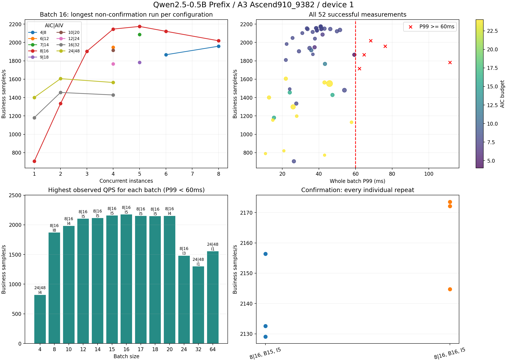

# Qwen2.5-0.5B Prefix A3 调优记录

2026-10-20至2026-10-21，在 99 机器的 `hejun-cann9-qwen25` 容器、逻辑设备1、Ascend910_9382（物理24 AIC / 48 AIV）上，已测范围内推荐 **限核 8|16、batch=16、并发实例=5**。三轮各10000次模型调用的业务QPS中位数为 **2172.093**，最差轮整batch P99为 **41.266ms**，低于60ms；三轮完成测量均零执行错误。

参数已写入 `models/qwen2.5-0.5b/config/model.yaml` 的 `chips.Ascend910_9382`，原公共参数与A5参数保留。该芯片配置自动选中 `prefix_910` 与 `weight_nz`，使用FP16和 `force_fp16`。

## 环境与测量口径

| 项目 | 实际值 |
|---|---|
| 项目根目录 | `/export/home/ext.hejun23/workspace/ascend-ge-adapters` |
| Git基线 | `59050e390a8bcd4d01f7beac50b741c008285f2a` |
| CANN / Python | 9.0.0（V100R001C10SPC001B250）/ 3.11.15 |
| Torch / TorchNPU / Transformers | 2.9.0+cpu / 2.9.0.post2 / 5.10.1 |
| 后端 | GE Session，单设备，独立图实例与stream并发 |
| 输入 | 每种batch固定100组，seed=0；lognormal(mu=4.997,sigma=0.167)，总长上限218，共享prefix=20–25 |
| 统计请求 | 按seed有放回抽样；改变并发不改变同batch、同seed的全局抽样顺序 |
| 预热 | 每实例覆盖输入池全部shape；推荐池为89种shape |
| 业务QPS | 业务样本数/测量段墙钟秒数，等于模型调用QPS×batch |
| P99 | 整batch的H2D、描述符处理、执行与同步时间；不除以batch |
| 计时范围 | 初始化、编译、加载、预热、服务排队和组batch等待均在测量范围之外 |
| Profiling | 全部调优测量关闭 |

限核是GE核预算，不表示独占绑核。推荐配置三轮共30000次模型调用、480000个业务样本。

## 搜索范围与数据完整性

自适应粗扫、邻域和细扫实际覆盖：AIC=[4, 6, 7, 8, 9, 10, 12, 16, 24]，AIV=2×AIC；batch=[4, 8, 10, 12, 14, 15, 16, 17, 18, 20, 24, 32, 64]；并发=[1, 2, 3, 4, 5, 6, 8]。这些集合不是完整笛卡尔积。出现P99超标或吞吐下降后，后续选点围绕较优区域展开；图中每点都有实际结果支持。

累计 **57次尝试**：55次形成完整性能结果，其中5次P99达到或超过60ms；2次失败/中断没有完整性能值。完整记录共151000次模型调用，未形成完整统计的中断调用不补计为0，也不补造性能值。

- 一次 `4|8` 尝试发生 `E39007` 设备子进程启动超时；随后相同核预算正常完成，原失败保留。
- 一次batch16、seed43长测的原生进程收到SIGTERM；回收日志确认已完成445次预热，未形成完整测量统计。原中断和继承日志管道的编译子进程清理过程均保留，同seed已补测成功。
- 初始推理还记录了嵌入Python找不到NumPy、Prefix算子发现路径两个环境问题，保留在阶段记录中。现以容器Python环境脚本及依赖路径解析修复。

测试初期有其他xllm驻留，随后进程退出并经历显存清理；环境变化和设备时间线均已记录。最佳短测配置在变化前后复测，QPS差约0.35%。本次候选长测的设备基础显存均约140.89MiB，前后快照未列出其他同卡进程；一次SIGTERM中断单独保留。

## 两组候选的完整确认

按业务QPS中位数排名，要求3轮完成测量均零执行错误且各轮P99<60ms。QPS区间有重叠，以下是本次实测排名。

| AIC/AIV | batch | 并发 | 中位数业务QPS | QPS范围 | 最差P99 ms | 完整轮数 |
|---|---:|---:|---:|---|---:|---:|
| 8/16 | 16 | 5 | 2172.093 | 2144.731–2173.514 | 41.266 | 3 |
| 8/16 | 15 | 5 | 2132.621 | 2129.060–2156.354 | 38.941 | 3 |

每轮原始结果如下；batch16的中断尝试另见附录A和B，不计为完成轮。

| batch | seed | 模型调用数 | 业务QPS | P99 ms | 执行错误 | run_id |
|---:|---:|---:|---:|---:|---:|---|
| 16 | 42 | 10000 | 2172.093 | 40.915 | 0 | 20261020T131502-5225ada1 |
| 16 | 43 | 10000 | 2173.514 | 40.899 | 0 | 20261020T133635-e25d7302 |
| 16 | 44 | 10000 | 2144.731 | 41.266 | 0 | 20261020T133114-e3ef8669 |
| 15 | 42 | 10000 | 2156.354 | 38.615 | 0 | 20261020T131743-082f31e8 |
| 15 | 43 | 10000 | 2132.621 | 38.941 | 0 | 20261020T132015-c63d2db0 |
| 15 | 44 | 10000 | 2129.060 | 38.896 | 0 | 20261020T133351-886a45a4 |

## 精度与环境修复

应用最终芯片配置后，重新对全部 **100组、1600个业务样本** 运行NPU推理并与未patch的HF CPU FP32参考比较，通过现有阈值：cosine≥0.998、relative L2≤0.05。实际最小cosine为 **0.998909550002**，最大relative L2为 **0.046848644966**。

额外保留batch32的100组原始CPU FP32参考。共享1600条请求与独立batch16参考的最大绝对差为1.57356e-5、最大relative L2为3.166e-6；参考复用前逐组校验prefix、请求token与输出行对齐。batch15参考为原始共享请求的精确行子集，并保留来源及摘要。

必要修复：`core/dependencies.py` 将安装目录中的OPP软链接解析为实际vendor路径，使GE发现A3自定义算子；`scripts/env_a3.sh` 将原生GE内嵌Python指向当前容器的Python库和site-packages。新增vendor软链接回归测试。2026-10-20回归为54项Python测试、CTest 1/1通过；本次输入一致性修复后的55项Python测试见下文。

最终infer记录：`20261020T133917-797a3bbc`；compare记录：`20261020T133950-b474153d`。

## 图表



左上：batch16下每组核数/并发选调用数最多、同调用数最新的一条非确认测量；右上：全部成功测量，红叉为P99超标；左下：每种batch已观察到的最高达标QPS；右下：两组候选逐轮长测。图表反映2026-10-20的54次尝试；2026-10-21新增两次并发8补测见附录。全部重复与异常均保留在附录，图表不代表未测组合的结论。[SVG](../../images/qwen2.5-0.5b-a3-overview.svg)

## 复现

在上述容器和项目根目录中执行：

```bash
source /usr/local/Ascend/ascend-toolkit/latest/set_env.sh
source models/qwen2.5-0.5b/scripts/env_a3.sh
export QWEN_MODEL_DIR=/export/home/models/Qwen2.5-0.5B
# 显式恢复与当前YAML一致的输入池；bench不会自动重建输入。
python3 -m core.pipeline data --config models/qwen2.5-0.5b/config/model.yaml --target Ascend910_9382
python3 -m core.pipeline bench --config models/qwen2.5-0.5b/config/model.yaml --device 1
```

当前默认是8|16、batch16、5实例，默认1000次调用。输入、依赖和AIR已保留；重新生成交付件时按主README执行data、baseline、prepare、build、infer、compare、bench七步入口。

三轮10000次调用的实验脚本：

```bash
python3 work/a3-tuning-20261020/tune_a3.py --phase reproduction --cores 8 --batches 16 --instances 5 --iterations 10000 --seeds 42 43 44
# 实验脚本逐次更新本机芯片配置；完成后可恢复已验收默认值：
cp work/a3-tuning-20261020/validation/final-batch16/validated-config.yaml models/qwen2.5-0.5b/config/model.yaml
```

## 并发3–5的综合比较

用户重点关注并发3–5，不要求并发3–8每一点都满足60ms。未指定流量占比，因此以下等权平均仅作比较参考。

以下三组均为限核8|16，且已有并发3、4、5的完整观测点。

| batch | 并发3 QPS / P99(ms) | 并发4 QPS / P99(ms) | 并发5 QPS / P99(ms) | 3–5等权平均QPS | 此范围最差P99(ms) |
|---|---:|---:|---:|---:|---:|
| 12 | 1809.1 / 21.910 | 2048.9 / 25.575 | 2102.0 / 30.914 | 1986.7 | 30.914 |
| **16** | **1904.0 / 29.073** | **2145.8 / 33.757** | **2172.1 / 41.266** | **2073.9** | **41.266** |
| 20 | 1938.5 / 34.869 | 2151.8 / 41.415 | 2136.4 / 51.488 | 2075.6 | 51.488 |

同配置有多次测量时，优先取调用次数最多的一组；该组有多个种子时，QPS取中位数，P99取最大值。batch16、并发5为3轮各10000次调用，QPS范围2144.7–2173.5；表中的2172.1为中位数。其他格为单轮2000或3000次调用。不同轮次样本量不同，表格用于已有结果的综合比较，不代表统计显著性检验。

并发分布尚未指定，等权平均仅作参考，不能代替真实流量加权吞吐。batch20的等权平均QPS仅高约0.08%（约1.6 QPS），小于batch16长测中已观察到的波动；同时，batch20在并发3、4、5各点的P99都更高，范围内最差P99多10.222ms。因此不值得为这点未证实的吞吐收益改用batch20。batch16在并发5也更快约1.7%。

batch12的延迟余量更大，但3–5等权平均吞吐比batch16低约4.2%。如果业务更重视延迟余量，可选batch12；当前以60ms约束下的吞吐为主，优先batch16。

现有限核比较也支持8|16：batch16、并发4时，6|12、10|20、12|24分别约1947.7、1915.5、1766.5 QPS，8|16约2145.8；并发5时7|14约2086.1，8|16约2172.1。更高核数在并发4的已有结果也较低。并未对所有限核/batch/并发组合穷举，因此此建议是现有实测中的综合选择。

## 较高并发的边界

batch16、限核8|16在并发6时为2121.6 QPS / P99 49.811ms；并发8时为2018.6 QPS / P99 68.276ms。它适合当前以3–5为主的目标，但并发8不能保证60ms。

用户澄清重点范围前，已启动并发8补测；后续任务在澄清后停止，当前一轮完成后恢复原已验证配置。补测结果：8|16、并发8时，batch12为2004.3 QPS / P99 50.784ms，batch14为2029.1 QPS / P99 58.603ms；各3000次调用、seed42。两轮均成功，随后停止，没有执行batch15。它们不用于取代上述3–5范围的比较。

已验证并恢复的仓库默认配置保持8|16、batch16、benchmark instances5。实际使用以并发3–5为主。batch16的100组全量精度验证通过，原有精度阈值未调整。

## 默认输入恢复与复验（2026-10-21）

review确认：高并发补测后只恢复YAML，默认输入目录仍保留batch14。现已从归档恢复batch16的100组、300个NPY文件，并逐文件核对内容相同；1600个业务样本的输入池摘要与原确认轮完全一致：

`21defc288cc9848d6f1f71f8a8c6d900327963431e57e77125274b5f5fc8c85b`

Qwen输入加载器现在逐组检查实际请求数量是否等于`data.params.batch_size`。任意一组不匹配即报错并提示显式执行data，在启动推理/性能worker前停止，不自动重建输入。新增回归测试覆盖正确池加载、末尾case残留batch14时拒绝bench、拒绝时文件不变，以及显式重新生成后的恢复；同时确认本机默认batch16和5实例。全部55项Python测试通过。真实旧输入池也已被新检查明确拒绝后再恢复。

在逻辑卡1重新对全部100组进行推理、与原独立HF CPU FP32参考比较，然后按未修改的YAML执行默认bench：8|16、batch16、5实例、1000次调用、seed42、profiling关闭。没有覆盖实例数或调用次数。配置文件前后SHA256相同，验证后输入池摘要保持一致。

| 检查 | 本次结果 |
|---|---|
| 输入一致性 | 100组 × batch16；300个NPY与归档逐文件一致 |
| 全量精度 | 100组 / 1600样本通过；min cosine=0.998909550002，max relative L2=0.046848644966 |
| 默认bench | 1000次模型调用 / 16000个业务样本，零执行错误 |
| 业务QPS | 2165.776 |
| 整batch P99 | 41.100ms，低于60ms |
| 逐调用审计 | 调用索引、每次samples=16、无首次shape开销、P99和业务QPS复算通过 |
| infer run_id | 20261021T025239-d521f724 |
| compare run_id | 20261021T025312-9ae1ad7a |
| bench run_id | 20261021T025325-ad2aff5f |
| 原始复验元数据 | work/a3-tuning-20261020/validation/default-restored-20261021/validation.json |

本轮是恢复输入后的默认1000次复验；原三轮各10000次确认的结论和历史数值保持不变。完整记录已追加到附录A、C、E。最新全量审计覆盖55次成功测量、151000次调用、13组输入池。

## 原始证据与复核

调优结果统一记录在下方附录表格，不再提供独立汇总表文件。失败或中断缺少完整统计时以“—”表示，不填零。

服务器实验目录：`/export/home/ext.hejun23/workspace/ascend-ge-adapters/work/a3-tuning-20261020`。附录中的run_id对应原始结果目录：`/export/home/ext.hejun23/workspace/ascend-ge-adapters/work/qwen2.5-0.5b/results/<run_id>`；其中的`result.json`及运行日志保留完整配置和原始统计。原始逐调用数据继续用于复算。交付压缩包内的逐调用表转换为JSONL，逐行字段和值保持一致。

NPY输入池、版本与芯片信息、库/图/输入摘要、设备快照与时间线、全部参考和实际输出、实验脚本、测试日志、事件与中断记录均保留。最新审计通过：55次成功测量、151000次模型调用、13组输入池；逐调用P99、业务QPS、请求索引与同seed抽样顺序均已复核。

## 附录A：全部57次性能调优尝试

按原始记录顺序保留，每次尝试独立一行。QPS为业务样本/秒，P99单位为ms；“达标”仅判断该次运行是否成功、零执行错误且P99严格小于60ms。

| 编号 | run_id | 阶段 | AIC/AIV | batch | 实例 | seed | 计划调用 | 完成调用 | 业务QPS | P99 ms | 执行错误 | 状态 | 达标 |
| --- | --- | --- | --- | --- | --- | --- | --- | --- | --- | --- | --- | --- | --- |
| 1 | 20261020T114849-2e3ebad4 | coarse | 24/48 | 16 | 1 | 42 | 1000 | 1000 | 1400.679 | 12.711 | 0 | success | 是 |
| 2 | 20261020T115006-c28fa68f | coarse | 24/48 | 16 | 2 | 42 | 1000 | 1000 | 1605.842 | 21.897 | 0 | success | 是 |
| 3 | 20261020T115115-ef79c343 | coarse | 24/48 | 16 | 4 | 42 | 1000 | 1000 | 1564.328 | 43.026 | 0 | success | 是 |
| 4 | 20261020T115245-71f2cabe | coarse | 16/32 | 16 | 1 | 42 | 1000 | 1000 | 1180.780 | 15.418 | 0 | success | 是 |
| 5 | 20261020T115407-8261bebf | coarse | 16/32 | 16 | 2 | 42 | 1000 | 1000 | 1455.525 | 24.045 | 0 | success | 是 |
| 6 | 20261020T115511-9ba87e71 | coarse | 16/32 | 16 | 4 | 42 | 1000 | 1000 | 1428.388 | 47.400 | 0 | success | 是 |
| 7 | 20261020T115644-f7266ef8 | coarse | 8/16 | 16 | 1 | 42 | 1000 | 1000 | 705.928 | 26.295 | 0 | success | 是 |
| 8 | 20261020T115811-d23b4432 | coarse | 8/16 | 16 | 2 | 42 | 1000 | 1000 | 1334.755 | 27.625 | 0 | success | 是 |
| 9 | 20261020T115916-89fe293a | coarse | 8/16 | 16 | 4 | 42 | 1000 | 1000 | 2153.396 | 33.423 | 0 | success | 是 |
| 10 | 20261020T120037-db6a70cb | batch-screen | 24/48 | 4 | 2 | 42 | 1000 | 1000 | 789.974 | 10.774 | 0 | success | 是 |
| 11 | 20261020T120133-5e325fed | batch-screen | 24/48 | 4 | 4 | 42 | 1000 | 1000 | 820.018 | 20.840 | 0 | success | 是 |
| 12 | 20261020T120245-c4c065e4 | batch-screen | 24/48 | 4 | 8 | 42 | 1000 | 1000 | 772.949 | 43.080 | 0 | success | 是 |
| 13 | 20261020T120436-7b55007e | batch-screen | 24/48 | 8 | 2 | 42 | 1000 | 1000 | 1155.419 | 14.804 | 0 | success | 是 |
| 14 | 20261020T120552-91c0f68b | batch-screen | 24/48 | 8 | 4 | 42 | 1000 | 1000 | 1197.805 | 27.847 | 0 | success | 是 |
| 15 | 20261020T120710-8011dc99 | batch-screen | 24/48 | 8 | 8 | 42 | 1000 | 1000 | 1130.896 | 57.800 | 0 | success | 是 |
| 16 | 20261020T120901-96782376 | core-refine | 8/16 | 16 | 6 | 42 | 2000 | 2000 | 2121.607 | 49.811 | 0 | success | 是 |
| 17 | 20261020T121058-3a915055 | core-refine | 8/16 | 16 | 8 | 42 | 2000 | 2000 | 2018.581 | 68.276 | 0 | success | 否 |
| 18 | 20261020T121311-840bb90b | core-refine | 4/8 | 16 | 4 | 42 | 1000 | — | — | — | — | failed | 否 |
| 19 | 20261020T121629-7c50517d | core-refine | 6/12 | 16 | 4 | 42 | 2000 | 2000 | 1947.714 | 37.626 | 0 | success | 是 |
| 20 | 20261020T122107-7e9138e2 | stability-recheck | 8/16 | 16 | 4 | 42 | 2000 | 2000 | 2145.781 | 33.757 | 0 | success | 是 |
| 21 | 20261020T122242-8baa25f0 | core-refine | 12/24 | 16 | 4 | 42 | 2000 | 2000 | 1766.468 | 43.283 | 0 | success | 是 |
| 22 | 20261020T122417-298d0dde | batch-refine | 8/16 | 24 | 3 | 42 | 2000 | 2000 | 1480.166 | 53.929 | 0 | success | 是 |
| 23 | 20261020T122607-8f0b19f9 | batch-refine | 8/16 | 24 | 4 | 42 | 2000 | 2000 | 1716.392 | 62.142 | 0 | success | 否 |
| 24 | 20261020T122801-43701484 | batch-refine | 8/16 | 32 | 3 | 42 | 2000 | 2000 | 1866.609 | 64.628 | 0 | success | 否 |
| 25 | 20261020T122953-bf673829 | batch-lowcore | 8/16 | 8 | 4 | 42 | 1000 | 1000 | 1492.649 | 24.025 | 0 | success | 是 |
| 26 | 20261020T123109-4d3a91ad | batch-lowcore | 8/16 | 8 | 8 | 42 | 1000 | 1000 | 1870.976 | 36.680 | 0 | success | 是 |
| 27 | 20261020T123256-d70ea799 | large-batch | 24/48 | 32 | 1 | 42 | 1000 | 1000 | 1298.511 | 25.876 | 0 | success | 是 |
| 28 | 20261020T123409-4e0c2b8b | large-batch | 24/48 | 64 | 1 | 42 | 1000 | 1000 | 1552.545 | 45.783 | 0 | success | 是 |
| 29 | 20261020T123630-350a40b7 | concurrency-neighbor | 8/16 | 16 | 3 | 42 | 3000 | 3000 | 1903.961 | 29.073 | 0 | success | 是 |
| 30 | 20261020T123758-dc86b614 | concurrency-neighbor | 8/16 | 16 | 5 | 42 | 3000 | 3000 | 2174.658 | 41.025 | 0 | success | 是 |
| 31 | 20261020T123947-4bd17eb8 | batch-neighbor | 8/16 | 12 | 3 | 42 | 2000 | 2000 | 1809.131 | 21.910 | 0 | success | 是 |
| 32 | 20261020T124102-621801ab | batch-neighbor | 8/16 | 12 | 4 | 42 | 2000 | 2000 | 2048.892 | 25.575 | 0 | success | 是 |
| 33 | 20261020T124231-48e7eddf | batch-neighbor | 8/16 | 20 | 3 | 42 | 2000 | 2000 | 1938.529 | 34.869 | 0 | success | 是 |
| 34 | 20261020T124404-5e37f248 | batch-neighbor | 8/16 | 20 | 4 | 42 | 2000 | 2000 | 2151.794 | 41.415 | 0 | success | 是 |
| 35 | 20261020T124544-51652554 | core-neighbor | 4/8 | 16 | 6 | 42 | 2000 | 2000 | 1866.171 | 59.347 | 0 | success | 是 |
| 36 | 20261020T124800-3bd75c9f | core-neighbor | 4/8 | 16 | 8 | 42 | 2000 | 2000 | 1959.107 | 76.207 | 0 | success | 否 |
| 37 | 20261020T125035-0b52706c | core-neighbor | 10/20 | 16 | 4 | 42 | 2000 | 2000 | 1915.493 | 35.822 | 0 | success | 是 |
| 38 | 20261020T125228-6b0f23dd | batch-neighbor | 8/16 | 10 | 4 | 42 | 2000 | 2000 | 1983.187 | 22.334 | 0 | success | 是 |
| 39 | 20261020T125355-250ec1bd | batch-concurrency | 8/16 | 12 | 5 | 42 | 3000 | 3000 | 2102.015 | 30.914 | 0 | success | 是 |
| 40 | 20261020T125609-741f8f9d | batch-concurrency | 8/16 | 12 | 6 | 42 | 3000 | 3000 | 2041.465 | 37.796 | 0 | success | 是 |
| 41 | 20261020T125845-d4a6cf3e | batch-concurrency | 8/16 | 20 | 5 | 42 | 3000 | 3000 | 2136.431 | 51.488 | 0 | success | 是 |
| 42 | 20261020T130056-35f6c0c3 | fine | 8/16 | 14 | 5 | 42 | 3000 | 3000 | 2114.317 | 36.568 | 0 | success | 是 |
| 43 | 20261020T130316-8827231c | fine | 8/16 | 18 | 5 | 42 | 3000 | 3000 | 2146.220 | 46.191 | 0 | success | 是 |
| 44 | 20261020T130604-cb658c09 | fine | 7/14 | 16 | 5 | 42 | 3000 | 3000 | 2086.144 | 41.976 | 0 | success | 是 |
| 45 | 20261020T130813-8141569d | fine | 9/18 | 16 | 5 | 42 | 3000 | 3000 | 1782.147 | 111.523 | 0 | success | 否 |
| 46 | 20261020T131044-a03a8f65 | fine | 8/16 | 15 | 5 | 42 | 3000 | 3000 | 2156.475 | 38.376 | 0 | success | 是 |
| 47 | 20261020T131313-f8918a17 | fine | 8/16 | 17 | 5 | 42 | 3000 | 3000 | 2150.654 | 43.014 | 0 | success | 是 |
| 48 | 20261020T131502-5225ada1 | confirmation | 8/16 | 16 | 5 | 42 | 10000 | 10000 | 2172.093 | 40.915 | 0 | success | 是 |
| 49 | 20261020T131743-082f31e8 | confirmation | 8/16 | 15 | 5 | 42 | 10000 | 10000 | 2156.354 | 38.615 | 0 | success | 是 |
| 50 | 20261020T132015-c63d2db0 | confirmation | 8/16 | 15 | 5 | 43 | 10000 | 10000 | 2132.621 | 38.941 | 0 | success | 是 |
| 51 | 20261020T132246-e6b6babd | confirmation | 8/16 | 16 | 5 | 43 | 10000 | — | — | — | — | failed | 否 |
| 52 | 20261020T133114-e3ef8669 | confirmation | 8/16 | 16 | 5 | 44 | 10000 | 10000 | 2144.731 | 41.266 | 0 | success | 是 |
| 53 | 20261020T133351-886a45a4 | confirmation | 8/16 | 15 | 5 | 44 | 10000 | 10000 | 2129.060 | 38.896 | 0 | success | 是 |
| 54 | 20261020T133635-e25d7302 | confirmation | 8/16 | 16 | 5 | 43 | 10000 | 10000 | 2173.514 | 40.899 | 0 | success | 是 |
| 55 | 20261021T020338-893c6fbd | range-screen-20261021 | 8/16 | 12 | 8 | 42 | 3000 | 3000 | 2004.281 | 50.784 | 0 | success | 是 |
| 56 | 20261021T020537-a41abc2c | range-screen-20261021 | 8/16 | 14 | 8 | 42 | 3000 | 3000 | 2029.149 | 58.603 | 0 | success | 是 |
| 57 | 20261021T025325-ad2aff5f | default-restored-20261021 | 8/16 | 16 | 5 | 42 | 1000 | 1000 | 2165.776 | 41.100 | 0 | success | 是 |

## 附录B：失败、中断与异常说明

| 附录A编号 | run_id | 状态 | P99 ms | 记录 |
| --- | --- | --- | --- | --- |
| 17 | 20261020T121058-3a915055 | success | 68.276 | 完整测量成功，但P99达到或超过60ms |
| 18 | 20261020T121311-840bb90b | failed | — | RuntimeError: bench: RuntimeError: GE execution: [INFO] GEInitialize ge.aicoreNum=4\|8<br>[ERROR] GEInitialize failed: [PID: 29533] 2026-10-20-20:16:08.018.734 Inner_Error_Device_Subprocess_Startup_Timeout(E39007): Starting a subprocess on the device timed out.<br>        Possible Cause: 1.Failed to start the subprocess. 2. The HDC link is faulty.<br>        Solution: Obtain the device log and contact technical support at https://www.hiascend.com/support.<br>        TraceBack (most recent call last):<br>        tsd client wait response fail, hostpid:3465389, receive device response data failed, check hdc service.[FUNC:WaitRsp][FILE:process_mode_manager.cpp][LINE:340]<br>        Starting a subprocess on the device timed out.<br>        TsdOpen failed. devId=1, tdt error=31[FUNC:PrintfTsdError][FILE:runtime.cc][LINE:2638]<br>        Check param failed, dev can not be NULL![FUNC:DeviceRetain][FILE:runtime.cc][LINE:3558]<br>        Check param failed, dev can not be NULL![FUNC:PrimaryContextRetain][FILE:runtime.cc][LINE:3175]<br>        Check param failed, ctx can not be NULL![FUNC:PrimaryContextRetain][FILE:runtime.cc][LINE:3206]<br>        Check param failed, context can not be null.[FUNC:SetDevice][FILE:api_impl.cc][LINE:3319]<br>        rtSetDevice execution failed, reason=device retain error[FUNC:FuncErrorReason][FILE:error_message_manage.cc][LINE:65]<br>        GELib::InnerInitialize failed.[FUNC:Initialize][FILE:gelib.cc][LINE:161]<br>        GEInitializeV2 failed.[FUNC:GEInitializeV2][FILE:ge_api_v2.cc][LINE:323]<br>        GEInitializeV2 initialize failed.[FUNC:GEInitialize][FILE:ge_api.cc][LINE:205]<br><br>backend execution failed<br><br>log: /export/home/ext.hejun23/workspace/ascend-ge-adapters/work/qwen2.5-0.5b/results/20261020T121311-840bb90b/bench-runtime.log<br>log: /export/home/ext.hejun23/workspace/ascend-ge-adapters/work/qwen2.5-0.5b/results/20261020T121311-840bb90b/bench.log |
| 23 | 20261020T122607-8f0b19f9 | success | 62.142 | 完整测量成功，但P99达到或超过60ms |
| 24 | 20261020T122801-43701484 | success | 64.628 | 完整测量成功，但P99达到或超过60ms |
| 36 | 20261020T124800-3bd75c9f | success | 76.207 | 完整测量成功，但P99达到或超过60ms |
| 45 | 20261020T130813-8141569d | success | 111.523 | 完整测量成功，但P99达到或超过60ms |
| 51 | 20261020T132246-e6b6babd | failed | — | RuntimeError: bench: RuntimeError: GE execution: [INFO] GEInitialize ge.aicoreNum=8\|16<br>the matmul_match num is  169<br>the matmul_effect num is  169<br>[INFO] CompileGraph ok (gid=1/5), cost 5940.01 ms<br>the matmul_match num is  169<br>the matmul_effect num is  169<br>[INFO] CompileGraph ok (gid=2/5), cost 5460.83 ms<br>the matmul_match num is  169<br>the matmul_effect num is  169<br>.[INFO] CompileGraph ok (gid=3/5), cost 5851.99 ms<br>the matmul_match num is  169<br>the matmul_effect num is  169<br>[INFO] CompileGraph ok (gid=4/5), cost 5438.13 ms<br>the matmul_match num is  169<br>the matmul_effect num is  169<br>.[INFO] CompileGraph ok (gid=5/5), cost 5451.41 ms<br>[INFO] 5 份图实例编译总耗时 28142.5 ms (/export/home/ext.hejun23/workspace/ascend-ge-adapters/work/qwen2.5-0.5b/build/model.air)<br>[INFO] LoadGraph ok (gid=1, tid=0), cost 1315.59 ms<br>[INFO] LoadGraph ok (gid=2, tid=1), cost 1221.14 ms<br>[INFO] LoadGraph ok (gid=3, tid=2), cost 1229.07 ms<br>[INFO] LoadGraph ok (gid=4, tid=3), cost 1226.43 ms<br>[INFO] LoadGraph ok (gid=5, tid=4), cost 1273.36 ms<br>[INFO] 5 个实例占用 HBM 948 MB (整机 140.891 → 1088.89 MB)<br>[INFO] warmup 445 次 (覆盖 89 种 shape × 5 实例), cost 10258.2 ms<br>[ERROR] TBE Subprocess[task_distribute] raise error[], main process disappeared!<br>[ERROR] TBE Subprocess[task_distribute] raise error[], main process disappeared!<br>[ERROR] TBE Subprocess[task_distribute] raise error[], main process disappeared!<br>[ERROR] TBE Subprocess[task_distribute] raise error[], main process disappeared!<br>[ERROR] TBE Subprocess[task_distribute] raise error[], main process disappeared!<br>[ERROR] TBE Subprocess[task_distribute] raise error[], main process disappeared!<br>[ERROR] TBE Subprocess[task_distribute] raise error[], main process disappeared!<br>[ERROR] TBE Subprocess[task_distribute] raise error[], main process disappeared!<br>/usr/local/python3.11.15/lib/python3.11/multiprocessing/resource_tracker.py:254: UserWarning: resource_tracker: There appear to be 30 leaked semaphore objects to clean up at shutdown<br>  warnings.warn('resource_tracker: There appear to be %d '<br><br>log: /export/home/ext.hejun23/workspace/ascend-ge-adapters/work/qwen2.5-0.5b/results/20261020T132246-e6b6babd/bench-runtime.log<br>log: /export/home/ext.hejun23/workspace/ascend-ge-adapters/work/qwen2.5-0.5b/results/20261020T132246-e6b6babd/bench.log |

SIGTERM中断发生在完成445次预热之后，未形成完整测量统计；信号来源未知。同配置同seed的后续补测作为独立行保留。

## 附录C：每次尝试的补充性能指标

以下指标与附录A编号一一对应。P50、最大耗时、测量时间和预热时间单位为ms；总耗时单位为秒，HBM单位为MiB。总耗时包含初始化等阶段，不等于测量窗口。

| 附录A编号 | 模型调用QPS | P50 | 最大耗时 | 测量窗口 | 预热时间 | 总耗时 s | 基础HBM | 初始化后HBM |
| --- | --- | --- | --- | --- | --- | --- | --- | --- |
| 1 | 87.542 | 11.375 | 12.871 | 11423.029 | 1050.154 | 57.343 | 50031.355 | 50979.355 |
| 2 | 100.365 | 19.887 | 22.501 | 9963.619 | 2081.910 | 49.240 | 50031.352 | 50979.352 |
| 3 | 97.771 | 40.831 | 43.408 | 10228.034 | 4186.109 | 64.405 | 50031.355 | 50979.355 |
| 4 | 73.799 | 13.080 | 15.618 | 13550.369 | 1232.900 | 63.114 | 50031.348 | 50979.348 |
| 5 | 90.970 | 21.942 | 24.708 | 10992.598 | 2492.064 | 50.935 | 50031.348 | 50979.348 |
| 6 | 89.274 | 44.752 | 48.031 | 11201.437 | 5019.442 | 72.230 | 50031.344 | 50979.344 |
| 7 | 44.120 | 21.836 | 26.448 | 22665.209 | 2051.101 | 73.115 | 50031.340 | 50979.340 |
| 8 | 83.422 | 23.155 | 27.865 | 11987.217 | 4076.113 | 52.326 | 50031.336 | 50979.336 |
| 9 | 134.587 | 29.254 | 34.303 | 7430.123 | 8601.254 | 66.607 | 50031.332 | 50979.332 |
| 10 | 197.494 | 10.131 | 10.915 | 5063.455 | 1345.490 | 43.322 | 50031.332 | 50979.332 |
| 11 | 205.005 | 19.467 | 21.720 | 4877.940 | 2760.686 | 58.922 | 50031.332 | 50979.332 |
| 12 | 193.237 | 41.344 | 43.581 | 5174.987 | 5761.674 | 96.191 | 50031.336 | 50979.336 |
| 13 | 144.427 | 13.818 | 15.075 | 6923.894 | 1392.710 | 51.044 | 50031.332 | 50979.332 |
| 14 | 149.726 | 26.704 | 28.192 | 6678.885 | 3095.407 | 62.775 | 139.797 | 1145.730 |
| 15 | 141.362 | 56.600 | 58.176 | 7074.037 | 5510.706 | 92.666 | 51702.512 | 52650.492 |
| 16 | 132.600 | 44.884 | 51.430 | 15082.905 | 12319.350 | 97.470 | 51702.465 | 52650.465 |
| 17 | 126.161 | 63.273 | 70.143 | 15852.720 | 17607.866 | 112.791 | 9016.523 | 35108.523 |
| 18 | — | — | — | — | — | 177.730 | — | — |
| 19 | 121.732 | 32.040 | 38.078 | 16429.514 | 10667.197 | 90.522 | 50593.383 | 51541.383 |
| 20 | 134.111 | 29.391 | 34.488 | 14912.987 | 9700.278 | 81.131 | 51871.090 | 52819.090 |
| 21 | 110.404 | 35.980 | 45.627 | 18115.241 | 7738.564 | 82.389 | 51875.059 | 52823.059 |
| 22 | 61.674 | 48.287 | 55.680 | 32428.793 | 11486.269 | 88.781 | 51875.059 | 52823.059 |
| 23 | 71.516 | 55.728 | 64.119 | 27965.636 | 15492.481 | 92.551 | 51875.055 | 52823.055 |
| 24 | 58.332 | 50.869 | 72.077 | 34286.765 | 13004.140 | 95.841 | 51877.055 | 52825.055 |
| 25 | 186.581 | 21.536 | 25.174 | 5359.599 | 5387.754 | 62.410 | 51988.184 | 52936.184 |
| 26 | 233.872 | 34.083 | 37.142 | 4275.843 | 10910.120 | 92.233 | 51987.113 | 52935.113 |
| 27 | 40.578 | 24.516 | 322.177 | 24643.607 | 2353.537 | 57.974 | 51990.062 | 52938.062 |
| 28 | 24.259 | 41.322 | 46.532 | 41222.637 | 4252.759 | 78.687 | 51990.051 | 52938.051 |
| 29 | 118.998 | 24.313 | 43.989 | 25210.604 | 6136.155 | 74.926 | 51994.699 | 52942.699 |
| 30 | 135.916 | 36.506 | 42.489 | 22072.437 | 10190.891 | 94.902 | 51994.703 | 52942.703 |
| 31 | 150.761 | 20.235 | 22.379 | 13266.036 | 4597.288 | 61.440 | 51994.703 | 52942.703 |
| 32 | 170.741 | 23.418 | 26.334 | 11713.650 | 6113.738 | 67.991 | 51994.703 | 52942.703 |
| 33 | 96.926 | 30.091 | 35.305 | 20634.205 | 7614.346 | 72.904 | 51994.699 | 52942.699 |
| 34 | 107.590 | 36.860 | 42.704 | 18589.137 | 10113.417 | 78.942 | 51994.703 | 52942.703 |
| 35 | 116.636 | 50.168 | 59.936 | 17147.414 | 22823.371 | 122.514 | 51994.699 | 52942.699 |
| 36 | 122.444 | 63.982 | 114.864 | 16333.971 | 31768.779 | 140.874 | 51992.336 | 52942.059 |
| 37 | 119.718 | 33.307 | 36.957 | 16705.885 | 6955.421 | 87.045 | 140.906 | 1088.906 |
| 38 | 198.319 | 20.077 | 22.924 | 10084.776 | 5675.896 | 71.051 | 140.906 | 1088.906 |
| 39 | 175.168 | 28.511 | 32.277 | 17126.420 | 7648.023 | 100.276 | 140.906 | 1088.906 |
| 40 | 170.122 | 34.586 | 347.228 | 17634.391 | 9232.820 | 133.671 | 140.902 | 1088.902 |
| 41 | 106.822 | 46.554 | 53.284 | 28084.218 | 12722.742 | 106.671 | 140.895 | 1088.895 |
| 42 | 151.023 | 32.565 | 272.868 | 19864.575 | 9135.138 | 102.759 | 140.895 | 1088.895 |
| 43 | 119.234 | 41.888 | 47.879 | 25160.509 | 11746.019 | 146.057 | 140.895 | 1088.895 |
| 44 | 130.384 | 38.201 | 43.391 | 23008.962 | 11489.297 | 107.719 | 140.895 | 1088.895 |
| 45 | 111.384 | 42.736 | 288.298 | 26933.811 | 9903.052 | 116.749 | 140.898 | 1088.898 |
| 46 | 143.765 | 34.665 | 39.715 | 20867.392 | 8597.037 | 128.436 | 140.895 | 1088.895 |
| 47 | 126.509 | 39.350 | 103.520 | 23713.713 | 11803.880 | 94.640 | 140.895 | 1088.895 |
| 48 | 135.756 | 36.557 | 42.484 | 73661.680 | 10271.061 | 146.314 | 140.891 | 1088.891 |
| 49 | 143.757 | 34.630 | 63.914 | 69561.856 | 8587.979 | 138.649 | 140.891 | 1088.891 |
| 50 | 142.175 | 34.781 | 302.546 | 70335.993 | 9288.022 | 137.245 | 140.895 | 1088.895 |
| 51 | — | — | — | — | — | 494.611 | — | — |
| 52 | 134.046 | 36.584 | 349.422 | 74601.440 | 10251.802 | 142.368 | 140.891 | 1088.891 |
| 53 | 141.937 | 34.748 | 387.396 | 70453.615 | 9416.678 | 138.162 | 140.883 | 1088.883 |
| 54 | 135.845 | 36.528 | 44.189 | 73613.529 | 10222.978 | 141.569 | 140.883 | 1088.883 |
| 55 | 167.023 | 47.874 | 52.517 | 17961.550 | 12223.537 | 106.960 | 43895.422 | 44843.422 |
| 56 | 144.939 | 55.141 | 61.580 | 20698.330 | 14507.657 | 109.651 | 43895.418 | 44843.418 |
| 57 | 135.361 | 36.616 | 42.645 | 7387.651 | 10211.198 | 73.815 | 43895.418 | 44843.418 |

## 附录D：输入与测量追溯

所有已记录的性能结果：model=`qwen2.5-0.5b`，backend=`ge_session`，soc=`Ascend910_9382`，device=1，dtype=`float16`，profiling关闭，latency_scope=`h2d_desc_execute_sync`。每个batch的输入池均为100组。同batch、同seed共享相同全局抽样顺序；每行的完整时间戳、repeat、核预算、原始路径及配置保留在其`result.json`中。

| batch | 输入池组数 | 输入池SHA256 |
| --- | --- | --- |
| 4 | 100 | cf88b8b1ff6f8348ed00c7043e241855abd9f1c3cec752789ca94720e82eae92 |
| 8 | 100 | 8cface3f69eafa00c8fd302989e824ba52fc95a2ed820e57829644da3497542a |
| 10 | 100 | 69892db56429877350ce7f55480f1f3f831e6342e9a1f14ff7be3235986a55a4 |
| 12 | 100 | dd4a14b4e7eaf0ca1475cbd84f1c773e27c704ad36b4c933a68a570491cd26ad |
| 14 | 100 | 997c62e6054722a80222716b35e27290c979d40cce4090f588e6114664d0e413 |
| 15 | 100 | d0115bf33dbe2dbb48eb787a1241f74961809f3c48f0b670f951c0e98b5273f1 |
| 16 | 100 | 21defc288cc9848d6f1f71f8a8c6d900327963431e57e77125274b5f5fc8c85b |
| 17 | 100 | 3c298981e602cff72eb7d79ea823a8f9f776749aa17d51eec1e85671f2ea40fa |
| 18 | 100 | e80d7196454456a3dbffad714d81bb6dd82e0da6c3c5e41f6f0a56f1a8ec1f0d |
| 20 | 100 | a6fbda0f48d61c8258146e9b0e0f07794b5bab8675622ecf2f60143636f16fdc |
| 24 | 100 | bfd9212335f5f7fb7fdc1b28bd7f1e281a91502d718b25a615b08fdc0f0aa76f |
| 32 | 100 | 4e86bae942bc659d3d9ff6fc5ecf63899f62d1e2b7f70565babc0d6dd221c939 |
| 64 | 100 | 261042de05bd95359f43935a1ff12b6cabd9ff062322b661b114b19444645ccf |

| 项 | SHA256 |
| --- | --- |
| 自定义算子库1 | 298bc1e5e41b8d55590a27ad4484b574dae4f8f549b15a9df47b4ddbd992786d |

## 附录E：全部执行阶段记录

包括数据生成、参考、依赖准备、构建、推理、精度与性能阶段，保留失败、补测和重复执行。时间戳为UTC。早期环境问题出现在推理阶段；它们不作为完整性能测量计入附录A的57次尝试。

| run_id | 执行阶段 | 状态 | 开始时间 UTC | 耗时 s | 错误 |
| --- | --- | --- | --- | --- | --- |
| 20261020T113947-037d7385 | baseline | success | 2026-10-20T11:39:47.544666+00:00 | 16.464 | — |
| 20261020T113947-60834b1a | data | success | 2026-10-20T11:39:47.154301+00:00 | 0.306 | — |
| 20261020T114004-b9ae44f6 | prepare | success | 2026-10-20T11:40:04.101098+00:00 | 58.000 | — |
| 20261020T114118-4285edff | build | success | 2026-10-20T11:41:18.510006+00:00 | 141.141 | — |
| 20261020T114357-d5c4c1db | infer | failed | 2026-10-20T11:43:57.396979+00:00 | 14.985 | RuntimeError: infer: RuntimeError: GE execution: [INFO] GEInitialize ge.aicoreNum=12\|24<br>[ERROR] GEInitialize failed: [PID: 2497] 2026-10-20-19:44:07.710.852 Environment_Error_Import_Python_Module_Failed(EC0010): Failed to import Python module ModuleNotFoundError: No module named 'numpy'.<br>        Solution: Check that all required components are properly installed and the specified Python path matches the Python installation directory. If the path does not match the directory, run set_env.sh in the installation package.<br>        TraceBack (most recent call last):<br>        AOE failed to call InitCannKB.[FUNC:Initialize][FILE:python_adapter_manager.cc][LINE:52]<br>        Failed to initialize TeConfigInfo.[FUNC:TeInnerErrMessageReport][FILE:common_utils.cc][LINE:397]<br>        [GraphOpt][InitializeInner][InitTbeFunc] Failed to init tbe.[FUNC:InitializeTeFusion][FILE:tbe_op_store_adapter.cc][LINE:1974]<br>        [GraphOpt][InitializeInner][InitTeFusion]: Failed to initialize TeFusion.[FUNC:InitializeInner][FILE:tbe_op_store_adapter.cc][LINE:1941]<br>        [SubGraphOpt][PreCompileOp][InitAdapter] InitializeAdapter adapter [tbe_op_adapter] failed! Ret [4294967295][FUNC:InitializeAdapter][FILE:op_store_adapter_manager.cc][LINE:80]<br>        [SubGraphOpt][PreCompileOp][Init] Initialize op store adapter failed, OpsStoreName[tbe-custom].[FUNC:Initialize][FILE:op_store_adapter_manager.cc][LINE:121]<br>        [FusionMngr][Init] Op store adapter manager init failed.[FUNC:Initialize][FILE:fusion_manager.cc][LINE:118]<br>        PluginManager InvokeAll failed.[FUNC:Initialize][FILE:ops_kernel_manager.cc][LINE:100]<br>        OpsManager initialize failed.[FUNC:InnerInitialize][FILE:gelib.cc][LINE:223]<br>        GELib::InnerInitialize failed.[FUNC:Initialize][FILE:gelib.cc][LINE:161]<br>        GEInitializeV2 failed.[FUNC:GEInitializeV2][FILE:ge_api_v2.cc][LINE:323]<br>        GEInitializeV2 initialize failed.[FUNC:GEInitialize][FILE:ge_api.cc][LINE:205]<br><br>backend execution failed<br><br>log: /export/home/ext.hejun23/workspace/ascend-ge-adapters/work/qwen2.5-0.5b/results/20261020T114357-d5c4c1db/infer-runtime.log<br>log: /export/home/ext.hejun23/workspace/ascend-ge-adapters/work/qwen2.5-0.5b/results/20261020T114357-d5c4c1db/infer.log |
| 20261020T114510-5a7f1e76 | infer | failed | 2026-10-20T11:45:10.105247+00:00 | 38.083 | RuntimeError: infer: RuntimeError: GE execution: [INFO] GEInitialize ge.aicoreNum=12\|24<br>the matmul_match num is  169<br>the matmul_effect num is  169<br>[ERROR] CompileGraph(gid=1) failed, ret=1343225857<br>backend execution failed<br><br>log: /export/home/ext.hejun23/workspace/ascend-ge-adapters/work/qwen2.5-0.5b/results/20261020T114510-5a7f1e76/infer-runtime.log<br>log: /export/home/ext.hejun23/workspace/ascend-ge-adapters/work/qwen2.5-0.5b/results/20261020T114510-5a7f1e76/infer.log |
| 20261020T114746-ba49c485 | infer | success | 2026-10-20T11:47:46.572994+00:00 | 42.833 | — |
| 20261020T114829-9a7a850f | data | success | 2026-10-20T11:48:29.704939+00:00 | 0.306 | — |
| 20261020T114829-d7478b23 | compare | success | 2026-10-20T11:48:29.495787+00:00 | 0.122 | — |
| 20261020T114849-2e3ebad4 | bench | success | 2026-10-20T11:48:49.253775+00:00 | 57.343 | — |
| 20261020T115006-c28fa68f | bench | success | 2026-10-20T11:50:06.493932+00:00 | 49.240 | — |
| 20261020T115115-ef79c343 | bench | success | 2026-10-20T11:51:15.652613+00:00 | 64.405 | — |
| 20261020T115245-71f2cabe | bench | success | 2026-10-20T11:52:45.520656+00:00 | 63.114 | — |
| 20261020T115407-8261bebf | bench | success | 2026-10-20T11:54:07.948577+00:00 | 50.935 | — |
| 20261020T115511-9ba87e71 | bench | success | 2026-10-20T11:55:11.802239+00:00 | 72.230 | — |
| 20261020T115644-f7266ef8 | bench | success | 2026-10-20T11:56:44.975121+00:00 | 73.115 | — |
| 20261020T115811-d23b4432 | bench | success | 2026-10-20T11:58:11.913183+00:00 | 52.326 | — |
| 20261020T115916-89fe293a | bench | success | 2026-10-20T11:59:16.841499+00:00 | 66.607 | — |
| 20261020T120025-42443c97 | data | success | 2026-10-20T12:00:25.689249+00:00 | 0.238 | — |
| 20261020T120037-db6a70cb | bench | success | 2026-10-20T12:00:37.236891+00:00 | 43.322 | — |
| 20261020T120133-5e325fed | bench | success | 2026-10-20T12:01:33.608904+00:00 | 58.922 | — |
| 20261020T120245-c4c065e4 | bench | success | 2026-10-20T12:02:45.832218+00:00 | 96.191 | — |
| 20261020T120424-1a903335 | data | success | 2026-10-20T12:04:24.230672+00:00 | 0.205 | — |
| 20261020T120436-7b55007e | bench | success | 2026-10-20T12:04:36.375736+00:00 | 51.044 | — |
| 20261020T120552-91c0f68b | bench | success | 2026-10-20T12:05:52.238027+00:00 | 62.775 | — |
| 20261020T120710-8011dc99 | bench | success | 2026-10-20T12:07:10.252217+00:00 | 92.666 | — |
| 20261020T120901-96782376 | bench | success | 2026-10-20T12:09:01.626723+00:00 | 97.470 | — |
| 20261020T121058-3a915055 | bench | success | 2026-10-20T12:10:58.738291+00:00 | 112.791 | — |
| 20261020T121311-840bb90b | bench | failed | 2026-10-20T12:13:11.763158+00:00 | 177.730 | RuntimeError: bench: RuntimeError: GE execution: [INFO] GEInitialize ge.aicoreNum=4\|8<br>[ERROR] GEInitialize failed: [PID: 29533] 2026-10-20-20:16:08.018.734 Inner_Error_Device_Subprocess_Startup_Timeout(E39007): Starting a subprocess on the device timed out.<br>        Possible Cause: 1.Failed to start the subprocess. 2. The HDC link is faulty.<br>        Solution: Obtain the device log and contact technical support at https://www.hiascend.com/support.<br>        TraceBack (most recent call last):<br>        tsd client wait response fail, hostpid:3465389, receive device response data failed, check hdc service.[FUNC:WaitRsp][FILE:process_mode_manager.cpp][LINE:340]<br>        Starting a subprocess on the device timed out.<br>        TsdOpen failed. devId=1, tdt error=31[FUNC:PrintfTsdError][FILE:runtime.cc][LINE:2638]<br>        Check param failed, dev can not be NULL![FUNC:DeviceRetain][FILE:runtime.cc][LINE:3558]<br>        Check param failed, dev can not be NULL![FUNC:PrimaryContextRetain][FILE:runtime.cc][LINE:3175]<br>        Check param failed, ctx can not be NULL![FUNC:PrimaryContextRetain][FILE:runtime.cc][LINE:3206]<br>        Check param failed, context can not be null.[FUNC:SetDevice][FILE:api_impl.cc][LINE:3319]<br>        rtSetDevice execution failed, reason=device retain error[FUNC:FuncErrorReason][FILE:error_message_manage.cc][LINE:65]<br>        GELib::InnerInitialize failed.[FUNC:Initialize][FILE:gelib.cc][LINE:161]<br>        GEInitializeV2 failed.[FUNC:GEInitializeV2][FILE:ge_api_v2.cc][LINE:323]<br>        GEInitializeV2 initialize failed.[FUNC:GEInitialize][FILE:ge_api.cc][LINE:205]<br><br>backend execution failed<br><br>log: /export/home/ext.hejun23/workspace/ascend-ge-adapters/work/qwen2.5-0.5b/results/20261020T121311-840bb90b/bench-runtime.log<br>log: /export/home/ext.hejun23/workspace/ascend-ge-adapters/work/qwen2.5-0.5b/results/20261020T121311-840bb90b/bench.log |
| 20261020T121629-7c50517d | bench | success | 2026-10-20T12:16:29.944467+00:00 | 90.522 | — |
| 20261020T121736-ebc098f2 | baseline | success | 2026-10-20T12:17:36.743401+00:00 | 682.915 | — |
| 20261020T122107-7e9138e2 | bench | success | 2026-10-20T12:21:07.655690+00:00 | 81.131 | — |
| 20261020T122242-8baa25f0 | bench | success | 2026-10-20T12:22:42.071511+00:00 | 82.389 | — |
| 20261020T122406-1e29da7a | data | success | 2026-10-20T12:24:06.423710+00:00 | 0.452 | — |
| 20261020T122417-298d0dde | bench | success | 2026-10-20T12:24:17.990688+00:00 | 88.781 | — |
| 20261020T122607-8f0b19f9 | bench | success | 2026-10-20T12:26:07.765862+00:00 | 92.551 | — |
| 20261020T122742-bf8bbc79 | data | success | 2026-10-20T12:27:42.359580+00:00 | 0.533 | — |
| 20261020T122801-43701484 | bench | success | 2026-10-20T12:28:01.279885+00:00 | 95.841 | — |
| 20261020T122953-bf673829 | bench | success | 2026-10-20T12:29:53.009068+00:00 | 62.410 | — |
| 20261020T123109-4d3a91ad | bench | success | 2026-10-20T12:31:09.097522+00:00 | 92.233 | — |
| 20261020T123256-d70ea799 | bench | success | 2026-10-20T12:32:56.685138+00:00 | 57.974 | — |
| 20261020T123356-1aa2b9db | data | success | 2026-10-20T12:33:56.867834+00:00 | 0.839 | — |
| 20261020T123409-4e0c2b8b | bench | success | 2026-10-20T12:34:09.181265+00:00 | 78.687 | — |
| 20261020T123542-c5064b6b | infer | success | 2026-10-20T12:35:42.786172+00:00 | 35.227 | — |
| 20261020T123618-4b73c97f | compare | success | 2026-10-20T12:36:18.101992+00:00 | 0.203 | — |
| 20261020T123630-350a40b7 | bench | success | 2026-10-20T12:36:30.704147+00:00 | 74.926 | — |
| 20261020T123758-dc86b614 | bench | success | 2026-10-20T12:37:58.576377+00:00 | 94.902 | — |
| 20261020T123935-68f5e68a | data | success | 2026-10-20T12:39:35.402730+00:00 | 0.333 | — |
| 20261020T123947-4bd17eb8 | bench | success | 2026-10-20T12:39:47.229598+00:00 | 61.440 | — |
| 20261020T124102-621801ab | bench | success | 2026-10-20T12:41:02.968733+00:00 | 67.991 | — |
| 20261020T124213-c22076c4 | data | success | 2026-10-20T12:42:13.083765+00:00 | 0.357 | — |
| 20261020T124231-48e7eddf | bench | success | 2026-10-20T12:42:31.134111+00:00 | 72.904 | — |
| 20261020T124404-5e37f248 | bench | success | 2026-10-20T12:44:04.399976+00:00 | 78.942 | — |
| 20261020T124544-51652554 | bench | success | 2026-10-20T12:45:44.337982+00:00 | 122.514 | — |
| 20261020T124800-3bd75c9f | bench | success | 2026-10-20T12:48:00.253111+00:00 | 140.874 | — |
| 20261020T125035-0b52706c | bench | success | 2026-10-20T12:50:35.613430+00:00 | 87.045 | — |
| 20261020T125204-3a57658d | data | success | 2026-10-20T12:52:04.590137+00:00 | 0.271 | — |
| 20261020T125228-6b0f23dd | bench | success | 2026-10-20T12:52:28.512153+00:00 | 71.051 | — |
| 20261020T125355-250ec1bd | bench | success | 2026-10-20T12:53:55.366057+00:00 | 100.276 | — |
| 20261020T125609-741f8f9d | bench | success | 2026-10-20T12:56:09.297469+00:00 | 133.671 | — |
| 20261020T125845-d4a6cf3e | bench | success | 2026-10-20T12:58:45.316128+00:00 | 106.671 | — |
| 20261020T130034-f25d37bc | data | success | 2026-10-20T13:00:34.317225+00:00 | 0.363 | — |
| 20261020T130056-35f6c0c3 | bench | success | 2026-10-20T13:00:56.497633+00:00 | 102.759 | — |
| 20261020T130242-f93d95c5 | data | success | 2026-10-20T13:02:42.679707+00:00 | 0.525 | — |
| 20261020T130316-8827231c | bench | success | 2026-10-20T13:03:16.764849+00:00 | 146.057 | — |
| 20261020T130604-cb658c09 | bench | success | 2026-10-20T13:06:04.573982+00:00 | 107.719 | — |
| 20261020T130813-8141569d | bench | success | 2026-10-20T13:08:13.653228+00:00 | 116.749 | — |
| 20261020T131015-a97f2118 | data | success | 2026-10-20T13:10:15.525877+00:00 | 0.645 | — |
| 20261020T131044-a03a8f65 | bench | success | 2026-10-20T13:10:44.183864+00:00 | 128.436 | — |
| 20261020T131254-2e678094 | data | success | 2026-10-20T13:12:54.605991+00:00 | 0.398 | — |
| 20261020T131313-f8918a17 | bench | success | 2026-10-20T13:13:13.542104+00:00 | 94.640 | — |
| 20261020T131502-5225ada1 | bench | success | 2026-10-20T13:15:02.430213+00:00 | 146.314 | — |
| 20261020T131743-082f31e8 | bench | success | 2026-10-20T13:17:43.581730+00:00 | 138.649 | — |
| 20261020T132015-c63d2db0 | bench | success | 2026-10-20T13:20:15.790823+00:00 | 137.245 | — |
| 20261020T132246-e6b6babd | bench | failed | 2026-10-20T13:22:46.618789+00:00 | 494.611 | RuntimeError: bench: RuntimeError: GE execution: [INFO] GEInitialize ge.aicoreNum=8\|16<br>the matmul_match num is  169<br>the matmul_effect num is  169<br>[INFO] CompileGraph ok (gid=1/5), cost 5940.01 ms<br>the matmul_match num is  169<br>the matmul_effect num is  169<br>[INFO] CompileGraph ok (gid=2/5), cost 5460.83 ms<br>the matmul_match num is  169<br>the matmul_effect num is  169<br>.[INFO] CompileGraph ok (gid=3/5), cost 5851.99 ms<br>the matmul_match num is  169<br>the matmul_effect num is  169<br>[INFO] CompileGraph ok (gid=4/5), cost 5438.13 ms<br>the matmul_match num is  169<br>the matmul_effect num is  169<br>.[INFO] CompileGraph ok (gid=5/5), cost 5451.41 ms<br>[INFO] 5 份图实例编译总耗时 28142.5 ms (/export/home/ext.hejun23/workspace/ascend-ge-adapters/work/qwen2.5-0.5b/build/model.air)<br>[INFO] LoadGraph ok (gid=1, tid=0), cost 1315.59 ms<br>[INFO] LoadGraph ok (gid=2, tid=1), cost 1221.14 ms<br>[INFO] LoadGraph ok (gid=3, tid=2), cost 1229.07 ms<br>[INFO] LoadGraph ok (gid=4, tid=3), cost 1226.43 ms<br>[INFO] LoadGraph ok (gid=5, tid=4), cost 1273.36 ms<br>[INFO] 5 个实例占用 HBM 948 MB (整机 140.891 → 1088.89 MB)<br>[INFO] warmup 445 次 (覆盖 89 种 shape × 5 实例), cost 10258.2 ms<br>[ERROR] TBE Subprocess[task_distribute] raise error[], main process disappeared!<br>[ERROR] TBE Subprocess[task_distribute] raise error[], main process disappeared!<br>[ERROR] TBE Subprocess[task_distribute] raise error[], main process disappeared!<br>[ERROR] TBE Subprocess[task_distribute] raise error[], main process disappeared!<br>[ERROR] TBE Subprocess[task_distribute] raise error[], main process disappeared!<br>[ERROR] TBE Subprocess[task_distribute] raise error[], main process disappeared!<br>[ERROR] TBE Subprocess[task_distribute] raise error[], main process disappeared!<br>[ERROR] TBE Subprocess[task_distribute] raise error[], main process disappeared!<br>/usr/local/python3.11.15/lib/python3.11/multiprocessing/resource_tracker.py:254: UserWarning: resource_tracker: There appear to be 30 leaked semaphore objects to clean up at shutdown<br>  warnings.warn('resource_tracker: There appear to be %d '<br><br>log: /export/home/ext.hejun23/workspace/ascend-ge-adapters/work/qwen2.5-0.5b/results/20261020T132246-e6b6babd/bench-runtime.log<br>log: /export/home/ext.hejun23/workspace/ascend-ge-adapters/work/qwen2.5-0.5b/results/20261020T132246-e6b6babd/bench.log |
| 20261020T133114-e3ef8669 | bench | success | 2026-10-20T13:31:14.864489+00:00 | 142.368 | — |
| 20261020T133351-886a45a4 | bench | success | 2026-10-20T13:33:51.155601+00:00 | 138.162 | — |
| 20261020T133635-e25d7302 | bench | success | 2026-10-20T13:36:35.646353+00:00 | 141.569 | — |
| 20261020T133917-797a3bbc | infer | success | 2026-10-20T13:39:17.038025+00:00 | 32.955 | — |
| 20261020T133950-b474153d | compare | success | 2026-10-20T13:39:50.004796+00:00 | 0.193 | — |
| 20261021T020338-893c6fbd | bench | success | 2026-10-21T02:03:38.055503+00:00 | 106.960 | — |
| 20261021T020537-a41abc2c | bench | success | 2026-10-21T02:05:37.915980+00:00 | 109.651 | — |
| reference-bank32 | baseline | success | 2026-10-20T12:53:06.480718+00:00 | 1752.906 | — |
| 20261021T025239-d521f724 | infer | success | 2026-10-21T02:52:39.432331+00:00 | 33.326 | — |
| 20261021T025312-9ae1ad7a | compare | success | 2026-10-21T02:53:12.772507+00:00 | 0.190 | — |
| 20261021T025325-ad2aff5f | bench | success | 2026-10-21T02:53:25.570121+00:00 | 73.815 | — |

## 附录F：交付文件

- 原始调优记录包：`qwen-a3-tuning-20261020.zip`（保留首日证据，汇总及逐调用表已转换为JSONL）。
- 次日补测记录包：`qwen-a3-range-supplement-20261021.zip`（含最新56次尝试记录及新增两轮原始证据，表数据使用JSONL）。
- 审计结果：`A3-audit-20261021.json`。

- 本次恢复与默认复验记录包：`qwen-a3-default-validation-20261021.zip`（输入、精度、逐调用JSONL、回归日志与修复源码）。
