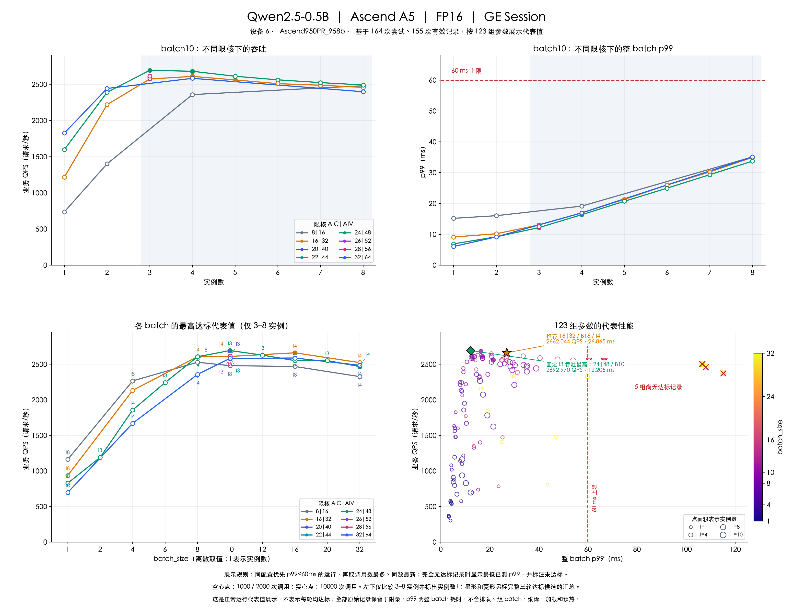
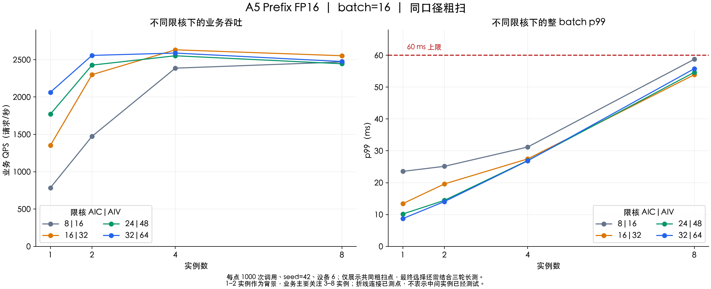
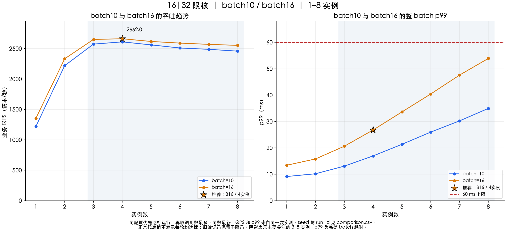
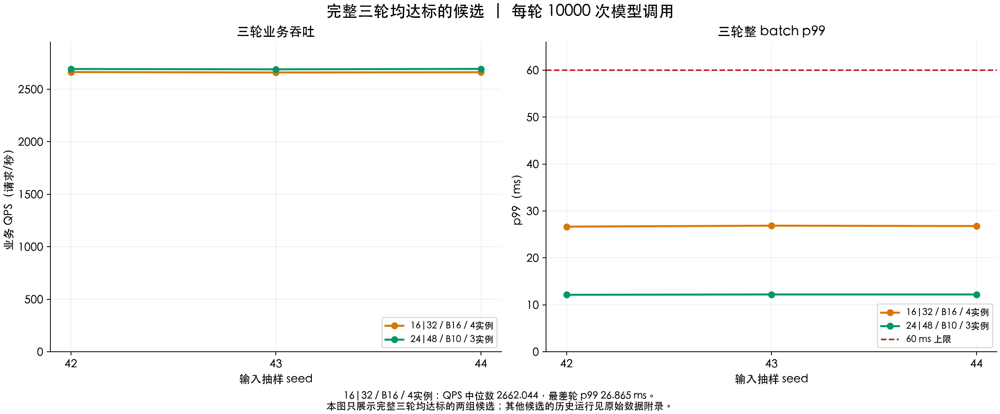

# Qwen2.5-0.5B A5 调优记录（2026-10-20，历史）

> 本文保留 2026-10-20 的配置、命令及全部 164 次尝试。后文“推荐”和“默认”均指当时实验；复现需使用对应版本及配置，不能直接把当前 YAML 当作历史快照。当前参数与最近报告入口见[文档索引](README.md)。

在 A5 Ascend950PR_958b、FP16、GE Session 和本次推荐业务输入分布下，建议采用 **限核 16|32、batch_size=16、实例数=4**。三轮各 10000 次模型调用的业务 QPS 中位数为 **2662.044 请求/秒**，最差轮整 batch p99 为 **26.865ms**，距 60ms 上限还有 **33.135ms**；三轮均零执行错误。

该配置面向主要使用 3–8 实例的场景，综合考虑吞吐、时延余量、限核预算与复测表现。固定使用 3 实例时，24|48、batch10 的三轮 QPS 中位数仍高约 **1.16%**，且 p99 更低；16|32、batch16、4 实例是当时业务偏好下的推荐工作点，并非所有配置中的绝对吞吐最高点。

测试日期：2026 年 10 月 20 日。完整测量记录、逐调用耗时和错误日志见[数据附录](#附录)。

## 测试范围与环境

| 项目 | 本次范围 |
|---|---|
| 设备 | 850-a5，设备 6，Ascend950PR_958b，物理 32 AIC / 64 AIV |
| 运行环境 | hejun-cann910-qwen25 容器，CANN 9.1.0，容器 Python 3.12.13 |
| 模型与路径 | Qwen2.5-0.5B，Prefix 自定义算子，GE Session 执行已有 AIR |
| 数值类型 | float16，precision_mode=force_fp16 |
| 调优目标 | 整 batch p99 严格小于 60ms，在此约束下提高业务 QPS |
| 主要使用区间 | 3–8 实例；1–2 实例作为背景，9–10 实例用于确认边界 |
| 粗扫 | AIC=8/16/24/32，AIV=2×AIC；batch=1/4/8/10/16/32；实例=1/2/4/8 |
| 精扫与邻域 | 增加实例 3/5/6/7，邻近 AIC=20/22/26/28、batch=2/6/12/20，交叉复测 |
| 定向补测 | 16|32 下 batch10、batch16 的 1–10 实例覆盖；batch10/4 实例 10000 次补测；batch10/5 实例三轮复测 |
| 候选长测 | 三个候选各三轮，每轮 10000 次调用，seed=42/43/44 |
| 异常点复测 | 全部8组超标参数各1轮10000次调用、seed42，新增80000次调用 |
| 本轮边界 | 性能测试；不新增精度、profiling、ATC 或 A3 测试；A3 无实机环境 |

粗扫与精扫采用分阶段选点：粗扫分支出现 p99≥60ms 后，停止继续增大该分支实例数；精扫围绕较好的配置展开。因此上述参数集合不是完整笛卡尔积。后续 16|32、batch10/16 的定向补测按要求补齐到 10 实例，不因超时延而剪枝。

| 记录分类 | 次数 | 处理方式 |
|---|---:|---|
| 执行成功、未观察到同卡共享 | 155 | 用于分析，累计 381000 次模型调用；包含 p99 超标记录 |
| 执行成功、同卡共享环境 | 7 | 保留原始数据，标记 shared_coarse，不参与配置排名 |
| 初始化失败 | 2 | 保留错误日志，性能字段留空，不补零 |
| 合计 | 164 | 全部汇总于文末附录，原始记录保留在服务器 work 目录 |

两次初始化失败均记录了 `AF_UNIX path too long`，后续使用项目内短路径 `work/tmp` 解决。历史 xllm 服务与 7 次测试发生重叠，相关记录已标记共享并排除。恢复测试后在每次运行前后检查设备 6 的驻留进程，未观察到其他同卡进程的记录仍可能出现尾延迟波动，不能把这些波动直接归因于共享负载。

## 输入数据与测量口径

每种 batch 使用固定的 100 个 case。batch10 沿用历史输入池；batch16 使用相同生成分布，保留每个 case 的历史前 10 条请求，并确定性扩展。序列长度采用 lognormal 分布，mu=4.997、sigma=0.167、最大长度 218，prefix 为 20–25，数据生成 seed=0。

| 输入池 | case 数 | 业务请求总数 | 总序列长度均值 | P99 | 最小值 | 最大值 | prefix |
|---|---:|---:|---:|---:|---:|---:|---|
| batch10 | 100 | 1000 | 149.345 | 212.020 | 89 | 218 | 20–25 |
| batch16 | 100 | 1600 | 149.769 | 218.000 | 84 | 218 | 20–25 |

100 个 case 的实际分布有采样差异。batch10 与 batch16 保持生成方法和历史请求一致，新增请求使两者实际统计量略有不同，比较结果对应各自保留的输入池。

性能输入按固定 seed 从池中有放回抽样。抽样顺序由全局调用编号决定，改变实例数不会改变相同 batch、seed 对应的全局输入序列。每个图实例在计时前预热输入池的全部 shape，统计阶段不包含首次编译和预热。

- **业务 QPS**：所有实例完成的业务请求总数 ÷ 测量段墙钟时间；固定 batch 下等于模型调用 QPS × batch_size。
- **模型调用 QPS**：完成的 batch 调用数 ÷ 测量段墙钟时间。推荐配置的三轮中位数约为 166.378 次模型调用/秒。
- **p99**：合并所有实例的逐调用耗时后，计算完整 batch 的 H2D、描述符处理、GE 执行与同步耗时分位数，不除以 batch_size。
- **计时边界**：不含服务排队、组 batch 等待、进程启动、GE 初始化、模型加载、编译和预热。因此 60ms 是本次后端执行约束，不能直接等同于线上端到端请求 SLA。

本次分别测量固定实例数下的稳态表现，没有测试实例持续增减过程。图中短测和补测的调用次数不同，均明确保留对应记录；三轮确认结果独立展示，不与短测做平均。

## 调优结果总览



图表基于全部 164 次尝试中的 155 次有效运行，按 123 组参数各展示一条代表记录。**同配置有达标记录时，主图不再显示该配置的异常记录或历史异常范围。**这里达标指零执行错误且整 batch p99<60ms。

达标记录中优先取调用数最多、同调用数最新的一次，不按最高 QPS 挑选；若同配置始终没有达标记录，则展示最低已测 p99 对应的完整记录，并标为未达标。QPS 和 p99 始终来自同一次实测。该规则跨 seed 选择，具体 seed 和 run_id 见数据附录，不表示每次运行都能达到展示值。

- **左上与右上**：固定 batch10，比较不同限核与 1–8 实例的代表吞吐和 p99；阴影为主要关注的 3–8 实例。
- **左下**：每种限核与 batch 在 3–8 实例的达标代表中选最高 QPS，并标注对应实例数 I。batch 为离散取值，连线不表示未测组合也已验证。
- **右下**：每组参数一个代表点，共 118 组达标、5 组尚无达标记录；颜色表示 batch，点面积表示实例数，红叉标明未达标。星形和绿色菱形另标两组完整三轮均达标候选的汇总。

可下载 [SVG 矢量图](../../images/qwen2.5-0.5b-a5-overview.svg) 放大查看。全部原始记录、历史异常和复测过程保留在[附录](#附录)。

## 限核对多实例的影响



图中各点均为 batch16、seed42、1000 次调用的共同粗扫点，便于比较限核本身的影响。1–2 实例时较大的核预算有利于降低时延、提高吞吐；到 4、8 实例时，16|32 已能提供较高的总吞吐，继续放大到 24|48 或 32|64 没有带来吞吐收益。

| 限核 AIC / AIV | 4 实例 QPS | 4 实例 p99 ms | 8 实例 QPS | 8 实例 p99 ms |
|---|---:|---:|---:|---:|
| 8 / 16 | 2386.643 | 31.195 | 2469.673 | 58.763 |
| 16 / 32 | 2632.373 | 27.467 | 2553.157 | 53.906 |
| 24 / 48 | 2552.477 | 26.962 | 2445.669 | 54.660 |
| 32 / 64 | 2588.835 | 26.875 | 2475.513 | 55.799 |

这支持在本次主要关注的多实例场景中优先选择 16|32。20/22/26/28 核的邻域只在 batch10、3 实例测试，32 核也没有覆盖每个精扫实例数；现有数据不能证明 16 核对所有模型、batch 和实例数都最优。GE 限核是配置的核预算，不表示物理核独占划分，也不能据此推导功耗或资源利用率。

## batch10 与 batch16 的实例趋势



下表与图使用同一组正常运行代表。batch10/5 实例与 batch16/4 实例采用 seed44，其余点为 seed42；调用数在表中列明。单轮代表值与后文三轮中位数采用不同口径。

| 实例数 | batch10 QPS | batch10 p99 ms | batch10 调用数 | batch16 QPS | batch16 p99 ms | batch16 调用数 |
|---:|---:|---:|---:|---:|---:|---:|
| 1 | 1217.997 | 9.142 | 1000 | 1352.094 | 13.415 | 1000 |
| 2 | 2219.423 | 10.189 | 1000 | 2332.563 | 15.802 | 2000 |
| 3 | 2573.887 | 13.077 | 2000 | 2650.808 | 20.612 | 2000 |
| 4 | 2610.622 | 16.954 | 10000 | 2662.044 | 26.781 | 10000 |
| 5 | 2561.132 | 21.346 | 10000 | 2617.427 | 33.619 | 2000 |
| 6 | 2510.025 | 25.981 | 2000 | 2590.521 | 40.427 | 2000 |
| 7 | 2488.390 | 30.237 | 2000 | 2569.820 | 47.588 | 2000 |
| 8 | 2458.190 | 34.963 | 1000 | 2553.157 | 53.906 | 1000 |

按展示代表值比较，batch16 从 3 实例增至 4 实例，QPS 增加约 **0.42%**，p99 从 20.612ms 增至 26.781ms；3 实例同样是时延更低、吞吐接近的备选。4 实例处于该组合的吞吐拐点，并完成三轮长测确认。继续增至 5–8 实例，QPS 逐步下降，p99 增至 53.906ms，因此没有必要为吞吐继续增加实例。

batch10 与 batch16 在 3–8 实例的展示代表均满足 p99<60ms；这个结论描述已选正常代表，完整重复运行记录见附录。batch16 的 9、10 实例尚无达标记录，不纳入推荐工作区间。

与 16|32、batch10、4 实例的 10000 次补测相比，batch16 推荐配置的三轮 QPS 中位数提高约 **1.97%**（2662.044 对 2610.622），代价是整 batch p99 更高（最差确认轮 26.865ms，对 batch10 单轮 16.954ms），仍有充足的 60ms 余量。如果优先追求更低时延，batch10 仍是合理备选。

batch10/5 实例展示其 10000 次调用的达标代表：**2561.132 QPS、p99 21.346ms**。该点与曲线中其余点均使用正常优先的展示规则，历史异常不再叠加在主图中。

## 复测覆盖与展示代表

对原超标集合中的 8 组参数均完成一次 10000 调用、seed42 的复测，复用原输入池和 AIR。下表按累计实测记录汇总正常优先代表，**不等同于这次复测的八条结果**；同配置已有达标记录时，其历史异常仅放在附录。没有达标记录的配置继续列明未达标。

| AIC / AIV | batch | 实例 | 业务 QPS | p99 ms | 调用数 | seed | 展示状态 |
|---|---:|---:|---:|---:|---:|---:|---|
| 24 / 48 | 10 | 4 | 2681.311 | 16.370 | 10000 | 42 | 已有达标记录 |
| 24 / 48 | 32 | 4 | 2467.905 | 58.364 | 10000 | 42 | 已有达标记录 |
| 16 / 32 | 10 | 5 | 2561.132 | 21.346 | 10000 | 44 | 已有达标记录 |
| 16 / 32 | 16 | 9 | 2546.279 | 60.334 | 2000 | 42 | 尚无达标记录 |
| 16 / 32 | 16 | 10 | 2547.603 | 66.630 | 10000 | 42 | 尚无达标记录 |
| 16 / 32 | 32 | 8 | 2503.219 | 106.549 | 10000 | 42 | 尚无达标记录 |
| 8 / 16 | 32 | 8 | 2374.773 | 115.170 | 10000 | 42 | 尚无达标记录 |
| 32 / 64 | 32 | 8 | 2461.272 | 107.995 | 1000 | 42 | 尚无达标记录 |

本次复测均零执行错误，未运行精度、profiling、ATC 或 A3；各限核算子库和输入池 SHA256 与历史一致。该轮复测结束时曾恢复当时默认配置；当前已应用16|32、batch16、4实例，见下文。实际本轮八条结果、前后对照及全部历史记录见[附录](#附录)中的逐轮结果及复测对照表。

## 三轮达标候选与单次正常代表



图中只展示完整三轮均零执行错误且 p99<60ms 的两组候选，每轮 10000 次调用，seed=42/43/44。前两行用三轮 QPS 中位数和最差轮 p99；第三行是 24|48、batch10、4实例的单次达标代表，不将它描述为三轮均达标。

| AIC / AIV | batch | 实例 | 业务 QPS | p99 ms | 统计口径 |
|---|---:|---:|---:|---:|---|
| 16 / 32 | 16 | 4 | 2662.044 | 26.865 | 三轮中位数 QPS、最差轮 p99，完整三轮达标 |
| 24 / 48 | 10 | 3 | 2692.970 | 12.205 | 三轮中位数 QPS、最差轮 p99，完整三轮达标 |
| 24 / 48 | 10 | 4 | 2681.311 | 16.370 | 单次 10000 调用的正常代表 |

推荐配置的逐轮结果如下。每轮包含 160000 条业务请求，三轮共 480000 条；测量段约 60 秒/轮，不代表小时级服务稳定性测试。

| seed | 模型调用数 | 业务 QPS | p50 ms | p99 ms | 测量段 s | 执行错误 |
|---:|---:|---:|---:|---:|---:|---:|
| 42 | 10000 | 2663.753 | 23.899 | 26.657 | 60.066 | 0 |
| 43 | 10000 | 2659.738 | 23.902 | 26.865 | 60.156 | 0 |
| 44 | 10000 | 2662.044 | 23.898 | 26.781 | 60.104 | 0 |

24|48、batch10、3 实例在完整三轮确认中取得更高吞吐与更低时延，可作为固定 3 实例部署的备选。单次正常代表与完整三轮达标属于不同验证口径。

## 为什么选择 16|32 和 batch16 以及 4 实例

1. **16|32 适合主要使用的多实例区间。** batch16 的共同粗扫中，4、8 实例吞吐均高于 8|16、24|48、32|64；不需要为了 1–2 实例的单实例性能扩大核预算。
2. **batch16 在 4 实例获得小幅吞吐收益。** 相比 batch10/4 实例约提高 1.97%，整 batch p99 仍明显低于 60ms。收益不大，但三轮确认中的吞吐范围为 2659.738–2663.753 QPS。
3. **4 实例位于该组合的吞吐拐点。** 3 实例吞吐已接近饱和，4 实例最高且完成三轮确认；5–8 实例吞吐下降、时延增加，增加实例没有改善目标。
4. **余量足够且经过重复验证。** 最差轮 p99 26.865ms，比上限低 33.135ms，避免直接选用接近边界的 8 实例工作点。

选择该配置接受了相对于 24|48、batch10、3 实例约 1.15% 的 QPS 损失，以及更高的 p99，换取较小的单图核预算和 batch16 在 3–8 实例的已测覆盖。对于实际固定为 4 实例的部署，它也是当前三个长测候选中通过全部三轮的配置。实例数变化时可优先沿用 16|32、batch16，但不应据此认为需要主动增加到 8 实例。

## 本轮实验配置

已将推荐配置应用到 `models/qwen2.5-0.5b/config/model.yaml`：**A5 限核 16|32、batch_size=16、实例数=4**。实际配置节选如下；预热、默认采样次数和 seed 保持原值。

```yaml
data:
  directory: models/qwen2.5-0.5b/io/inputs
  params:
    count: 100
    batch_size: 16
benchmark:
  instances: 4
  warmup: 10
  iterations: 1000
  seed: 42
platforms:
  a5:
    build:
      options:
        aicore_num: "16|32"
```

已核对该输入池包含100组实际 batch16 输入，池摘要与本报告的 batch16 实测一致；默认目录已恢复为模型内固定路径，原 batch10 输入、golden 和 output 保留于 work/qwen2.5-0.5b/validation/history-batch10。Prefix 源码 `third_party/ascend-ops/prefix-attention/cannbot-dsl/ge/src/kernel_launcher.h` 已同步为 `kAicCores=16`，并通过独立 `prepare` 重建安装；安装库 SHA256 与本报告的16核实测库一致。当时 A3 的限核配置为12|24。

独立 `bench` 直接读取当前 YAML，复用已有 AIR、输入和依赖，不自动补跑前置步骤。本报告的性能值仍来自已保存的三轮长测。随后框架修改的验证另记于 docs/qwen2.5-0.5b/validation.md，不加入本报告164次调优尝试，也不改变图表和附录中的原始测量。batch16 全量精度不能由历史 batch10 验收推断。

## 性能测试复现

在 hejun-cann910-qwen25 容器中，使用已有 AIR、对应 batch 的实际输入池及已安装算子。当时默认读取16|32、batch16、4实例配置；设备号按运行环境传入。使用容器 Python：

```bash
cd /home/h00909914/ascend-ge-adapters
source /usr/local/Ascend/ascend-toolkit/latest/set_env.sh
export OPENBLAS_NUM_THREADS=8 OMP_NUM_THREADS=8 MKL_NUM_THREADS=8
mkdir -p work/tmp
export TMPDIR="$PWD/work/tmp"
python3 -m core.pipeline bench --config models/qwen2.5-0.5b/config/model.yaml --device 6
```

只比较其他实例数时，通过命令覆盖，不修改 YAML：

```bash
python3 -m core.pipeline bench --config models/qwen2.5-0.5b/config/model.yaml --device 6 --instances 8
```

复现三轮长测时，在同一个 model.yaml 中将 benchmark.iterations 设为10000，依次设置 benchmark.seed 为42、43、44，每次执行一次 bench。各轮均要求零执行错误、整 batch p99 严格小于60ms，候选吞吐取三轮业务 QPS 中位数，时延取最差轮 p99。该结果覆盖三轮测量段，不代表小时级稳定性验证。完成后，日常默认采样可恢复 iterations=1000、seed=42，warmup 保持10。

切换 batch 时，让 data.directory 指向该 batch 的实际输入池；需要生成输入时，显式执行 data，并提供权重环境变量 QWEN_MODEL_DIR。改变限核时，同步修改 platforms.a5.build.options.aicore_num 与 Prefix 源码的 kAicCores，再显式执行 prepare 重建安装。直接 bench 读取当前 YAML，不运行精度或其他前置步骤，不需要原始权重环境变量。

运行产物统一位于项目 work 目录；保持 TMPDIR 为项目内短路径 work/tmp，以避免 CANN 多进程初始化出现 AF_UNIX path too long。不为每个实例生成临时 YAML，不依赖 resolve、build.json、lock.json 或 cases.json。

## 附录

本附录保留 2026 年 10 月 20 日的全部 164 次性能测量尝试，包含共享环境、初始化失败与 p99 超标记录。性能汇总不覆盖或修改原始测量；正文的工程推荐与历史自动选优记录可能不同，均可通过原始 run_id 追溯。

### 数据保留与追溯

本文集中保存测试范围、配置选择、趋势图、完整 164 次测试结果、候选逐轮结果、异常复测对照和图表来源运行编号。文档图片统一保存在项目根目录 images/，平铺存放，文件名包含模型、平台与用途。阅读结果不需要额外的数据附件。表格数值显示三位小数，完整数值仍可从原始运行记录追溯。

原始运行保留在服务器项目的 work/qwen2.5-0.5b/results/<run_id>/，可按表中的 run_id 找到 result.json、逐调用 requests.csv 和运行日志；162 次成功记录均保留逐调用数据，两次初始化失败保留错误日志。实验脚本、输入池与审计日志继续保留在 work/qwen2.5-0.5b/tuning/a5-cbi-20261020/。文档目录的 CSV 与压缩副本已删除，服务器原始记录保持不变。

### 环境与输入标识

所有性能记录来自同一张设备 6、Ascend950PR_958b，AIC/AIV 物理核数为 32/64，FP16、GE Session。本次没有新增精度或 profiling 运行。

| 对象 | SHA256 或位置 |
|---|---|
| batch10 输入池 SHA256 | 69892db56429877350ce7f55480f1f3f831e6342e9a1f14ff7be3235986a55a4 |
| batch16 输入池 SHA256 | 21defc288cc9848d6f1f71f8a8c6d900327963431e57e77125274b5f5fc8c85b |
| batch32 输入池 SHA256 | 4e86bae942bc659d3d9ff6fc5ecf63899f62d1e2b7f70565babc0d6dd221c939 |
| 16 核实测 libcust_opapi.so SHA256 | 51d16a5bed62e49e911cd7f15121c096ea0a805a6d45f35ef5d7fea7b4101adc |
| 历史复测结束时恢复的 24 核库 SHA256 | e1762da405fdf9a01040e37542310789a0572a69aa680437749e04b409ca94ee |
| 原始结果根目录 | /home/h00909914/ascend-ge-adapters/work/qwen2.5-0.5b/results |
| 实验根目录 | /home/h00909914/ascend-ge-adapters/work/qwen2.5-0.5b/tuning/a5-cbi-20261020 |

输入池 SHA256 采用实验脚本对加载后 case 列表调用 core.contracts.digest 的口径，不等同于单个 .npy 输入文件的文件摘要。每次 result.json 的 experiment 保存池摘要、算子库摘要、kAicCores 和运行前后设备进程观察值。

### 图表的正常优先展示规则

[四联总览 PNG](../../images/qwen2.5-0.5b-a5-overview.png) 与 [SVG](../../images/qwen2.5-0.5b-a5-overview.svg) 依据文末全部测试结果选择展示代表，原始测量保持不变。164 次尝试中，155 次执行成功且未观察到共享；同配置去重后为 123 组，其中 118 组至少有一次 p99<60ms，5 组始终未达标。

配置身份包含模型、后端、芯片、设备、dtype、AIC/AIV预算、kernel_aic_cores、batch、实例数、输入池 SHA256 和算子库 SHA256。先排除执行失败、非零错误、shared_ 阶段及 profiling 记录，再按以下规则选择，允许跨 seed：

1. 同配置有 p99<60ms 的记录时，仅从这些达标记录中选择调用数最多、同调用数最新的一条；不按最高 QPS 选择。
2. 同配置完全没有达标记录时，选择最低已测 p99 对应的一条；p99相同再优先调用数较多、较新的记录。这些点仍标为未达标。
3. QPS、p99、调用数、seed 均来自同一次原始运行，不拼接不同测量。展示代表不是重复运行的稳定性统计。

主图、1–8实例曲线和正文代表表采用上述规则，同配置被替代的历史异常和异常范围不在主图重复显示；原始汇总值均保留在本附录的完整测试结果表中，逐调用记录保留在服务器。16|32、batch10/16、1–8实例的16条展示记录对应的 run_id 见下表。

四联图上排固定 batch10、实例1–8；左下每个限核与batch从3–8实例的达标代表中取最高QPS并标出I，batch按离散值排列；右下只画123个配置代表，颜色为batch、面积为实例数，红叉表示无达标记录。空心点为1000/2000调用，实心点为10000调用。额外星形与绿色菱形仍表示两组完整三轮均达标候选的 QPS中位数及最差轮p99。长测图只显示完整三轮均达标的两组候选，其他历史轮次在本附录保留。

### 主曲线对应的运行编号

下表对应正文 batch10/16、1–8实例的图和表，限核均为16|32。可通过 run_id 在文末完整结果表找到同一次运行的性能值；seed 与调用数随记录保留。

| batch | 实例 | seed | 调用数 | run_id |
|---:|---:|---:|---:|---|
| 10 | 1 | 42 | 1000 | 20261020T033116-b78b5db0 |
| 10 | 2 | 42 | 1000 | 20261020T033203-43772791 |
| 10 | 3 | 42 | 2000 | 20261020T062322-3644e5de |
| 10 | 4 | 42 | 10000 | 20261020T065604-07920554 |
| 10 | 5 | 44 | 10000 | 20261020T074640-cb5bc567 |
| 10 | 6 | 42 | 2000 | 20261020T071303-ae3a5156 |
| 10 | 7 | 42 | 2000 | 20261020T071524-09da74bc |
| 10 | 8 | 42 | 1000 | 20261020T043149-91a1e787 |
| 16 | 1 | 42 | 1000 | 20261020T043316-90a90c16 |
| 16 | 2 | 42 | 2000 | 20261020T061607-eadb281b |
| 16 | 3 | 42 | 2000 | 20261020T061711-21dfa3f0 |
| 16 | 4 | 44 | 10000 | 20261020T062834-277988e8 |
| 16 | 5 | 42 | 2000 | 20261020T055253-65342824 |
| 16 | 6 | 42 | 2000 | 20261020T055411-5e519162 |
| 16 | 7 | 42 | 2000 | 20261020T055536-9677204f |
| 16 | 8 | 42 | 1000 | 20261020T043616-d328b979 |

### 9–10 实例的已测边界

下表补充1–8实例主曲线之外的边界，限核均为16|32，继续使用正常优先的代表选择规则。每行来自一次实际运行，不作为完整三轮稳定性结论；batch16在9、10实例均尚无达标记录。

| run_id | batch | 实例 | seed | 调用数 | 业务 QPS | p99 ms | 状态 |
|---|---:|---:|---:|---:|---:|---:|---|
| 20261020T071654-2a914eee | 10 | 9 | 42 | 2000 | 2442.597 | 38.881 | 达标 |
| 20261020T071841-66fbae71 | 10 | 10 | 42 | 2000 | 2444.018 | 46.268 | 达标 |
| 20261020T072050-4a271875 | 16 | 9 | 42 | 2000 | 2546.279 | 60.334 | 未达标 |
| 20261020T084209-83fd7fa2 | 16 | 10 | 42 | 10000 | 2547.603 | 66.630 | 未达标 |

### 阶段与实际覆盖

| 阶段 | 尝试次数 | 用途 |
|---|---:|---|
| baseline | 4 | 初始性能基准尝试，2 成功、2 初始化失败；不是生成 golden 的 baseline 步骤 |
| coarse | 95 | 1000 次调用的粗扫 |
| shared_coarse | 7 | 与其他服务重叠，保留但不排名 |
| fine | 12 | 较优组合的实例数精扫 |
| neighborhood | 11 | 邻近核数与 batch 扫描 |
| cross | 6 | 候选交叉复测 |
| closing | 1 | 16核、batch10、3实例补点 |
| confirm | 9 | 三个候选各三轮 10000 次确认 |
| followup | 1 | 16核、batch10、4实例 10000 次补测 |
| complete16 | 7 | 补齐16核、batch10/16、1–10实例的7个缺失点 |
| retest5 | 3 | 16核、batch10、5实例三轮 10000 次复测 |
| anomaly_retest | 8 | 全部8组超标参数各一次10000调用复测，seed42 |

初轮粗扫、精扫与三候选确认共145次尝试；后续依次增加1次 batch10/4实例长测、7次1–10实例缺失点补齐、3次 batch10/5实例长测，以及8次异常参数复测，合计164次。初轮已将16|32、batch10、3实例纳入 closing 补测，避免遗漏粗扫中相近的点，计入上述145次尝试。扫描选点策略保留在实验脚本，项目框架提供独立运行和结果输出能力。

以下是执行成功且未观察到共享的实际核预算覆盖。batch 和实例数两列分别为该核预算下的集合，不表示集合之间的所有组合均已测量；完整组合与重复次数见本节末尾的全部测试结果表。

| AIC / AIV | 记录数 | 已测 batch 集合 | 已测实例数集合 |
|---|---:|---|---|
| 8 / 16 | 25 | 1, 4, 8, 10, 16, 32 | 1, 2, 4, 8 |
| 16 / 32 | 56 | 1, 4, 8, 10, 16, 32 | 1, 2, 3, 4, 5, 6, 7, 8, 9, 10 |
| 20 / 40 | 1 | 10 | 3 |
| 22 / 44 | 1 | 10 | 3 |
| 24 / 48 | 45 | 1, 2, 4, 6, 8, 10, 12, 16, 20, 32 | 1, 2, 3, 4, 5, 6, 7, 8 |
| 26 / 52 | 1 | 10 | 3 |
| 28 / 56 | 1 | 10 | 3 |
| 32 / 64 | 25 | 1, 4, 8, 10, 16, 32 | 1, 2, 4, 8 |

### 字段与计算方法

模型、GE 后端、设备、数值类型和输入分布见正文，输入池及算子库标识见本附录。表中每一行对应一次真实运行，数值不跨运行拼接。

| 字段 | 含义与单位 |
|---|---|
| run_id | 唯一运行编号；前缀包含 UTC 起始时间，精确到秒，可定位服务器原始记录 |
| 阶段 | 粗扫、精扫、确认或复测阶段；baseline 表示初始性能基准 |
| AIC / AIV | GE 配置的核预算；对应 Prefix kAicCores=AIC，AIV=2×AIC |
| batch、实例、seed | 实际 batch、图实例数及输入采样 seed |
| 调用数 | 完成/请求的模型调用数，跨全部实例合计 |
| 业务 QPS | 所有实例完成的业务请求数 ÷ 测量段墙钟秒数；模型调用 QPS 可用业务 QPS ÷ batch 计算 |
| p50、p99、max ms | 全部实例合并后的整 batch H2D、描述符、执行及同步耗时；max 为单次最大值 |
| 错误数 | 运行器统计的执行错误数；初始化失败用“—” |
| 状态 | 零错误且 p99<60ms 为达标；共享、初始化失败、超标均单独标明；max 不参与本次 p99 约束判定 |

分位数沿用 C++ 运行器定义：将 N 条逐调用耗时升序排列，p50 取下标 N//2，p99 取 min(floor(0.99×N), N−1)，均从 0 开始。吞吐由测量段墙钟时间计算；统计区间不包含初始化、编译、加载及预热。不能对各实例 p99 求平均来得到全局 p99，也不能用多轮 QPS 算术平均代替合并后的墙钟吞吐。

已从服务器原始逐调用记录审计全部162次成功运行的调用数、实例、实际 batch、分位数、错误数与墙钟吞吐，并核对 FP16、核预算、算子库和输入标识，未发现不一致。7次共享记录包含在审计范围内，选优时排除。

### 三个候选的逐轮原始汇总

初轮三个长测候选的统计结论如下；逐轮数据全部保留。当时默认根据后续主要使用3–8实例的业务偏好确定，见正文配置选择。

| AIC / AIV | batch | 实例 | QPS 中位数 | 最差轮 p99 ms | 三轮均达标 |
|---|---:|---:|---:|---:|---|
| 16 / 32 | 16 | 4 | 2662.044 | 26.865 | 是 |
| 24 / 48 | 10 | 3 | 2692.970 | 12.205 | 是 |
| 24 / 48 | 10 | 4 | 2009.007 | 97.974 | 否 |

以下指标直接来自各次 result.json，未对异常轮做剔除。逐调用记录按 run_id 保留在服务器 work 目录。

| run_id | AIC / AIV | batch | 实例 | seed | 调用数 | 业务 QPS | p50 ms | p99 ms | 测量段 s |
|---|---|---:|---:|---:|---:|---:|---:|---:|---:|
| 20261020T062426-0b19d1c6 | 16 / 32 | 16 | 4 | 42 | 10000 | 2663.753 | 23.899 | 26.657 | 60.066 |
| 20261020T062630-6bbefb83 | 16 / 32 | 16 | 4 | 43 | 10000 | 2659.738 | 23.902 | 26.865 | 60.156 |
| 20261020T062834-277988e8 | 16 / 32 | 16 | 4 | 44 | 10000 | 2662.044 | 23.898 | 26.781 | 60.104 |
| 20261020T063059-ae0cd8b4 | 24 / 48 | 10 | 3 | 42 | 10000 | 2692.970 | 11.131 | 12.137 | 37.134 |
| 20261020T063229-a635941e | 24 / 48 | 10 | 3 | 43 | 10000 | 2689.704 | 11.148 | 12.205 | 37.179 |
| 20261020T063400-bc5f4da7 | 24 / 48 | 10 | 3 | 44 | 10000 | 2693.797 | 11.129 | 12.203 | 37.122 |
| 20261020T063534-842bfc73 | 24 / 48 | 10 | 4 | 42 | 10000 | 1588.100 | 19.927 | 94.959 | 62.968 |
| 20261020T063840-f05a126e | 24 / 48 | 10 | 4 | 43 | 10000 | 2009.007 | 15.136 | 97.974 | 49.776 |
| 20261020T064131-4068fc7b | 24 / 48 | 10 | 4 | 44 | 10000 | 2077.257 | 15.300 | 57.335 | 48.140 |

### batch10 在 5 实例的历史异常与三轮复测

所有记录均为 16|32、设备 6、batch10、5 实例、零执行错误。原异常与复测均保留，不将初始化成功或零错误等同于 p99 达标。

| run_id | seed | 调用数 | 业务 QPS | p99 ms | 前 2000 次 p99 ms | 结论 |
|---|---:|---:|---:|---:|---:|---|
| 20261020T071040-50d745bb | 42 | 2000 | 1258.728 | 199.710 | 199.710 | p99 超标 |
| 20261020T074232-bbcf00b9 | 42 | 10000 | 2236.570 | 77.888 | 21.417 | p99 超标 |
| 20261020T074440-8d0cf542 | 43 | 10000 | 2385.928 | 56.918 | 34.675 | 达标 |
| 20261020T074640-cb5bc567 | 44 | 10000 | 2561.132 | 21.346 | 21.344 | 达标 |

已核对 seed42 复测的前2000次输入编号和实际样本数，与原异常运行一致；核对结果仍不能确定后续尾延迟波动的原因。

### 八组参数复测前后对照

以下是复测过程的完整对照，保留异常值；正文和主图按累计数据的正常优先规则另选代表。历史列取原 seed42 中调用数最多、同数最新的一次。本次八条新运行中有2条达标、6条仍超标，均零执行错误，不等同于累计展示代表的达标数量。

| AIC / AIV | batch | 实例 | 历史调用数 | 历史 QPS | 历史 p99 ms | 本轮调用数 | 本轮 QPS | 本轮 p99 ms | 本轮判定 |
|---|---:|---:|---:|---:|---:|---:|---:|---:|---|
| 24 / 48 | 10 | 4 | 10000 | 1588.100 | 94.959 | 10000 | 2681.311 | 16.370 | 本轮达标 |
| 24 / 48 | 32 | 4 | 1000 | 2113.108 | 151.993 | 10000 | 2467.905 | 58.364 | 本轮达标 |
| 16 / 32 | 10 | 5 | 10000 | 2236.570 | 77.888 | 10000 | 2352.652 | 66.642 | 仍超标 |
| 16 / 32 | 16 | 9 | 2000 | 2546.279 | 60.334 | 10000 | 2549.438 | 60.945 | 仍超标 |
| 16 / 32 | 16 | 10 | 2000 | 2539.327 | 67.011 | 10000 | 2547.603 | 66.630 | 仍超标 |
| 16 / 32 | 32 | 8 | 1000 | 2495.433 | 107.267 | 10000 | 2503.219 | 106.549 | 仍超标 |
| 8 / 16 | 32 | 8 | 1000 | 2369.097 | 115.794 | 10000 | 2374.773 | 115.170 | 仍超标 |
| 32 / 64 | 32 | 8 | 1000 | 2461.272 | 107.995 | 10000 | 2395.447 | 214.345 | 仍超标 |

### 本轮异常复测的原始运行

每组一次10000调用，seed42，phase=anomaly_retest；历史记录全部保留。

| run_id | AIC / AIV | batch | 实例 | QPS | p99 ms |
|---|---|---:|---:|---:|---:|
| 20261020T083137-7d57126d | 24 / 48 | 10 | 4 | 2681.311 | 16.370 |
| 20261020T083314-35437029 | 24 / 48 | 32 | 4 | 2467.905 | 58.364 |
| 20261020T083713-551b181e | 16 / 32 | 10 | 5 | 2352.652 | 66.642 |
| 20261020T083920-61134888 | 16 / 32 | 16 | 9 | 2549.438 | 60.945 |
| 20261020T084209-83fd7fa2 | 16 / 32 | 16 | 10 | 2547.603 | 66.630 |
| 20261020T084507-fec60a90 | 16 / 32 | 32 | 8 | 2503.219 | 106.549 |
| 20261020T084915-fe935563 | 8 / 16 | 32 | 8 | 2374.773 | 115.170 |
| 20261020T085407-2f2532ff | 32 / 64 | 32 | 8 | 2395.447 | 214.345 |

本轮 B10/I5 的前2000次 p99 为21.409ms，整轮为66.642ms。新旧164次运行的原始记录均保留在服务器。

### 全部测试结果（164 次）

下表保留全部实际测试，按 UTC 起始时间排序。QPS 单位为业务请求/秒，p50/p99/max 单位为毫秒，均为完整 batch；调用数为跨全部实例的完成/请求数。失败项用“—”，不补零。

共享记录不参与排名；“达标”仅表示该次运行零执行错误且 p99<60ms，不等同于三轮确认或精度验收。历史异常在本表保留，正文和图按正常优先规则展示。

| run_id | 阶段 | AIC / AIV | batch | 实例 | seed | 调用数 | 业务 QPS | p50 ms | p99 ms | max ms | 错误数 | 状态 |
|---|---|---|---:|---:|---:|---|---:|---:|---:|---:|---:|---|
| 20261020T025956-6a58d76c | baseline | 16 / 32 | 10 | 1 | 42 | —/1000 | — | — | — | — | — | 初始化失败 |
| 20261020T030020-e4ad5694 | baseline | 16 / 32 | 10 | 4 | 42 | —/1000 | — | — | — | — | — | 初始化失败 |
| 20261020T030210-620d26d1 | baseline | 16 / 32 | 10 | 1 | 42 | 1000/1000 | 1220.826 | 8.205 | 9.138 | 15.631 | 0 | 达标 |
| 20261020T030258-c5460a1f | baseline | 16 / 32 | 10 | 4 | 42 | 1000/1000 | 2602.799 | 15.236 | 17.040 | 42.126 | 0 | 达标 |
| 20261020T030423-a8d98a9d | coarse | 8 / 16 | 10 | 1 | 42 | 1000/1000 | 737.590 | 13.447 | 15.202 | 22.899 | 0 | 达标 |
| 20261020T030516-67f859a1 | coarse | 8 / 16 | 10 | 2 | 42 | 1000/1000 | 1401.256 | 14.253 | 16.051 | 26.775 | 0 | 达标 |
| 20261020T030610-50aefff8 | coarse | 8 / 16 | 10 | 4 | 42 | 1000/1000 | 2359.023 | 16.812 | 19.153 | 46.762 | 0 | 达标 |
| 20261020T030713-ce879dd9 | coarse | 8 / 16 | 10 | 8 | 42 | 1000/1000 | 2481.012 | 31.894 | 35.099 | 89.514 | 0 | 达标 |
| 20261020T030842-532fd791 | coarse | 8 / 16 | 16 | 1 | 42 | 1000/1000 | 785.009 | 19.790 | 23.553 | 30.291 | 0 | 达标 |
| 20261020T030943-09a311b3 | coarse | 8 / 16 | 16 | 2 | 42 | 1000/1000 | 1473.131 | 21.121 | 25.134 | 40.045 | 0 | 达标 |
| 20261020T031041-d89a65d4 | coarse | 8 / 16 | 16 | 4 | 42 | 1000/1000 | 2386.643 | 25.965 | 31.195 | 58.364 | 0 | 达标 |
| 20261020T031149-0eea3a2a | coarse | 8 / 16 | 16 | 8 | 42 | 1000/1000 | 2469.673 | 50.984 | 58.763 | 105.843 | 0 | 达标 |
| 20261020T031323-c93c666e | coarse | 8 / 16 | 32 | 1 | 42 | 1000/1000 | 808.585 | 38.661 | 43.481 | 46.697 | 0 | 达标 |
| 20261020T031445-c8b302c5 | coarse | 8 / 16 | 32 | 2 | 42 | 1000/1000 | 1482.336 | 42.795 | 47.094 | 57.647 | 0 | 达标 |
| 20261020T031557-5a05ec8f | coarse | 8 / 16 | 32 | 4 | 42 | 1000/1000 | 2327.110 | 54.706 | 59.835 | 85.850 | 0 | 达标 |
| 20261020T031718-cfab4a6c | coarse | 8 / 16 | 32 | 8 | 42 | 1000/1000 | 2369.097 | 107.674 | 115.794 | 162.659 | 0 | 超标 |
| 20261020T031914-762f3a8f | coarse | 8 / 16 | 8 | 1 | 42 | 1000/1000 | 695.893 | 11.481 | 12.932 | 17.230 | 0 | 达标 |
| 20261020T032006-ef5ba147 | coarse | 8 / 16 | 8 | 2 | 42 | 1000/1000 | 1329.682 | 12.039 | 13.451 | 26.807 | 0 | 达标 |
| 20261020T032056-de8a1ddc | coarse | 8 / 16 | 8 | 4 | 42 | 1000/1000 | 2317.199 | 13.933 | 15.638 | 44.547 | 0 | 达标 |
| 20261020T032159-15bf0b1f | coarse | 8 / 16 | 8 | 8 | 42 | 1000/1000 | 2529.196 | 25.135 | 28.087 | 77.355 | 0 | 达标 |
| 20261020T032322-f5b520e2 | coarse | 8 / 16 | 4 | 1 | 42 | 1000/1000 | 574.087 | 7.058 | 8.315 | 15.919 | 0 | 达标 |
| 20261020T032406-6c56ad55 | coarse | 8 / 16 | 4 | 2 | 42 | 1000/1000 | 1098.035 | 7.365 | 8.620 | 20.554 | 0 | 达标 |
| 20261020T032454-2900bd3e | coarse | 8 / 16 | 4 | 4 | 42 | 1000/1000 | 1952.499 | 8.313 | 9.622 | 34.361 | 0 | 达标 |
| 20261020T032553-c21a5227 | coarse | 8 / 16 | 4 | 8 | 42 | 1000/1000 | 2266.654 | 14.035 | 15.983 | 65.021 | 0 | 达标 |
| 20261020T032712-c6fd34a2 | coarse | 8 / 16 | 1 | 1 | 42 | 1000/1000 | 302.204 | 3.277 | 3.955 | 10.827 | 0 | 达标 |
| 20261020T032752-fe740970 | coarse | 8 / 16 | 1 | 2 | 42 | 1000/1000 | 539.692 | 3.617 | 4.375 | 19.486 | 0 | 达标 |
| 20261020T032841-7284f41d | coarse | 8 / 16 | 1 | 4 | 42 | 1000/1000 | 910.305 | 4.262 | 5.077 | 32.228 | 0 | 达标 |
| 20261020T032937-b60a702a | coarse | 8 / 16 | 1 | 8 | 42 | 1000/1000 | 1162.902 | 6.503 | 8.717 | 63.419 | 0 | 达标 |
| 20261020T033116-b78b5db0 | coarse | 16 / 32 | 10 | 1 | 42 | 1000/1000 | 1217.997 | 8.245 | 9.142 | 14.358 | 0 | 达标 |
| 20261020T033203-43772791 | coarse | 16 / 32 | 10 | 2 | 42 | 1000/1000 | 2219.423 | 8.973 | 10.189 | 24.601 | 0 | 达标 |
| 20261020T033253-c2271339 | coarse | 16 / 32 | 10 | 4 | 42 | 1000/1000 | 2605.363 | 15.267 | 17.120 | 43.640 | 0 | 达标 |
| 20261020T033352-3c8a8b67 | shared_coarse | 16 / 32 | 10 | 8 | 42 | 1000/1000 | 2474.185 | 32.096 | 34.653 | 85.580 | 0 | 共享，排除 |
| 20261020T033514-bac8ad06 | shared_coarse | 16 / 32 | 16 | 1 | 42 | 1000/1000 | 1353.235 | 11.501 | 13.452 | 21.330 | 0 | 共享，排除 |
| 20261020T033605-8f021060 | shared_coarse | 16 / 32 | 16 | 2 | 42 | 1000/1000 | 2336.045 | 13.322 | 15.796 | 28.137 | 0 | 共享，排除 |
| 20261020T033658-0dfc9702 | shared_coarse | 16 / 32 | 16 | 4 | 42 | 1000/1000 | 2609.490 | 23.758 | 27.542 | 199.075 | 0 | 共享，排除 |
| 20261020T033822-3f765174 | shared_coarse | 16 / 32 | 16 | 8 | 42 | 1000/1000 | 2487.621 | 49.692 | 58.467 | 284.253 | 0 | 共享，排除 |
| 20261020T034004-cc26b646 | shared_coarse | 16 / 32 | 32 | 1 | 42 | 1000/1000 | 1409.435 | 22.597 | 24.737 | 34.907 | 0 | 共享，排除 |
| 20261020T034308-38b0fe32 | shared_coarse | 16 / 32 | 32 | 2 | 42 | 1000/1000 | 2337.794 | 27.277 | 29.748 | 44.085 | 0 | 共享，排除 |
| 20261020T043149-91a1e787 | coarse | 16 / 32 | 10 | 8 | 42 | 1000/1000 | 2458.190 | 32.360 | 34.963 | 86.772 | 0 | 达标 |
| 20261020T043316-90a90c16 | coarse | 16 / 32 | 16 | 1 | 42 | 1000/1000 | 1352.094 | 11.503 | 13.415 | 18.704 | 0 | 达标 |
| 20261020T043410-5aab96ed | coarse | 16 / 32 | 16 | 2 | 42 | 1000/1000 | 2299.878 | 13.378 | 19.604 | 82.848 | 0 | 达标 |
| 20261020T043510-007d4590 | coarse | 16 / 32 | 16 | 4 | 42 | 1000/1000 | 2632.373 | 23.878 | 27.467 | 91.225 | 0 | 达标 |
| 20261020T043616-d328b979 | coarse | 16 / 32 | 16 | 8 | 42 | 1000/1000 | 2553.157 | 49.766 | 53.906 | 105.892 | 0 | 达标 |
| 20261020T043751-08621b10 | coarse | 16 / 32 | 32 | 1 | 42 | 1000/1000 | 1408.644 | 22.673 | 24.800 | 29.385 | 0 | 达标 |
| 20261020T043857-609c920f | coarse | 16 / 32 | 32 | 2 | 42 | 1000/1000 | 2336.577 | 27.281 | 29.934 | 40.399 | 0 | 达标 |
| 20261020T044002-8b5f47cc | coarse | 16 / 32 | 32 | 4 | 42 | 1000/1000 | 2524.073 | 50.603 | 53.647 | 78.755 | 0 | 达标 |
| 20261020T044122-3b91ecba | coarse | 16 / 32 | 32 | 8 | 42 | 1000/1000 | 2495.433 | 102.349 | 107.267 | 167.390 | 0 | 超标 |
| 20261020T044311-0b1f34b0 | coarse | 16 / 32 | 8 | 1 | 42 | 1000/1000 | 1142.967 | 7.010 | 7.835 | 13.227 | 0 | 达标 |
| 20261020T044402-1527d9b1 | coarse | 16 / 32 | 8 | 2 | 42 | 1000/1000 | 2118.237 | 7.615 | 8.565 | 21.751 | 0 | 达标 |
| 20261020T044453-72334ede | coarse | 16 / 32 | 8 | 4 | 42 | 1000/1000 | 2608.016 | 12.173 | 13.778 | 40.904 | 0 | 达标 |
| 20261020T044558-d1d2dab7 | coarse | 16 / 32 | 8 | 8 | 42 | 1000/1000 | 2470.231 | 25.643 | 28.405 | 84.410 | 0 | 达标 |
| 20261020T044724-9b3c77b4 | coarse | 16 / 32 | 4 | 1 | 42 | 1000/1000 | 877.374 | 4.539 | 5.287 | 12.121 | 0 | 达标 |
| 20261020T044811-0d82156c | coarse | 16 / 32 | 4 | 2 | 42 | 1000/1000 | 1607.567 | 4.937 | 5.684 | 23.626 | 0 | 达标 |
| 20261020T044900-1205767c | coarse | 16 / 32 | 4 | 4 | 42 | 1000/1000 | 2133.730 | 7.397 | 8.312 | 34.555 | 0 | 达标 |
| 20261020T045000-7f99e634 | coarse | 16 / 32 | 4 | 8 | 42 | 1000/1000 | 2073.526 | 15.167 | 17.228 | 73.752 | 0 | 达标 |
| 20261020T045121-0a3636d7 | coarse | 16 / 32 | 1 | 1 | 42 | 1000/1000 | 361.470 | 2.718 | 3.274 | 13.640 | 0 | 达标 |
| 20261020T045206-bfc10692 | coarse | 16 / 32 | 1 | 2 | 42 | 1000/1000 | 575.220 | 3.385 | 3.948 | 20.928 | 0 | 达标 |
| 20261020T045255-c078c38e | coarse | 16 / 32 | 1 | 4 | 42 | 1000/1000 | 843.895 | 4.310 | 5.035 | 106.331 | 0 | 达标 |
| 20261020T045358-659fd369 | coarse | 16 / 32 | 1 | 8 | 42 | 1000/1000 | 936.916 | 7.881 | 8.672 | 105.043 | 0 | 达标 |
| 20261020T045542-f09ad1ca | coarse | 24 / 48 | 10 | 1 | 42 | 1000/1000 | 1599.044 | 6.342 | 6.918 | 14.877 | 0 | 达标 |
| 20261020T045630-189ec18a | coarse | 24 / 48 | 10 | 2 | 42 | 1000/1000 | 2385.854 | 8.346 | 9.243 | 24.473 | 0 | 达标 |
| 20261020T045723-5ef2d3a9 | coarse | 24 / 48 | 10 | 4 | 42 | 1000/1000 | 2677.757 | 14.864 | 16.216 | 43.044 | 0 | 达标 |
| 20261020T045827-0e233c4b | coarse | 24 / 48 | 10 | 8 | 42 | 1000/1000 | 2491.872 | 31.898 | 33.734 | 86.188 | 0 | 达标 |
| 20261020T045951-90c0735c | coarse | 24 / 48 | 16 | 1 | 42 | 1000/1000 | 1770.642 | 8.926 | 10.165 | 14.952 | 0 | 达标 |
| 20261020T050042-6b38ac57 | coarse | 24 / 48 | 16 | 2 | 42 | 1000/1000 | 2427.540 | 13.126 | 14.445 | 29.711 | 0 | 达标 |
| 20261020T050135-a2ede933 | coarse | 24 / 48 | 16 | 4 | 42 | 1000/1000 | 2552.477 | 24.928 | 26.962 | 61.438 | 0 | 达标 |
| 20261020T050242-1c8ef02a | coarse | 24 / 48 | 16 | 8 | 42 | 1000/1000 | 2445.669 | 52.103 | 54.660 | 106.641 | 0 | 达标 |
| 20261020T050412-5531e1ab | coarse | 24 / 48 | 32 | 1 | 42 | 1000/1000 | 1844.108 | 17.340 | 19.054 | 23.673 | 0 | 达标 |
| 20261020T050514-5e60ed14 | coarse | 24 / 48 | 32 | 2 | 42 | 1000/1000 | 2340.073 | 27.266 | 29.130 | 43.588 | 0 | 达标 |
| 20261020T050619-29e17303 | coarse | 24 / 48 | 32 | 4 | 42 | 1000/1000 | 2113.108 | 52.442 | 151.993 | 236.027 | 0 | 超标 |
| 20261020T050751-fb0df2e2 | coarse | 24 / 48 | 8 | 1 | 42 | 1000/1000 | 1472.613 | 5.387 | 6.089 | 11.893 | 0 | 达标 |
| 20261020T050839-f01a2b10 | coarse | 24 / 48 | 8 | 2 | 42 | 1000/1000 | 2247.683 | 7.062 | 7.824 | 25.657 | 0 | 达标 |
| 20261020T050929-eef72b2c | coarse | 24 / 48 | 8 | 4 | 42 | 1000/1000 | 2607.101 | 12.187 | 13.534 | 39.558 | 0 | 达标 |
| 20261020T051035-40b85b69 | coarse | 24 / 48 | 8 | 8 | 42 | 1000/1000 | 2418.314 | 26.246 | 29.146 | 83.197 | 0 | 达标 |
| 20261020T051202-762425d5 | coarse | 24 / 48 | 4 | 1 | 42 | 1000/1000 | 1018.960 | 3.894 | 4.469 | 12.000 | 0 | 达标 |
| 20261020T051248-13d7079b | coarse | 24 / 48 | 4 | 2 | 42 | 1000/1000 | 1562.027 | 5.067 | 5.671 | 21.068 | 0 | 达标 |
| 20261020T051339-2c20ba40 | coarse | 24 / 48 | 4 | 4 | 42 | 1000/1000 | 1857.131 | 8.500 | 9.338 | 35.737 | 0 | 达标 |
| 20261020T051438-315f41e5 | coarse | 24 / 48 | 4 | 8 | 42 | 1000/1000 | 1781.533 | 17.744 | 18.967 | 70.082 | 0 | 达标 |
| 20261020T051557-12349917 | coarse | 24 / 48 | 1 | 1 | 42 | 1000/1000 | 370.251 | 2.632 | 3.191 | 11.093 | 0 | 达标 |
| 20261020T051641-846fac27 | coarse | 24 / 48 | 1 | 2 | 42 | 1000/1000 | 561.669 | 3.473 | 4.044 | 20.164 | 0 | 达标 |
| 20261020T051730-d5ba3717 | coarse | 24 / 48 | 1 | 4 | 42 | 1000/1000 | 797.315 | 4.877 | 5.620 | 34.224 | 0 | 达标 |
| 20261020T051830-a3bf7909 | coarse | 24 / 48 | 1 | 8 | 42 | 1000/1000 | 828.902 | 9.395 | 10.234 | 64.340 | 0 | 达标 |
| 20261020T052012-77fc7aac | coarse | 32 / 64 | 10 | 1 | 42 | 1000/1000 | 1826.385 | 5.521 | 6.055 | 14.624 | 0 | 达标 |
| 20261020T052100-8bf41c31 | coarse | 32 / 64 | 10 | 2 | 42 | 1000/1000 | 2443.406 | 8.128 | 9.183 | 22.093 | 0 | 达标 |
| 20261020T052150-8a1f2bf9 | coarse | 32 / 64 | 10 | 4 | 42 | 1000/1000 | 2583.434 | 15.391 | 16.973 | 49.278 | 0 | 达标 |
| 20261020T052317-3ce3a1b7 | coarse | 32 / 64 | 10 | 8 | 42 | 1000/1000 | 2398.198 | 33.249 | 35.069 | 84.920 | 0 | 达标 |
| 20261020T052444-b4eb4116 | coarse | 32 / 64 | 16 | 1 | 42 | 1000/1000 | 2063.736 | 7.567 | 8.722 | 16.925 | 0 | 达标 |
| 20261020T052536-8b042ea1 | coarse | 32 / 64 | 16 | 2 | 42 | 1000/1000 | 2557.602 | 12.464 | 14.064 | 31.584 | 0 | 达标 |
| 20261020T052629-a2a05b4f | coarse | 32 / 64 | 16 | 4 | 42 | 1000/1000 | 2588.835 | 24.619 | 26.875 | 52.034 | 0 | 达标 |
| 20261020T052735-af7391d0 | coarse | 32 / 64 | 16 | 8 | 42 | 1000/1000 | 2475.513 | 51.482 | 55.799 | 107.992 | 0 | 达标 |
| 20261020T052904-462f598d | coarse | 32 / 64 | 32 | 1 | 42 | 1000/1000 | 2158.328 | 14.857 | 16.390 | 24.960 | 0 | 达标 |
| 20261020T053022-52068eab | coarse | 32 / 64 | 32 | 2 | 42 | 1000/1000 | 2508.952 | 25.441 | 27.385 | 41.901 | 0 | 达标 |
| 20261020T053125-0eb00342 | coarse | 32 / 64 | 32 | 4 | 42 | 1000/1000 | 2486.183 | 51.404 | 54.293 | 84.455 | 0 | 达标 |
| 20261020T053240-e3f4beab | coarse | 32 / 64 | 32 | 8 | 42 | 1000/1000 | 2461.272 | 103.800 | 107.995 | 156.831 | 0 | 超标 |
| 20261020T053421-b9bbd07a | coarse | 32 / 64 | 8 | 1 | 42 | 1000/1000 | 1631.471 | 4.847 | 5.455 | 14.729 | 0 | 达标 |
| 20261020T053512-b662bd67 | coarse | 32 / 64 | 8 | 2 | 42 | 1000/1000 | 2208.215 | 7.184 | 7.891 | 23.426 | 0 | 达标 |
| 20261020T053613-1edb405f | coarse | 32 / 64 | 8 | 4 | 42 | 1000/1000 | 2357.841 | 13.462 | 14.556 | 41.461 | 0 | 达标 |
| 20261020T053719-8d055b5e | coarse | 32 / 64 | 8 | 8 | 42 | 1000/1000 | 2210.941 | 28.820 | 29.958 | 83.053 | 0 | 达标 |
| 20261020T053841-60df8f97 | coarse | 32 / 64 | 4 | 1 | 42 | 1000/1000 | 1079.278 | 3.732 | 4.250 | 13.015 | 0 | 达标 |
| 20261020T053925-fd93cb55 | coarse | 32 / 64 | 4 | 2 | 42 | 1000/1000 | 1482.834 | 5.367 | 5.975 | 21.770 | 0 | 达标 |
| 20261020T054015-c856d9c6 | coarse | 32 / 64 | 4 | 4 | 42 | 1000/1000 | 1670.465 | 9.468 | 10.428 | 35.546 | 0 | 达标 |
| 20261020T054114-4816f57b | coarse | 32 / 64 | 4 | 8 | 42 | 1000/1000 | 1624.852 | 19.484 | 21.429 | 74.884 | 0 | 达标 |
| 20261020T054232-d9b7e2d7 | coarse | 32 / 64 | 1 | 1 | 42 | 1000/1000 | 355.407 | 2.759 | 3.284 | 12.411 | 0 | 达标 |
| 20261020T054316-4d9124bc | coarse | 32 / 64 | 1 | 2 | 42 | 1000/1000 | 550.101 | 3.581 | 4.272 | 18.761 | 0 | 达标 |
| 20261020T054405-0bef6330 | coarse | 32 / 64 | 1 | 4 | 42 | 1000/1000 | 673.456 | 5.829 | 6.563 | 35.450 | 0 | 达标 |
| 20261020T054505-2e944f9d | coarse | 32 / 64 | 1 | 8 | 42 | 1000/1000 | 697.367 | 11.232 | 12.155 | 66.562 | 0 | 达标 |
| 20261020T054655-155d822a | fine | 16 / 32 | 8 | 3 | 42 | 2000/2000 | 2534.408 | 9.481 | 10.647 | 28.224 | 0 | 达标 |
| 20261020T054755-77db505d | fine | 16 / 32 | 8 | 5 | 42 | 2000/2000 | 2582.980 | 15.437 | 17.107 | 49.881 | 0 | 达标 |
| 20261020T054907-eeceee88 | fine | 16 / 32 | 8 | 6 | 42 | 2000/2000 | 2532.857 | 18.872 | 20.688 | 55.050 | 0 | 达标 |
| 20261020T055025-8326619f | fine | 16 / 32 | 8 | 7 | 42 | 2000/2000 | 2501.557 | 22.332 | 24.206 | 73.102 | 0 | 达标 |
| 20261020T055148-112df121 | fine | 16 / 32 | 16 | 3 | 42 | 2000/2000 | 2652.890 | 17.932 | 20.580 | 41.032 | 0 | 达标 |
| 20261020T055253-65342824 | fine | 16 / 32 | 16 | 5 | 42 | 2000/2000 | 2617.427 | 30.447 | 33.619 | 64.341 | 0 | 达标 |
| 20261020T055411-5e519162 | fine | 16 / 32 | 16 | 6 | 42 | 2000/2000 | 2590.521 | 36.895 | 40.427 | 74.823 | 0 | 达标 |
| 20261020T055536-9677204f | fine | 16 / 32 | 16 | 7 | 42 | 2000/2000 | 2569.820 | 43.383 | 47.588 | 92.780 | 0 | 达标 |
| 20261020T055732-dbddcde5 | fine | 24 / 48 | 10 | 3 | 42 | 2000/2000 | 2685.879 | 11.123 | 12.220 | 30.920 | 0 | 达标 |
| 20261020T055833-9f54b867 | fine | 24 / 48 | 10 | 5 | 42 | 2000/2000 | 2609.882 | 19.083 | 20.726 | 51.718 | 0 | 达标 |
| 20261020T055944-e29c037c | fine | 24 / 48 | 10 | 6 | 42 | 2000/2000 | 2562.825 | 23.289 | 24.970 | 66.679 | 0 | 达标 |
| 20261020T060101-4db5fc28 | fine | 24 / 48 | 10 | 7 | 42 | 2000/2000 | 2524.484 | 27.686 | 29.341 | 78.245 | 0 | 达标 |
| 20261020T060246-23f90b44 | neighborhood | 20 / 40 | 10 | 3 | 42 | 2000/2000 | 2610.769 | 11.407 | 12.840 | 29.752 | 0 | 达标 |
| 20261020T060413-ca0593f2 | neighborhood | 22 / 44 | 10 | 3 | 42 | 2000/2000 | 2596.409 | 11.485 | 12.797 | 32.526 | 0 | 达标 |
| 20261020T060539-60ce2867 | neighborhood | 24 / 48 | 2 | 3 | 42 | 2000/2000 | 1192.192 | 4.993 | 5.619 | 26.248 | 0 | 达标 |
| 20261020T060633-7ea66715 | neighborhood | 24 / 48 | 6 | 3 | 42 | 2000/2000 | 2243.260 | 7.981 | 8.520 | 30.589 | 0 | 达标 |
| 20261020T060730-b28755b7 | neighborhood | 24 / 48 | 10 | 2 | 42 | 2000/2000 | 2392.432 | 8.323 | 9.272 | 21.990 | 0 | 达标 |
| 20261020T060826-46f19db4 | neighborhood | 24 / 48 | 10 | 4 | 42 | 2000/2000 | 2673.348 | 14.902 | 16.267 | 43.944 | 0 | 达标 |
| 20261020T060932-e93cd715 | neighborhood | 24 / 48 | 10 | 5 | 42 | 2000/2000 | 2612.387 | 19.048 | 20.722 | 56.694 | 0 | 达标 |
| 20261020T061044-622cee7b | neighborhood | 24 / 48 | 12 | 3 | 42 | 2000/2000 | 2629.273 | 13.674 | 15.074 | 37.343 | 0 | 达标 |
| 20261020T061146-5fe14d66 | neighborhood | 24 / 48 | 20 | 3 | 42 | 2000/2000 | 2552.819 | 23.465 | 24.926 | 47.998 | 0 | 达标 |
| 20261020T061319-f01d94c3 | neighborhood | 26 / 52 | 10 | 3 | 42 | 2000/2000 | 2581.015 | 11.589 | 12.540 | 34.406 | 0 | 达标 |
| 20261020T061443-d5b0beda | neighborhood | 28 / 56 | 10 | 3 | 42 | 2000/2000 | 2614.437 | 11.456 | 12.517 | 31.222 | 0 | 达标 |
| 20261020T061607-eadb281b | cross | 16 / 32 | 16 | 2 | 42 | 2000/2000 | 2332.563 | 13.324 | 15.802 | 27.284 | 0 | 达标 |
| 20261020T061711-21dfa3f0 | cross | 16 / 32 | 16 | 3 | 42 | 2000/2000 | 2650.808 | 17.920 | 20.612 | 42.477 | 0 | 达标 |
| 20261020T061816-dbd1c43e | cross | 16 / 32 | 16 | 4 | 42 | 2000/2000 | 2653.384 | 23.892 | 26.799 | 70.779 | 0 | 达标 |
| 20261020T061955-54f62f6f | cross | 24 / 48 | 10 | 2 | 42 | 2000/2000 | 2389.881 | 8.339 | 9.206 | 22.726 | 0 | 达标 |
| 20261020T062050-390a3ab9 | cross | 24 / 48 | 10 | 3 | 42 | 2000/2000 | 2684.462 | 11.159 | 12.141 | 32.320 | 0 | 达标 |
| 20261020T062150-d1abf941 | cross | 24 / 48 | 10 | 4 | 42 | 2000/2000 | 2672.248 | 14.932 | 16.174 | 41.266 | 0 | 达标 |
| 20261020T062322-3644e5de | closing | 16 / 32 | 10 | 3 | 42 | 2000/2000 | 2573.887 | 11.584 | 13.077 | 33.739 | 0 | 达标 |
| 20261020T062426-0b19d1c6 | confirm | 16 / 32 | 16 | 4 | 42 | 10000/10000 | 2663.753 | 23.899 | 26.657 | 51.502 | 0 | 达标 |
| 20261020T062630-6bbefb83 | confirm | 16 / 32 | 16 | 4 | 43 | 10000/10000 | 2659.738 | 23.902 | 26.865 | 70.317 | 0 | 达标 |
| 20261020T062834-277988e8 | confirm | 16 / 32 | 16 | 4 | 44 | 10000/10000 | 2662.044 | 23.898 | 26.781 | 58.293 | 0 | 达标 |
| 20261020T063059-ae0cd8b4 | confirm | 24 / 48 | 10 | 3 | 42 | 10000/10000 | 2692.970 | 11.131 | 12.137 | 32.915 | 0 | 达标 |
| 20261020T063229-a635941e | confirm | 24 / 48 | 10 | 3 | 43 | 10000/10000 | 2689.704 | 11.148 | 12.205 | 34.079 | 0 | 达标 |
| 20261020T063400-bc5f4da7 | confirm | 24 / 48 | 10 | 3 | 44 | 10000/10000 | 2693.797 | 11.129 | 12.203 | 33.675 | 0 | 达标 |
| 20261020T063534-842bfc73 | confirm | 24 / 48 | 10 | 4 | 42 | 10000/10000 | 1588.100 | 19.927 | 94.959 | 240.322 | 0 | 超标 |
| 20261020T063840-f05a126e | confirm | 24 / 48 | 10 | 4 | 43 | 10000/10000 | 2009.007 | 15.136 | 97.974 | 348.057 | 0 | 超标 |
| 20261020T064131-4068fc7b | confirm | 24 / 48 | 10 | 4 | 44 | 10000/10000 | 2077.257 | 15.300 | 57.335 | 174.625 | 0 | 达标 |
| 20261020T065604-07920554 | followup | 16 / 32 | 10 | 4 | 42 | 10000/10000 | 2610.622 | 15.278 | 16.954 | 82.085 | 0 | 达标 |
| 20261020T071040-50d745bb | complete16 | 16 / 32 | 10 | 5 | 42 | 2000/2000 | 1258.728 | 23.561 | 199.710 | 485.734 | 0 | 超标 |
| 20261020T071303-ae3a5156 | complete16 | 16 / 32 | 10 | 6 | 42 | 2000/2000 | 2510.025 | 23.811 | 25.981 | 70.618 | 0 | 达标 |
| 20261020T071524-09da74bc | complete16 | 16 / 32 | 10 | 7 | 42 | 2000/2000 | 2488.390 | 28.049 | 30.237 | 79.021 | 0 | 达标 |
| 20261020T071654-2a914eee | complete16 | 16 / 32 | 10 | 9 | 42 | 2000/2000 | 2442.597 | 36.719 | 38.881 | 99.860 | 0 | 达标 |
| 20261020T071841-66fbae71 | complete16 | 16 / 32 | 10 | 10 | 42 | 2000/2000 | 2444.018 | 40.724 | 46.268 | 112.662 | 0 | 达标 |
| 20261020T072050-4a271875 | complete16 | 16 / 32 | 16 | 9 | 42 | 2000/2000 | 2546.279 | 56.322 | 60.334 | 120.226 | 0 | 超标 |
| 20261020T072237-df27fe2a | complete16 | 16 / 32 | 16 | 10 | 42 | 2000/2000 | 2539.327 | 62.664 | 67.011 | 197.507 | 0 | 超标 |
| 20261020T074232-bbcf00b9 | retest5 | 16 / 32 | 10 | 5 | 42 | 10000/10000 | 2236.570 | 19.575 | 77.888 | 263.181 | 0 | 超标 |
| 20261020T074440-8d0cf542 | retest5 | 16 / 32 | 10 | 5 | 43 | 10000/10000 | 2385.928 | 19.490 | 56.918 | 192.360 | 0 | 达标 |
| 20261020T074640-cb5bc567 | retest5 | 16 / 32 | 10 | 5 | 44 | 10000/10000 | 2561.132 | 19.485 | 21.346 | 58.393 | 0 | 达标 |
| 20261020T083137-7d57126d | anomaly_retest | 24 / 48 | 10 | 4 | 42 | 10000/10000 | 2681.311 | 14.879 | 16.370 | 45.980 | 0 | 达标 |
| 20261020T083314-35437029 | anomaly_retest | 24 / 48 | 32 | 4 | 42 | 10000/10000 | 2467.905 | 51.627 | 58.364 | 374.064 | 0 | 达标 |
| 20261020T083713-551b181e | anomaly_retest | 16 / 32 | 10 | 5 | 42 | 10000/10000 | 2352.652 | 19.535 | 66.642 | 222.333 | 0 | 超标 |
| 20261020T083920-61134888 | anomaly_retest | 16 / 32 | 16 | 9 | 42 | 10000/10000 | 2549.438 | 56.366 | 60.945 | 146.372 | 0 | 超标 |
| 20261020T084209-83fd7fa2 | anomaly_retest | 16 / 32 | 16 | 10 | 42 | 10000/10000 | 2547.603 | 62.675 | 66.630 | 278.482 | 0 | 超标 |
| 20261020T084507-fec60a90 | anomaly_retest | 16 / 32 | 32 | 8 | 42 | 10000/10000 | 2503.219 | 102.212 | 106.549 | 163.018 | 0 | 超标 |
| 20261020T084915-fe935563 | anomaly_retest | 8 / 16 | 32 | 8 | 42 | 10000/10000 | 2374.773 | 107.498 | 115.170 | 161.084 | 0 | 超标 |
| 20261020T085407-2f2532ff | anomaly_retest | 32 / 64 | 32 | 8 | 42 | 10000/10000 | 2395.447 | 103.785 | 214.345 | 454.867 | 0 | 超标 |
